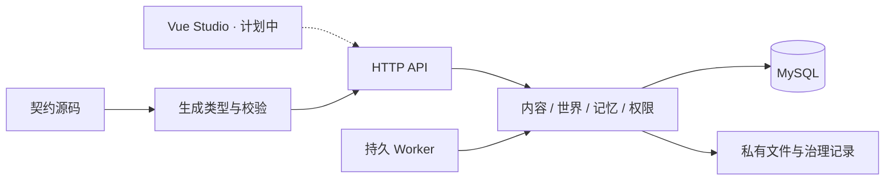

# 技术架构与实现边界

Loreviva — The AI Platform for Living Worlds。

本页描述已批准 Tasks 1–6 副本及后续架构方向。公开文档是规范的整理分发视图，不产生新的字段源；协议生成从 [contracts/source](../contracts/source/openapi.yaml) 出发。

## 技术与运行方式

| 项目 | 本批状态 |
| --- | --- |
| 后端 | Go 1.27.2、Kratos 3.0.0、模块化单应用；见 [go.mod](../go.mod) |
| 数据库 | MySQL Community LTS / InnoDB，`database/sql`；嵌入迁移 0001–0006 |
| 工具链 | Node.js 24、pnpm 11.25.0、TypeScript；精确依赖见 [package.json](../package.json) 与 lockfile |
| 文件 | 私有本机目录、应用鉴权代理；不公开挂载文件根 |
| 前端 | 当前最小启动页；Vue Studio 是后续实现路线 |
| 模型/计费 | 配置只接受 Mock；真实供应商及托管收费尚未接入 |

一个应用支持 `all`、`api`、`worker`。默认 `all` 同时运行 HTTP 与持久 Worker；分进程仍共用领域代码、数据库与迁移。当前不需要 Redis、独立消息队列、向量库或 Kubernetes。

## 模块与权威

| 模块入口 | 持有职责 |
| --- | --- |
| [app](../internal/app/runtime.go) | 组合服务、HTTP、Worker 与运行就绪检查 |
| [auth](../internal/auth/operator.go) / [store](../internal/store/mysql) | 当前 Operator 资格、范围、命令/任务/提交设施 |
| [content](../internal/content) | 草稿修订、关联影响、权利与依赖检查、固定 release/路由 |
| [runtime](../internal/runtime) | 实例、控制、动作规则及兼容迁移 |
| [memory](../internal/memory) | 来源与获知、私人关系、用途政策与治理 |
| [harness](../internal/harness) | 有界Mock文本调用、草稿候选、隔离排练、原请求查询恢复 |
| [files](../internal/files) | 私有上传、鉴权读取、持久清理 |
| [maintenance](../internal/maintenance) | 新合成安装、迁移计划及协调 |

程序拥有事实、权限、事务、计量和最终提交权。Harness及未来Agent返回候选，不能直接获得数据库写权、扩展资料用途或决定外部业务终态。

## 持久化与并发

命令按范围和稳定幂等键登记，同键同输入返回原记录，同键异输入冲突；重放仍检查当前授权。持久任务有接管与检查点，旧执行者失去资格后不能继续提交。

世界状态、事件、任务结果、提交回执与对应 Outbox 通过权威事务成立。HTTP 返回丢失时应查询原提交身份，不把不确定结果当作新业务再执行。该本地机制不代表客户支付、外部消息或第三方物品服务与数据库跨服务原子提交。

文件使用独立持久阶段：记录上传、验证内容、移动私有文件、确认 READY。文件系统与数据库不是同一个原子事务；清理任务记录范围与进度，恢复原任务不等于重做新任务。

## 内容、身份与记忆

草稿是可修改输入，release 是不可变快照，实例固定引用 release。依赖锁按 release、对象、版本及哈希解析；展示 ID 不能代替完整依赖身份。

生成路由按限定的 `owner_reference` 与 `module_id` 固定，`owner_object_id` 仅辅助展示。PROGRAM 岗位/Skill 不拥有生成路由，`NONE` 终止生成。保存、预检和发布分别承担不同责任，发布再次检查当前权利。

运行数据按 tenant、product、world instance 隔离；私有关系进一步绑定 actor 与目标主体。当前读取资格、实际获知、用途和来源有效性共同限制使用，私人内容不会因复制模板自动成为共享知识。

## HTTP 实际接入范围

以 [HTTP 注册](../internal/app/http.go)、[实例路由](../internal/app/instances.go)、[记忆路由](../internal/app/memory.go)、[资产路由](../internal/app/assets.go)和[任务路由](../internal/app/tasks.go)为本批实现事实：

| 路由族 | 实际拥有者与状态 |
| --- | --- |
| `/health`、`/version`、`/ready`、`/` | app 启动检查；根页仅最小 HTML |
| `/world/v1/admin/content-drafts` 及修订/影响/命令/发布路径，`/admin/releases` | content 服务已接入 |
| `/world/v1/admin/capabilities` | app 提供内容能力检查信息 |
| `/world/v1/admin/assets` 上传/详情，`/world/v1/assets/{asset_id}/content` 下载 | files 与资产服务已接入，内容逐次鉴权 |
| `/world/v1/admin/tasks`、`/world/v1/admin/tasks/{task_id}` 及取消 | 当前资格下的安全任务列表、原已登记任务查询及取消；列表元数据不授予私人正文资格 |
| `/world/v1/admin/instances`、演员、控制与迁移路径 | runtime 服务已接入 |
| 实例下 memories、正文、memory-governance、memory-use-policy | memory 服务已接入，元数据/正文/治理权限分开 |
| 草稿下 POST `rehearsals`、`candidates` | Mock拥有者和依赖就绪、当前资格/路由/输入成立时受理持久任务并返回202；缺依赖或不支持输入仍拒绝，不是通用真实AI入口 |
| 草稿下 POST `generation-resolution` | source1.3新增的当前草稿生成配置解析读；不采购模型、不修改草稿 |
| OpenAPI 的其他预留操作 | 本批不能据 Schema 声称已接入，尤其玩家会话/互动/事件交付等完整流程 |

表中的 `/admin/...` 省略部分均位于 `/world/v1` 下。具体方法、参数与响应须同时核对唯一 OpenAPI 与对应 HTTP 注册；契约覆盖大于当前可用处理器范围。

## Worker 已登记任务

[Worker](../internal/app/worker.go)支持 `ADMIN/FILE_CLEANUP`、`CONTROL/INSTANCE_CONTROL`、`MIGRATION/INSTANCE_MIGRATION`，以及安装了 Memory 服务时的 `GOVERNANCE/MEMORY_GOVERNANCE`。正常启动会组合Memory服务，并在对应Harness拥有者就绪时登记`TURN/TURN`、`ADMIN/CANDIDATE`及`ADMIN/REHEARSAL`，按原任务、attempt和当前资格处理。

本批Worker只能执行已登记的对应作业。Mock互动内核、世界控制和迁移已实现；原UNKNOWN与必要费用继续查询原请求身份，不重建采购。内部TURN和排练的成功不证明玩家会话/互动HTTP、SSE交付、真实模型或完整客户SDK已经接通。

## 契约与扩展

机器契约为1.3.0，51 operations / 131 schemas；source1.2的49/123及原18操作/43 DTO比较语义保留，两项新增操作为`resolveDraftGeneration`与`listAdminTasks`。[OpenAPI](../contracts/source/openapi.yaml)和[wepkg Schema](../contracts/source/wepkg.schema.json)是维护源；Go/TypeScript 类型与校验产物由生成器派生。现有 [TypeScript SDK 入口](../packages/sdk-ts/src/index.ts)只有配置校验、冻结配置及生成类型导出，没有 HTTP/SSE 调用方法。

Vue GUI、完整SDK、导入导出、计量管理和完整恢复仍须按各自任务实施。新增行业适配器可以提交候选或回执，不能越过事实、隐私或客户业务权威。

返回[首页](../README.md) · 查看[搭建和接入](04-setup-and-integration.md)
