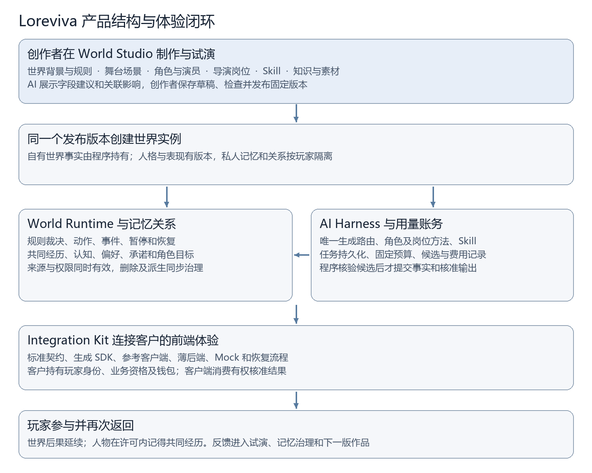
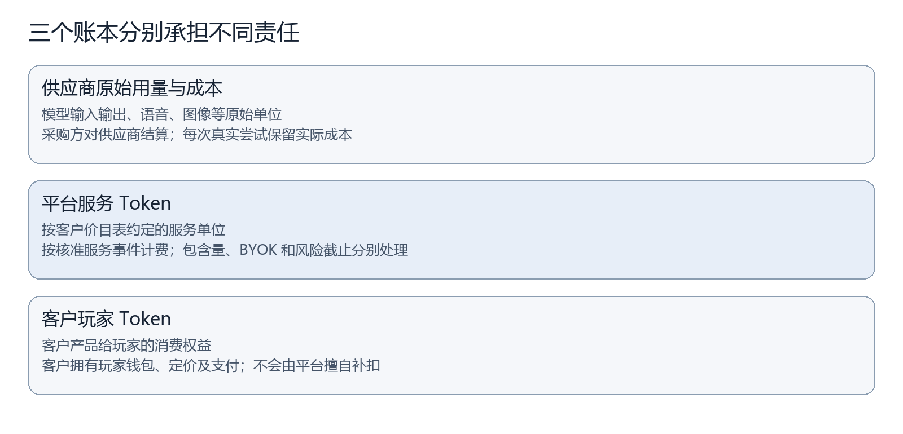

> 设计文档 v3.0.2。本文定义产品目标与要求；本分支源码仍为 Task1–7 / 契约1.4.0，未包含开发中的1.6.0功能。可用能力和安装步骤见[本仓库支持范围](00-status.md)。

# Loreviva 产品设计概述与结构图

开发设计 v3.0.2｜R0执行合同 v3.0.1。本文说明产品设计与验收要求，已实现及验收范围见[当前项目状态](00-status.md)。

Loreviva — The AI Platform for Living Worlds

创造世界，让它持续生长。

本文说明Loreviva的产品定位、体验和组成。[产品需求说明书](02-requirements.md)定义功能行为；[技术架构白皮书](03-architecture.md)、[搭建和接入指南](04-setup-and-integration.md)与[实施计划](05-roadmap.md)分别说明实现、使用和交付。

## 01 我们要交付的产品

Loreviva 是让创作者制作并持续运行世界的 AI 平台。一个世界包含背景、场景、规则、人物、专业岗位、Skill、知识和表现资源。创作者把这些内容组合成作品，玩家进入作品、与人物交流并作出选择，程序让合法选择产生真实的世界后果；人物在当前许可内记住共同经历，延续目标、承诺和关系。

平台的主要价值是把“制作一个人物”延伸到“经营一个能持续接续经历的世界”。创作者不用分别拼装角色提示词、聊天历史、规则、素材、模型接入、记忆与计量系统；业务客户可以集中建设自己的客户端体验，同时通过标准接入获得同源的创作内容、角色运行、世界后果和恢复能力。行业客户仍保留身份、业务资格、玩家收费以及其原业务服务的最终权威。

“具有真实个性”有可观察的标准：人物拥有相对稳定的价值观、目标、说话方式、知识边界和合理拒绝理由；同一处境下，不同人物表现出不同而连贯的选择。“越来越懂玩家”表现为能够正确接续来源明确的经历、偏好和约定，接受纠正并承认未知。“持续生长”表现为世界有后果、人物有目标、承诺能够兑现、关系可以亲近也可以修复或自然结束。以上是开发与研究目标，真实 AI 质量和真人体验仍须分别验证。

共同内核面向游戏、影游互动、情感陪同、在线教育和虚拟社区。世界状态、人物经历、许可、事件、接入和恢复有共性，课程评分、游戏经济、影游剪辑、陪同联系渠道和社区公共活动则由行业产品包与客户适配明确。支持一个行业需要该行业的具体测试，不能仅靠换一套提示词扩大产品声明。

## 02 从构想到一场可返回的体验

制作主线从模板或一句描述开始。创作者输入“雨夜咖啡馆”，AI 助手可以提出世界背景、两名人物、木牌互动、资料和岗位绑定候选。创作者先确认人物立场与世界规则，再在舞台画布调整对象、位置、出入口、外观和声音。每一项都有普通表单，也有就地 AI 协助；AI 的建议展示字段差异、来源、实际模型、费用与关联影响，创作者可以逐项采用、修改或放弃。

试演把内容放入独立沙盒：固定初始场景、输入、记忆和模型配置，查看人物会怎样回应，规则是否阻止不合法动作，客户端缺少声音时如何降级。静态属性、资源和布局应准确预览；真实人物生成存在变化，试演展示可验证条件与变化范围。过去已经成立的结果可以回放，回放不重新购买模型，也不再次执行世界动作。

保存形成草稿，发布形成固定版本，创建实例建立独立的世界状态。实例经过启动操作才进入运行状态；保存、发布和创建在界面与回执中清楚区分。发布前检查人物、规则、资料权利、岗位职责、Skill依赖、模型能力、预算和适用测试。旧实例继续使用旧发布版本。创作者修改人格、知识或规则后，必须先发布新版本，再单独评估实例升级对经历、承诺和关系的影响。

玩家进入世界，先看到人物和当前场景，随后通过交流、行动或选择参与。Alex 保管咖啡馆木牌，Mia 可以建议借牌；玩家请求借出时，程序检查保管授权和当前状态，成功才建立事件并展示成功动作。人物说“我已经给你”本身不会改变物品。多个动作具有依赖时，前提失败就不能继续展示依赖它的后果。

玩家曾私下告诉 Alex 喜欢安静，后来再次进入，Alex 可以依据有效经历提出安静交谈的邀请；Mia 和公共视图不能因此知道私人偏好。邀请合入当轮主要回应，满足资源、冷却、许可和预算。玩家可以拒绝惊喜、纠正偏好、忘记经历、暂停或自然结束，关系不会因拒绝、删除或退出而受到惩罚。

断线与返回属于正常体验。客户端重新查询原任务、恢复有权快照并续取更新，继续同一结果。文字可先出现，声音稍后补入原表现包；重复投递不会重复借牌、播放动作或计费。暂停阻止新增叙事生成和提交，已经外发的模型请求与已有存储费用则如实显示。未知结果有可查询状态，界面不会诱导玩家再次购买同一未知执行。

## 03 产品结构与共同边界

产品由六个共同模块形成闭环。模块是职责划分，默认同仓、同应用运行，不意味着六套服务。

| 模块 | 创作者或客户得到什么 | 核心边界 |
| --- | --- | --- |
| World Studio | 世界、场景、人物、知识、岗位、Skill、舞台预览与发布 | 编辑草稿；有权操作才能发布 |
| World Runtime | 动作结果、世界状态、事件、时钟与控制 | 自有世界事实由程序裁决和提交 |
| 记忆与关系 | 共同经历、认知、偏好、承诺、关系和管理入口 | 有来源、有受众、可纠正与删除 |
| AI Harness | 模型选择、获准上下文、岗位方法、任务和恢复 | Agent 提出候选，不能扩权或写事实 |
| Integration Kit | 公开契约、SDK、参考客户端、Mock和行业样例 | 客户端消费核准结果，客户业务仍有权威 |
| 用量与账务 | 供应商成本、平台Token、预留、账单和风险状态 | 三层单位分开；玩家钱包由客户持有 |

图形源：[可编辑 Mermaid 定义](diagrams/product-structure.md)。

图示对应的候选返回 Runtime 后，程序检查当前身份、权限、状态、来源与预算，才建立事实和核准输出。业务外部动作经客户服务回执确认；世界成立、外部业务完成和客户端已播放分别显示。可编辑源图保存逻辑节点与连接，正文图形用于阅读。

世界项目是作品容器，世界定义描述内容，发布版本固定依赖，世界实例承载实际状态和经历。角色定义保存核心人格与表现起点，演员实例是该角色在具体世界中的存在。私人体验可为玩家提供独立世界与演员；共享世界使用同一公共事实，但每个玩家与演员的关系分开。共享角色模板不会携带私人经历，跨世界延续身份、承诺或记忆需要明确映射和玩家选择。

## 04 一站式 Studio 的产品组织

后台保留五组导航，把制作放在首位。“工作台”提供继续制作、模板起步、运行状态和待处理问题。“世界项目”集中舞台、规则、角色、岗位与Skill绑定、知识、试演、发布和实例入口。“资源库”保存可复用模板、岗位预设、Skill、资料与表现素材。“运行中心”管理实例、任务、记忆、关系、分析与财务。“系统设置”集中模型连接、工作空间权限、产品接入、配额、存储与维护。

所有创作对象支持搜索、标签、筛选、属性查看、新建、复制、编辑、保存、取消、归档和有条件删除。复制先预览依赖并重新映射标识；不复制凭据、玩家身份、私聊、关系、账单或运行状态。删除展示引用影响，不能让已发布版本缺失依赖而仍宣称有效。保存冲突保留本地修改并展示差异；取消只放弃未保存字段，不抹去已发生的试演费用和事件。

岗位包括导演、编导、演员、化妆造型、表演声音、场务、记忆关系和质量评审。岗位是职责与方法，可以兼任、合并或由程序承担，不强制每轮各调一次模型。导演可绑定多个固定版本 Skill，一个 Skill 也可由不同岗位复用；专用 Skill 表达职业方法，通用 Skill 提供检索、来源检查、结构提案、字段差异和资源登记。执行工具必须经有权源码登记，社区提示词不能自行安装程序或获得权限。

每个实际生成模块可独立选择模型，也可继承世界或工作空间默认值。普通互动归主要演员，主动世界事件归指定导演，编辑助手归当前模块；已批准任务覆盖优先。参与同一次生成的其他岗位方法合入上下文，清楚显示其配置本轮未独立调用。在线默认一个主要演员、一次主文本生成，结构修复或状态冲突重算共享最多一次额外文本调用；记忆、规划与评审不能借子任务增加常规调用。

## 05 长期人物与玩家控制

人物连续性来自稳定人格、变化状态和来源经历的分离。情绪、当前位置和当前目标可以改变；长期人格须由成长事件或创作者修订形成有效版本。演员对玩家的关系是角色判断，不能把推断写成玩家现实感受，更不能以付费自动增加亲近。没有共同经历的新玩家不能被虚构成老朋友。

记忆分世界事实、角色认知、共同经历、语义偏好、承诺待办与关系状态。事实由程序建立；认知还要证明角色确实通过初始知识、见证、告知或有依据的推理获知。玩家陈述保留“曾表达”的来源性质。后台更正世界事实不会让所有未在场角色瞬间知道，撤权和删除后的内容即使过去被获知也不得继续使用。

私人资料的派生结果继续保持私人受众，包括摘要、目标、计划、关系条件、规则分支、媒体和表现。拥有公共动作权限不代表可以把私人来源公开化；未经明确授权，私人偏好只用于原关系视图。删除先让原文及派生不可用，再清理相关保存与索引；恢复备份要先重放最新删除与撤权。已被客户端离线保存的内容有明确回收边界，不能承诺远程召回所有副本。

## 06 合作接入、社区与交付模式

客户接入围绕自己的客户端展开：其服务端确认玩家身份与资格，交换短期受限会话，选择行业包，提交互动，展示核准结果并恢复任务，提供玩家记忆控制入口。平台提供单源契约、生成 SDK、参考客户端、薄后端样例、Mock、错误示例和恢复指南。客户的模型与服务器密钥不会进入玩家客户端；平台不会代客户建立另一套玩家钱包。

内容用可移植 .wepkg 包分享，包括世界、角色、岗位、Skill、知识和表现主题。导出排除私人运行数据和凭据，导入先静态预检、预览权利、映射本地依赖、保存隔离草稿、Mock试演再发布。缺少模型、工具或素材会定位到对象，同版本不同哈希视为冲突。首期通过文件、仓库目录和社区内容目录共享，完整商业市场与分成后置。

完整开源核心可自托管，默认一个 Go/Kratos 应用与 MySQL Community LTS，Vue后台静态资源随应用，文件位于鉴权保护的本机私有目录。按需要再拆 api/worker 或增加社区存储适配。核心不强制平台账号、充值或付费云。托管 SaaS、专属部署和 BYOK 使用同一内核，采购责任与服务费用公开；开源许可与模型、素材、第三方许可分别核验。

## 07 收费和发行承诺

三层 Token 分别是供应商原始用量与成本、平台标准服务Token、客户玩家业务Token。平台按冻结SKU与价目表向客户结算，客户自行决定玩家权益和价格。BYOK不重复收平台转售模型费；内部结构修复和平台故障重算保留实际成本但不另转嫁正常生成费。关系不会因玩家购买而自动增长，收费结构也不证明平台或客户已经盈利。

未知结果分别记录任务、交付、用量和费用。付费合同固定有限的客户预留截止，到期无法核验时由平台承接风险并释放客户预留；供应商和全局安全预算继续保守占用，迟到费用默认归平台，不能偷偷补扣客户。风险达上限阻止新增外发。暂停、取消、退款和供应商结果不同，客户能够看见继续产生的存储或后台费用。

R0交付可安装的社区Mock制作与运行闭环；R1增加已测真实模型、人格记忆和玩家返回质量；R2增加明确客户产品包、身份接入、租户隔离、收款与Token结算、风险和支持责任；R3增加独立验收的行业与共享范围。首个收费客户需要的共享、行业和外部动作测试必须前置到R2。可选客户端适配按明确声明的支持范围验收，不是首轮强制依赖。

开发先完成内容与公开契约、世界与记忆、Harness、Studio与参考客户端，再完成托管计量闭环。验收围绕14项需求、40条核心场景、20条适配场景和12组补充检查组织。验收会分工程、人物质量、新手制作、客户接入、社区改造和商业结果记录证据；性能、容量、真实费率、研究阈值和环境在试验前冻结，未知参数须通过测量确定，发行声明以实际通过的范围为准。

## 08 角色怎样持续成长

创作者需要制作的不只是人物的开场设定，还包括“遇到什么事之后，这个人会怎样改变”。Loreviva 将这种连续性组织为稳定核心、演员成长、关系视角和当前表达四层：价值与身份保持可辨认；能力、习惯和目标按允许的经历改变；每段关系保存自己的理解与共同经历；当下情绪和表达节奏随情境调整。成长不会直接改写人物模板，也不会让一个玩家的私人经历扩散给所有玩家。

创作时先选择可变维度，再定义变化需要的事件、允许范围、恢复方式和反例。运行时，一次成立的互动可以形成经历、更新获准状态、产生下一步机会；下一次回应读取这些变化。成长有出处，重复投递不重复成长，人物允许坚持、拒绝、修复和改变目标。关系进展与使用许可分别管理。

长期记忆包括持续整理和正确消费。系统区分当轮指令、情境偏好、长期明确偏好与待验证推断，保留冲突与更正；编译有限上下文时保护当前边界和未完约定。角色视角的回顾可以帮助玩家理解共同经历，但不能把角色猜测变成用户事实，或以反复总结给同一来源增加可信度。

惊喜由经历、人物动机、当前世界与可用资源共同构成。平台可以提出新的活动或表达，玩家选择后才产生需要其参与的后果。私人原因留在有权视图；公共世界改变需要合法公共命令和相应来源资格。创作者用后果预览、经历时间线、对比试演和版本检查观察这条因果链，反馈再转化为获准的修订与回归案例。

人物连续性的详细要求见PRD第26节，实现约束见白皮书第16节。
