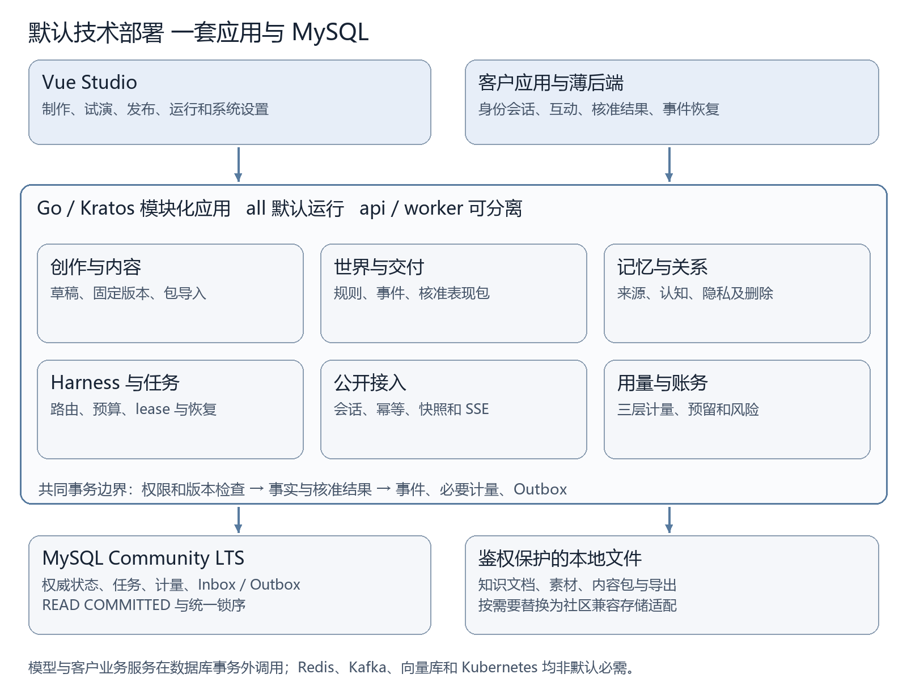
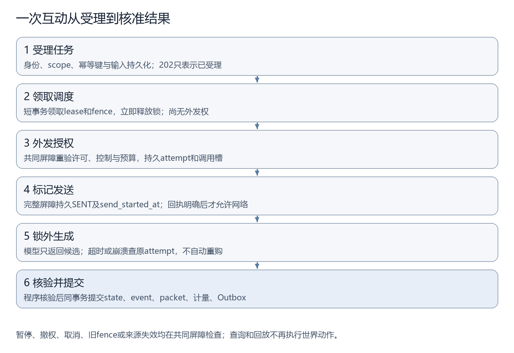
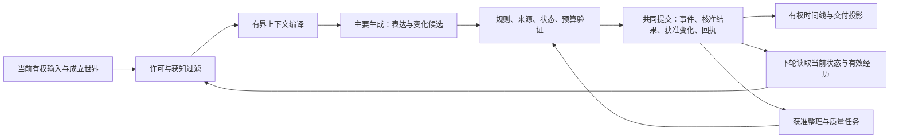

> 公开设计阅读视图v3.0.2；当前产品设计为3.1.0，R0执行基线为3.0.1。源码包含工作契约1.6.0的Task8快照及Task9静态预检；完整Task8/R0尚未验收。见[支持范围](00-status.md)。

# Loreviva 技术架构白皮书

设计版本v3.0.2，R0执行基线v3.0.1。产品开发进行中，完整产品尚未验收；当前进度、支持范围及验证边界见[项目状态](00-status.md)。持续角色（LC）属于后续设计。

Loreviva — The AI Platform for Living Worlds  
创造世界，让它持续生长。

开发设计v3.0.2 · 架构与设计契约。

## 01 文档效力与技术冻结

本白皮书规定Loreviva的领域权威、模块接口、持久化、并发屏障、身份、公开协议、模型采购、记忆治理、扩展和恢复。设计契约说明必需行为；代码、安装、真实模型效果、收款和生产容量分别需要实际证据。产品目标和交互任务见[产品设计概述与结构图](01-product-overview.md)、[产品需求说明书](02-requirements.md)、[搭建和接入指南](04-setup-and-integration.md)与[首阶段实施计划](05-roadmap.md)。字段唯一源为`contracts/source/openapi.yaml`及`contracts/source/wepkg.schema.json`；发现不一致时同步修正负责文档与唯一源，生成DTO和SDK不得成为人工维护的另一套接口。

工程与文档根目录为`<repository>`，凭据、数据和自动化限定于本项目。数据库采用MySQL，核心不依赖必须购买的云服务。拥有相应权利的新代码默认Apache-2.0；第三方软件、模型、历史资产及内容保留原许可和权属。

| 项目 | 技术选择 | 精确发行物要求 |
| --- | --- | --- |
| 公开HTTP契约 | `/world/v1`、OpenAPI 3.1.2；1.3.0兼容基线为51操作/131 Schema，批准1.4.0基线为58/156，工作1.6.0为67/181 | 原18公开及33行政/文件操作保持兼容；默认记忆响应兼容，provenance_v1须显式选择；SDK与客户支持范围按实际发行证据声明 |
| 数据Schema | JSON Schema 2020-12 | Schema与合法/非法固定样例共同版本化 |
| 内容包 | `.wepkg`格式1.0，逻辑依赖与本地release分开 | 包摘要、文件清单与导入映射可追溯 |
| 前端 | Vue 3.5.43稳定版、Node.js 24 LTS；TypeScript、Vite、Router、Pinia与可复用原生Vue/HTML/CSS/SVG组件 | 精确实物、严格类型及工程lock分别核验；ElementPlus不进入产品依赖，声明兼容性不得以弱化检查掩盖 |
| 内核 | Go 1.27.2、Kratos模块化单体、database/sql | Go按官方发布记录确认，Kratos、驱动及转依赖精确版本先核验后锁定 |
| 数据库 | MySQL Community LTS、InnoDB、9.7系列 | 每次发行核验精确包/镜像及安全补丁，不作未核验的最新版本声明 |
| 文件 | 私有本机目录与应用鉴权代理 | 数据根、权限、备份清单固定，不公开挂载目录 |

技术基线指定Vue 3.5.43、MySQL 9.7 LTS、Go 1.27.2及Node.js 24 LTS。项目级工程使用Go1.27.2、MySQL Community9.7.2、Node24.19.0与pnpm11.25.0；每次发行仍须固定并核验精确依赖和实物，不由此推导新机器安装或容器发行已验证。[Vue发布](https://github.com/vuejs/core/releases)、[Go发布](https://go.dev/doc/devel/release)、[Node发布](https://nodejs.org/en/about/previous-releases)、[MySQL LTS](https://dev.mysql.com/doc/refman/9.7/en/mysql-releases.html)提供上游版本信息。协议版本按产品合同采用：[OpenAPI 3.1.2](https://spec.openapis.org/oas/v3.1.2.html)、[JSON Schema 2020-12](https://json-schema.org/draft/2020-12)。

Studio采用Vue3.5.43/TS5.9.3及Router/Pinia/Vite，统一原生表单、对象树、属性、差异、对话框和SVG画布。不采用ElementPlus，不以skipLibCheck、手造ambient或TS升级掩盖声明不兼容。功能、权限和副作用遵守PRD，同源SDK与Go发行路径保持一致；键盘、焦点、窄屏及真实任务状态须按实际实物验证。

## 02 最小部署与模块边界

社区基线只有一个Go应用发行物和MySQL。应用提供Vue静态Studio、公开API、鉴权资源代理和持久任务执行器；默认`all`同时运行API与Worker。`api`与`worker`用于按需分进程，同一领域代码、数据库和迁移版本，运行模式不是功能等级。HTTP请求结束不终止持久任务。all模式重启与分进程接管必须产生相同事件、预算、fence及恢复结果。



图形源：[可编辑 Mermaid 定义](diagrams/deployment.md)。

| 模块 | 持有职责 | 不获得的权威 |
| --- | --- | --- |
| identity/governance | 租户、产品、会话、授权、epoch、撤权删除命令 | 不相信客户端自报玩家资格 |
| authoring/release | 草稿、差异、知识导入、内容依赖、不可变发布和映射 | 不以保存草稿改变运行世界 |
| runtime | 场景物品、控制、世界revision、声明式规则、事件提交 | 不以生成文本认定外部支付或物品结果 |
| memory/relationship | 来源、演员获知、私人经历、偏好、承诺和有方向关系 | 不以检索可读推断可公开表达 |
| harness/jobs | 路由、Skill、任务、attempt、租约、检查点、调用计数 | 不增权、改费率或绕过父预算 |
| presentation | approved packet、动作身份、媒体更新与有权交付 | 动画ACK不反写事实 |
| usage/billing | 原始成本、服务计量、客户Token、预留与风险账务 | 不直接操作客户玩家钱包 |
| integration/adapters | SDK输入输出、供应商、文件、客户端与业务回执 | 适配器不自行决定世界或账务终态 |

领域模块通过类型化命令和查询调用，共享一个Unit of Work。仓储只能接收当前事务连接，禁止一个提交使用多个隐藏连接。HTTP层验证协议和会话，领域层重验事实权限；Worker只能请求领域授权。通用库只放标识、精确数值、错误、时钟和事务设施，不能把所有领域逻辑堆进通用包。模块之间不直接更新对方表。

Redis、独立队列、向量库、分析仓库、Collector、Kubernetes和微服务均可选。启用前给出现有瓶颈、收益与同条件回归，不能为AI Native或社区标签增加必需服务。基础结构化日志、关联ID、成本及诊断留在单机发行物中。

## 03 领域身份、作用域与版本

所有运行对象具有租户和产品边界。`world_project`是制作容器，`release`是本地固定发布；`world_instance`承载事实与控制，`character_definition`是人格模板，`actor_instance`是模板在该实例中的存在。玩家身份来自客户后端核验后的映射，不能把业务用户字符串当作跨产品统一画像键。

关系方向为“演员对目标主体的理解”。演员对玩家的熟悉、信任、冲突等是角色判断，不能声称玩家现实感受。演员之间关系同样有方向。唯一范围包含tenant、product、world_instance、actor_instance、target_kind、target_id；反向关系是另一条记录，不从一个好感分自动推导互相亲近。

| 标识/版本 | 用途 | 不能混用 |
| --- | --- | --- |
| turn_id/task_id | 一次互动业务身份/持久执行身份 | task的多次接管不是新互动 |
| attempt_id | 一次供应商实际请求与采购风险 | 查询与网络重投不重置attempt |
| event_id | 已成立世界事件身份 | 不能用packet显示次数代表事件次数 |
| packet_id/action_id | 核准表现包及包内稳定动作身份 | 音频就绪不创建第二次动作 |
| delivery_id/packet_revision | 某受众交付流身份与单调更新版本 | ACK不等于世界提交或供应商成功 |
| release_id | 内容、规则、路由及预算模式固定版本 | `.wepkg`包版本不是release_id |
| world_revision | 自有事实提交版本 | 不等于控制、隐私或交付版本 |
| control_version | 启动暂停恢复结束的版本 | 费用回执不能推进叙事时钟 |
| privacy_epoch/view_epoch | 许可治理代次/主体有权视图代次 | 游标携带代次不授予权限 |
| fence | task每次租约接管单调令牌 | 不能由Worker自己生成重置 |

API大整数和金额均用精确字符串。内部序号与游标水位不会公开；客户端不能根据ID或缺号推断其他玩家的事件。外部ID使用明确区分大小写的UTF-8字节规则，字段非空，长度受限。必要的全局作用域用预登记非空哨兵值，不用NULL逃逸唯一约束。

<a id="s67规范实际采用与未实施边界"></a>

### 登记时间哈希兼容

REGISTER_CUSTOMER/REGISTER_PLAYER_ACCESS使用固定域loreviva.registry.registration.utc.v2的完整UTC命令hash，其它kind不变。旧V1原键只匹配原typed raw输入，不用V1UTC兜底；原hash、期限和revision不改，不续期、不授新权。完整历史证明支持已知旧UTC V1与V2 UTC；缺原命令的旧非UTC历史为UNVERIFIABLE，自动R1/CREATE重建为NOT_SUPPORTED，安全查询及原输入回放独立保留。

## 04 关键持久表与索引合同

常查作用域、状态、版本和金额保存为结构化列；JSON仅保存受Schema约束的扩展。写库前验证Schema，金额和业务唯一键不能放入自由JSON。跨租户引用使用包含tenant、product的复合外键；禁止仅以裸object_id连接有作用域对象。软归档不撤销引用权，删除治理先使内容不可读再清理。

| 表组 | 关键结构与约束 | 查询/并发目的 |
| --- | --- | --- |
| tenant_gates/product_gates/subject_governance | 非空复合主键，permission/privacy/view epoch，停用与风险状态 | 权限与dispatch共同入口，不依赖缓存 |
| world_projects/releases/release_bindings | 项目scope；release不可变；本地连接/工具/资源映射；内容哈希 | 旧实例固定旧release，凭据正文排除 |
| world_instances/world_controls | `(tenant,product,instance)`唯一；release复合FK；revision、control_version | 单世界公共事实串行裁决，控制线性化 |
| actors/items/relationships | 全作用域FK；关系方向复合唯一；revision | 唯一物品竞争及私人关系隔离 |
| memories/memory_sources/acquisitions | actor/player/audience/use/validity/epoch；来源边唯一 | 来源与获知先过滤，时间关键词后检索 |
| commands/tasks/checkpoints | 幂等完整scope/key唯一；claim状态/next_run/lease索引；fence与commit_key | 同键异参冲突、重启恢复及提交查询 |
| attempts/dispatch_authorizations | task+slot唯一；request_key唯一；provider request ID与状态 | 每次采购可对账，未知原请求查询 |
| events/approved_results/service_events | 世界内部水位唯一；task提交唯一；service_event条目唯一 | 同一事务产生事实、结果与服务条件 |
| budget_accounts/reservations/postings | 精确最小单位；task+account+purpose唯一；posting稳定键 | 投影可重建、预算不可由日志替代 |
| outbox/inbox/commit_receipts | scope+consumer+message唯一；commit_key唯一；投递租约索引 | 本地恰好一次效果及COMMIT未知查询 |
| assets/governance_tombstones | 归属、受众、派生、hash、PENDING/READY；删除版本与清理进度 | 文件非原子状态与恢复不复活正文 |

以下DDL仅说明约束方向，不是可执行迁移；完整迁移需按目标补丁验证索引长度、外键、字符集和执行计划。ID使用受限ASCII字节，业务文本另用utf8mb4。删除事实事件不能依靠FK级联把账务历史一起抹掉。

```sql
CREATE TABLE world_instances (
  tenant_id VARBINARY(64) NOT NULL,
  product_id VARBINARY(64) NOT NULL,
  instance_id VARBINARY(64) NOT NULL,
  release_id VARBINARY(64) NOT NULL,
  world_revision BIGINT UNSIGNED NOT NULL,
  PRIMARY KEY (tenant_id, product_id, instance_id),
  FOREIGN KEY (tenant_id, product_id, release_id)
    REFERENCES releases (tenant_id, product_id, release_id)
) ENGINE=InnoDB;
CREATE TABLE commands (
  tenant_id VARBINARY(64) NOT NULL,
  product_id VARBINARY(64) NOT NULL,
  subject_id VARBINARY(64) NOT NULL,
  operation VARBINARY(40) NOT NULL,
  instance_scope VARBINARY(64) NOT NULL,
  idem_key VARBINARY(128) NOT NULL,
  payload_hash BINARY(32) NOT NULL,
  command_id VARBINARY(64) NOT NULL,
  PRIMARY KEY (tenant_id, product_id, subject_id,
    operation, instance_scope, idem_key)
) ENGINE=InnoDB;
```

memory正文与必要审计元数据分离；event可保留脱敏身份与动作结果，受限陈述原文按删除要求清理。记忆检索索引以scope、actor、有效性、来源时间开始，实际全文索引另测语言和目标版本。预算投影和分析投影允许重建，查询标明延迟；权限、fence、预留与提交回执读取权威主库。

## 05 全局锁顺序与共同屏障

所有权威短事务显式READ COMMITTED。隔离级别不能替代领域版本和治理锁。以下是唯一总锁顺序，适用于受理、commit、dispatch授权、暂停、恢复、取消、撤权删除、费用结算和回执；模块不得另定顺序。未涉及的等级跳过，涉及多个同类对象先收集ID、按二进制升序取得，不能边生成边发现反向锁。

| 等级 | 行/资源 | 同级总序 |
| --- | --- | --- |
| 10 | tenant gate | tenant_id |
| 20 | product gate | tenant_id、product_id |
| 30 | subject governance | scope、subject_id |
| 40 | world control | scope、world_instance_id |
| 45 | 幂等command | scope、subject、operation、instance_scope、key |
| 50 | task | scope、task_id |
| 60 | attempt及dispatch authorization | task_id、attempt_id、authorization_id |
| 70 | 预算账户 | kind固定序：supplier_global、supplier_tenant、platform_risk、customer、project、world；随后scope、account_id |
| 80 | reservation | account排序键、reservation_id |
| 90 | 领域行 | kind固定序：item、actor、relationship、memory、content_project、content_draft、content_release、asset、content_check；随后scope、object_id |
| 100 | Inbox | scope、consumer_id、message_id |
| 110 | 追加记录与其唯一键 | 表固定序：events、approved_results、service_events、postings、outbox、commit_receipts；随后稳定业务键 |

同一短事务只获取当前命令必要的锁；需要增加对象集合时整体回滚、重新收集、按总序开始，不保持已有锁后回头补低等级锁。不可变release、报价与能力快照采用版本读取；如果要改变其有效性，通过上级gate，不直接锁不可变内容。新增表必须归入已有等级并通过竞争评审，不能留下“各模块自行决定”。层110的唯一冲突同样作为数据库事务错误处理。

共同屏障读取并锁定适用治理行、world control、task、attempt及预算，核验当前资格、许可、release可用性、privacy epoch、control version、world revision、fence、lease有效期、取消和余额。提交屏障再验证动作依赖、来源及输出受众；dispatch屏障预留调用槽位、精确上界、固定路由与请求hash，写`dispatch_authorization`、稳定attempt及不可逆的发送边界标记，然后COMMIT。只有成功退出事务的授权才允许外发。

实际网络发送前必须已持久化`send_started_at`，公开attempt_state SENT意为“已进入可能发送区间”，不能当作对方已收到的证据。若授权后崩溃，即使可能尚未发送也按原attempt查询；没有确证不自动再发。若仅处于准备态AUTHORIZED且没有发送边界标记，任何执行者都不得外发，恢复需以原attempt重新过当前完整dispatch屏障，不增加调用槽或重复预留。禁止先网络请求、后补SENT，因为崩溃会把已采购误当未发送。发送前的本地数据库COMMIT回执也须明确，否则先查授权稳定键。

屏障的线性化点是授权或治理事务提交。暂停/撤权先提交，后续授权拒绝；外发授权先提交，随后暂停不能承诺召回已授权请求，必须记录在途、限制后续外发并在本地提交前重新检查。网络发送前再检查本进程取消是缩小窗口的优化，不能声称与数据库暂停及外部接收实现跨系统原子性。任何持锁事务不得调用模型、支付、文件远端、客户端推送或可阻塞外部代码。

lease领取是严格例外：单个短事务用`FOR UPDATE SKIP LOCKED`只领取task并增加fence、写lease，立即COMMIT，不能继续取governance或budget锁，也不能外发。领取是调度资格，不是执行授权；随后必须重新进入完整屏障。Outbox领取同样只更新投递租约，退出领取事务后才经适用交付授权；需要领域写入时另开总序事务。[MySQL锁定读](https://dev.mysql.com/doc/refman/8.4/en/innodb-locking-reads.html)支持机制说明，目标9.7补丁仍须实测。

## 06 事务、提交与消息恢复

一次成功世界提交在同一连接、同一事务内写自有state、成立events、approved_result、达到完成条件的service_events、相应预算/账务变化和Outbox，最后追加稳定commit_receipt。任一失败整体回滚，不产生“事实成功但核准输出丢失”的自有半提交。媒体制作可以在提交后独立推进，不能撤回事实。外部账户、支付、物品或消息仅保存引用和回执，外部确认不伪装成本数据库原子成员。



图形源：[可编辑 Mermaid 定义](diagrams/interaction-commit.md)。

执行阶段发生数据库错误，应用显式Rollback整个事务；锁等待超时即使只回滚当前语句也不能继续commit。仅对已经确定失败且可重试的错误，用同一稳定业务键有界重试完整短事务。数据库重试不再次采购模型、不重置槽位和预留。所有状态更新使用当前fence及版本条件，影响行数不符视为竞争失败。[InnoDB错误处理](https://dev.mysql.com/doc/refman/8.4/en/innodb-error-handling.html)

COMMIT断连、超时或回执丢失进入本地提交核验状态，通过权威主库查询`commit_key`对应receipt、task和approved_result。在权威连接未恢复或无法证明提交/回滚前，不写FAILED、不释放预算、不再外发。查到稳定receipt返回原结果；明确未提交且原事务已结束后才重试本地事务。稳定键由命令生成并持久化，不从随机重试重新生成。

Outbox提供至少一次消息交付。内部消费者把Inbox去重和消费者本地变更写在同一事务；唯一Inbox冲突整体回滚本次重复效果后返回原处理结果。外部客户服务也应将Inbox和其本地业务变更共同提交，API/SDK不向消费者授予SQL权限。跨数据库或供应商仍可能重复、乱序或未知，按稳定业务键、原对象查询和权威回执对账，不能承诺跨服务恰好一次。

同步保存、发布和HTTP任务受理使用类型化WithCommandBarrier，与leased WithBarrier共用当前主体/gates、锁序、短事务及稳定命令回执。同步回执的task_id为SQL NULL；不得伪造worker、fence或world ID。新任务在预登记rank50锁下同事务CreateTask为ACCEPTED、fence0且无租约；任务与受理回执共同成功或回滚。PRODUCT行政任务没有world_instance_id，WORLD任务须有真实完整实例scope。对任务最终状态的改变在同一拥有者/当前fence事务完成。

执行、控制、治理和迁移屏障用途是封闭程序类型，绑定存储task_kind及当前资格。普通叙事/模型发送必须RUNNING；CONTROL允许当前状态的合法控制转换但不能采购模型；治理在PAUSED/ENDED继续，迁移限定PAUSED。任何用途都不能绕过当前范围、来源和账务权限。R0先用租户gate排他锁串行每租户短事务，网络在锁外；这是明确吞吐限制而非生产容量承诺。supplier_global与platform_risk账户是独立GLOBAL边界，不能以每租户副本乘大限额。

## 07 task、attempt、delivery与检查点

task是业务执行状态，attempt是一次外部请求状态，delivery是表现交付状态，账务与媒体另有状态。它们不能合并成一个success字段。task COMMITTED后仍可能有媒体FAILED、delivery PENDING或supplier usage UNKNOWN。查询HTTP 200只表示查到原任务，不表示互动成功。

| 状态机 | 正常路径 | 未知及终态约束 |
| --- | --- | --- |
| task | ACCEPTED→RUNNING→WAITING_EXTERNAL→RUNNING→COMMITTED | UNKNOWN凭原attempt证据恢复；FAILED/CANCELLED/REVOKED不恢复旧执行 |
| attempt | RESERVED→AUTHORIZED→SENT→SUCCEEDED/FAILED | SENT后无权威结果→UNKNOWN；查询原请求，不新购；取消请求另列 |
| delivery | PENDING→AVAILABLE→ACKNOWLEDGED | WITHDRAWN阻止后续访问；ACK不改变事实，媒体可更新同一delivery |
| world | CREATED→RUNNING↔PAUSED→ENDED | ENDED不恢复叙事；费用核验与删除仍可进行 |

ACCEPTED可取消、撤权或明确失败；RUNNING、WAITING_EXTERNAL、UNKNOWN可因本地取消/撤权进入对应终态，但attempt依然保留外部未知。task UNKNOWN只能在原结果得到权威证据后恢复，不能仅因用户点击重试回RUNNING。COMMITTED不可普通取消，返回409 ALREADY_COMMITTED；改变已成立事实是新获准命令。FAILED只用于已知失败，不能把超时直接标失败。

检查点保存任务阶段、输入与来源版本、路由、参数hash、已用调用槽、预算、外部引用及下一允许步骤，不保存可绕过当前权限的通行证。仅获准长任务允许分段；接管后重验所有gate、fence、控制与删除版本，恢复最多继续原允许步骤。在线结构修复和状态冲突共享一次额外槽位，检查点、递归Skill或子Agent不能重置计数。

任务取消、暂停世界、停止播放、取消供应商、退款分别有回执。本地取消立即阻断未来提交，外部取消不支持或未知如实显示；已发请求可能收费。进程死亡不判任务失败，租约过期按fence接管。旧Worker接收到迟到正文或回执只能登记核验，不能越过新fence提交或再外发。

## 08 Actor认知、source memory与关系更新

世界事实、角色认知、玩家陈述与沙盒假设分表或以严格类型区分。世界后台纠正事实不瞬间通知未在场演员；在场见证、私下告知、初始知识和推理分别产生acquisition记录。角色输入首先满足当前许可与确已获知两个条件，再按相关性、时间、未完承诺和目标选择有限上下文。

每条memory包含scope、owner/actor/target、类型、来源事件或知识版本、acquisition、受众、用途、有效期、修订、privacy epoch及派生边。玩家说“喜欢雨声”记录为曾表达的偏好，不能当成全局事实。模型推断保留依据和不确定性；纠正建立有效新版本与失效引用，不能静默改原来源。关系、目标、承诺、情绪和媒体派生继承来源限制。

私人经历只能形成该关系内的个性化候选。公共动作权不把私人来源解密；公共状态改变必须通过独立公开化授权及来源规则。来源撤权或删除后，原文、摘要、向量、索引、规则条件、关系及媒体派生均不可继续使用，角色曾相信该内容不构成例外。携带记忆到另一个世界需要显式映射、用途与玩家选择。

R0原owner明示同意为独立授权来源：fresh-bootstrap新增default-false的--owner-private-generation-consent，保留原BootstrapSynthetic wrapper和原凭据/治理/空库保护。只为固定synthetic creator自己、PRIVATE_RESPONSE保存当前generation.use与最多30×24小时DB UTC期限；0006附属consent记录保存policy/原credential/明示选择/时点，但不授予读取或生成权。existing安装重放不补种/续期/覆盖原grant；当前MemoryService owning validator仍在实际AuthorizeDispatch、StartSend及最终WORLD Tx重装来源/获知/受众/许可。续权与撤回须封闭self命令、当前原credential及独立memory.generation.consent动作、CAS/原key/同事务检查，不使用泛型权限回调或bootstrap覆盖作为恢复。

一次主生成可以同时提出行为、对白、承诺和memory/relationship候选；程序验证来源存在、actor获知、版本、输出受众和可写字段后受控提交。摘要仅缩短上下文，不替代原事件。首期MySQL作用域、时间及关键词检索；向量适配器必须在固定世界、模型、输入和预算的保留集对照证明收益，且不能跳过前置许可过滤。

恢复批准是程序封闭端口，不是玩家/Operator可写权限字段。持久原结果证据绑定原task/attempt/authorization、send marker提交身份、供应方原请求/Mock耐久请求、固定route/request hash、完整结果引用/hash与来源治理。权威结果已完整不等于结构合法或费用已知，原结果正文仍可被删除。批准1:1绑定父互动、原证据/诊断hash、限定理由、当前获准新输入/source、路由、版本、费用上界及唯一额外attempt；rank60预锁原与额外attempt及其附属证据/批准，随后既定账户/预留/领域总序。消费批准、slot1/calls及预留共同提交，StartSend再次核验；已发送或未知仅query原请求。批准尚未发送却变得不兼容时R0有界拒绝，不换路由/hash/attempt重买。在线子Skill为同一父互动执行步骤，不另开独立两槽task；修复/冲突并发只有一个额外胜者。

UNKNOWN/WAITING_EXTERNAL查询调度需封闭原请求核验lease/purpose，只可查原marker绑定请求，不能获得Generate授权。原结果明确核验后，程序可在当前完整执行资格/来源下进入本地裁决或取得合格额外批准；不得把任务状态改RUNNING当授权证据。叙事停止/撤权/取消后仍需记录的费用使用独立必要费用能力，绑定原scope/authorization/marker/provider请求及唯一条目；仅最小费用/审计元数据，不读取或复活正文、事实、记忆、输出/交付或新采购，不借GovernancePurpose作通用后门。已派生的state-writer任务证明转为ACCOUNTING_ONLY后才允许迁移不受其阻断，Task10仍拥有有限预留截止/平台风险/迟到不补扣客户的结算策略。

原结果留存与读取：owning Memory/Store adapter在原StartSend同Tx冻结attempt级原identity/Versions/选中节点及完整治理图hash、core/route/request/input binding，不存正文不覆盖attempt0。仅该私有检查路径从server取当前world revision并经原world锁核验，proof只归一WorldRevision；普通Authorize/Send/WithBarrier继续严格，其余运行/权限/generation.use/期限/来源获知lineage/删除/actor/route/release/control/privacy/view/lease/fence/install/seal不放宽。Files同storage锁前后短Tx+当前独立J/body匹配，IO在DB外；只读检查sentinel回滚不写receipt/FSM，缺正文不重建。最终当前相关资源验证仍独立；无关revision纯重验/rebase无采购，真冲突+明确原rollback+新有权输入才批准共享一次重算。完整C含新增上下文和正文依赖。

World输入：Memory同一私有canonical加入实际typed current perception，原creation/qualified scene证明且仅请求actor所在PUBLIC场景actorID/slot与可见itemID/custodian/holder/state/封闭能力，32+32及总16000上限；ACTOR_SCOPED缺证据仅self，隐藏引用item排除。无Name/Note/Description/角色私文/完整定义，authoring audience不推runtime许可。事务前预集actor/item/custodian90，Tx重读闭包；原StartSend同Tx冻结原白名单World值/hash/来源。普通Build/Authorize/Send用当前World；固定原证据路径用真实冻结历史World重组原canonical并重验当前感知/来源/scene及原结果读取规则中的其它完整治理字段，不能凭旧值生成或以新值冒充旧输入。当前resource语义/冲突批准仍独立；完整C包括原World快照，J不重建事实。

来源锁桥：Store私有planPerception只调用固定registered GenerationContext.PlanGenerationLocks，每次重建未导出的BarrierRequest.harnessPerceptionReleases；只允许rank90 content_release且IDs恰为当前t/p和actual originalcreation/qualified dependency id。完整预集排序，Tx重读闭包，变化ErrReplan；其余scope/kind guard与RuntimePurpose不扩。终态Store.InspectApprovedTurn固定内部command-only inspection，无callback/purpose/名单参数，复用私有planner并调用Memory.InspectApprovedTurnTx验证实际owner/COMMIT/narrative/currentversions/selectedsource/World资格，sentinel rollback无receipt/FSM；锁许可不授authoring/privatebody/Generate/COMMIT权限。

COMMITTED历史读取：仅InspectApprovedTurn注册终态链，原approved_result+WORLD_COMMIT/HARNESS_TURN_COMMIT及当前实际COMMITTED身份为前提；叙事退休须完整seal本task条目/receipt代际链，release漂移须真实Task4原owner/角色保留与目标currentrelease迁移链。先重验当前reader/privacy/view门槛、actor可见性、generation.use期限/selectedsource/acquisition/lineage/delete、原0/1正文、路由配置实值及installation/维护当前性，再只在内部历史比较归一获证release/control/view/退休代际；不归一privacy，不要求旧RUNNING/执行lease/叙事期限，不改快照/body/receipt，不写FSM/交付。未共同COMMITTED恢复仍严格原结果读取规则/World输入规则/额外依赖规则，缺链/正文拒绝。既有preview纯读，execute同原Command Tx写完整seal+queue+SetMigration+原receipt，ACK查原receipt，worker固定消费；C包含实际完整链。

Product候选终态读取：实际typed candidate COMMIT/result asset/validated fields及原attempt/send/source/0+1 binding先成立，固定ReadApprovedDraftCandidate→Content独立InspectCandidateSourcesTx→Files原正文，按当前scope/owner/content.read/asset.read及原selected sources use/licence/audience/privacy/expiry/delete、installation/GJ/治理和实际正文核验。原draft revision/hash/selection/effective route保持历史base，不与普通新revision/未来defaults强制相等；无旧assist采购许可/lease/执行期限要求，当前独立read/use必须有效。未COMMIT路径继续严格原basis/current assist/lease/deadline，无候选冲突重算。只读sentinel rollback，不改FSM/receipt/body/预算；采用本地字段后Save独立当前CAS/edit/Schema/依赖/来源，不借旧COMMIT授权。完整C保留实际Product全部结果/来源链/原0+1文件，J不代替。

REHEARSAL报告终态读取：原root joint COMMIT/asset/evidencehash/完整冻结child outcome及实际0+1证据先成立，固定Store→Content独立原revision来源闭包→Memory实际child selected source→Files原字节；当前owner/scope/enabled/content.read/asset.read/use/licence/audience/privacy/view/expiry/delete/install/GJ/admission不放宽。纯读不需旧采购can_execute/rehearse/父子执行lease/期限/latestdraft-default等式，原历史basis不可变；已证自身/laterSANDBOX增长沿固定只读选择，退休代际仅实际完整ownseal条目回执链归一，privacy/install/current权限不归一。source→各0→1→report有序物理锁、DB外IO、短Tx前后证明/sentinel rollback，无FSM/receipt/service/Generate/Save/新delivery。未共同COMMIT仍严格原执行，缺字节不重建；所有新reader/原父子/版本/source/report/0+1物理域及seal链纳入完整C/drain。

额外依赖：Recovery仅extra加入server原0身份/批准原因/有效UTF8真实正文，原0不可变，完整canonical≤16000。两发送及extra结果的固定Files owning路径DB外实际读0/1、0→1有序互斥，前后短Tx当前资格/J/治理重验；Memory用真实原文重建最终sent binding，不以BaseBinding/metadata/hash授权正文。snapshot保存extra base/final binding和固定原0identity/hash/storage及批准identity，不存私文；原0按自身snapshot读取但旧候选退休。仅原结果读取规则/World输入规则明确的历史World重组，其他全proof/current治理不放宽；缺任一正文关闭读/世界提交，费用沿封闭预算与恢复规则保留。批准/提交持文件锁至实际Tx终结，终态派生亦检查当前来源依赖。完整C纳入两正文及snapshot。

## 09 Harness路由、能力与预算

生成路由唯一归属按已批准task override、任务类型归属对象、对象覆盖、世界、工作空间顺序解析。普通互动归主要演员，主动世界任务归该任务导演，编辑助手归编辑模块；多人岗位方法合入一次上下文，不因其配置了模型就各调用一次。受理冻结实际供应商、模型标识、参数、能力、Skill及prompt/source hash，恢复不追随新默认值。

发布映射按限定owner_reference+module_id唯一，owner_object_id辅助显示；LOCAL_DRAFT由所在不可变release限定，PINNED_DEFINITION固定release/object/version/hash，固定effective_settings/settings_hash和descriptor；不能按模块全局覆盖。选定归属对象内的绑定/岗位/对象/世界/工作空间继承共享一份服务器解析器，NONE不回退；草稿解析器提供候选字段支持投影供Studio消费。真实连接元数据在R0停用且未验证，不能进入Mock有效路由；Save保留未支持草稿与定位findings，发布明确阻断。

在线默认一次主文本生成联合产出候选，结构修复与状态冲突重算共享最多一次额外文本调用，最多两次。额外槽只用于已批准的这两类恢复，常规规划、记忆整理和在线评审不能占用。检索、分类、语音及媒体有自己的计量和封顶，不把一次主生成表述成所有供应商仅一次请求。多演员模式和独立制作任务有明确的新预算合同与验收。

每个请求先经短dispatch屏障预留调用槽及费用上界；退出锁后外发。自动SDK重试关闭，传输层不能偷偷采购第二次。只在首次外发之前、已批准连接明确不可用时才选择获准备用；SENT之后超时、5xx、断连或回执丢失查询原attempt，不自动换模型生成。无query能力的供应商标明无法确定原请求结果，进入UNKNOWN及风险流程。

Provider接口至少声明generate、query、cancel、usage、结构输出、工具、多模态、上下文、幂等及费用能力。通用协议兼容只说明形状相近，不证明能力真实支持。cancel是请求或结果，query必须区分不存在、处理中、已知完成和无法查询；用量区分authoritative、estimated、unknown。实际模型与适配器组合通过能力测试后才允许对应发布。缺可信费用上界的付费路由不得自动外发。

<a id="r0-harness封闭预算与恢复端口s40"></a>

### R0 Harness封闭预算与恢复端口

保持原共同Store/UoW与总序。quote/envelope/root-child绑定、步骤counter和叙事seal归rank50 task；原结果证据、恢复批准、query/cost lease归原rank60 attempt，批准目标attempt同时预锁；单位及账户revision归70，父/attempt预留和cutoff风险case归80，supplier条目追加及posting归110，Inbox若有先100。新增写为typed封闭方法，不扩大通用Exec或开放SQL callback。父服务/risk holds是引用，不能在第二次授权重复增加held；供应商attempt预留、批准消费与槽在一次授权事务成立，StartSend重复校验而不再加hold。已知计量路径中，服务计量仍与动作、记忆、核准结果、Outbox及receipt同事务；未知计量路径按UNKNOWN计量共同提交规则，在原业务事务共同绑定唯一service身份与真实待核验证据，后续计量仅沿原身份独立结算，不重做业务提交。所有金额Scale8有检查整数，沿原Quote两舍入枚举；R0旧Usage只按真实零价合同输出0，未知计量不补0，非零risk投影由Task10明确版本化。

普通执行两槽与Skill父预算不变。仅服务端冻结的REHEARSAL固定输入root-child绑定允许预收集多个task/attempt锁：真实隔离world40、父和当前子task50按完整二进制地址排序、原/目标attempt60，再账户/预留；同时验证父未取消/封闭、子当前lease/fence、两份期限/counter及安装内隔离映射。父task.calls_used不承载40，父envelope累计2N，子仍保留calls_used<=2/slot<2。不能推广为任意第二task或在线Skill新两槽。

ORIGINAL_QUERY与NECESSARY_COST为服务器封闭执行族及独立核验lease，不加入玩家可填任意purpose或普通Execution/Governance跳过开关。安装登记的核验服务身份须当前enabled并持原tenant/product/attempt操作族授权及有效fence；R0独立necessary-reconciliation政策允许已登记原采购在普通owner/产品停用后继续最小成本核验，不能凭“必要”自动获得该权，维护generation关闭时普通DB写仍隔离。query/necessary-query证据记录只沿attempt.cost.query；原条目账务、截止、risk、安全占用及receipt另验原envelope绑定的attempt.cost.settle/DeadlineWriter。query只取原marker/request绑定的状态、受控结果引用/hash及费用metadata；后台必要费用核验仍不得读取或引用正文/storage/bodyhash。二者不能Generate、读正文、写事实/记忆/交付或把任务改RUNNING；普通正文恢复仍需当前完整执行与来源获知/受众资格。未知结果与费用状态分别保存。

原Mock请求核验：fresh InitializeLocal登记installation-bound服务r0-mock-original-query、action attempt.cost.query、policy R0_ORIGINAL_MOCK_COST_V1；普通Open不补种/启用。Local当前QueryWriter共享admission铸造固定opaque能力，DB外持有；StartSend同Tx绑定原attempt服务/policy，typed Begin/Record核验原scope/task/attempt/marker/route/key/hash及当前服务/action/policy/query lease/fence。必要query可在owner/产品暂停撤权或叙事终态继续metadata-only，不能借Execution/GovernancePurpose读正文或强改RUNNING。必要时own0006封闭query lease sidecar，原截止不变/旧fence拒绝。原fresh登记失败/ACK未知只同身份核验补完；缺服务/当前性或disabled立即拒绝。完整C含其全部业务行与query writer，服务不作为真人维护入口。

必要费用续核验：只有原前台3次耗尽或execute截止且cost UNKNOWN，实际QueryWriter/currentadmission及原服务policy/请求身份/fenced query lease可进入typed Begin/RecordNecessaryCostQuery。后台每attempt终身3次、每次5秒、开始间隔至少30秒；rank60 sidecar持久cost_queries_used/next_cost_query_at及稳定query命令，重启/接管/未知不重置。Begin COMMIT未知先查同query receipt才允许IO，Record未知也沿原receipt，计数不回退。DB外查询前后短Tx重验当前服务/J身份与头/原marker/route/key/hash/lease/fence；只有最少费用metadata，无正文/storage或正文hash引用。独立metadata预算不增加原叙事步骤、不开RUNNING/槽/hold或延长期限；耗尽UNKNOWN保守占用，后续真实迟到条目仍经原封闭cost writer去重。完整C/排空包括这些sidecar与writer；封闭预算与恢复规则 cutoff/seal/迁移桥仍须满足。

ACCOUNTING_ONLY是单调服务端证明：锁world及完整关联task/attempt、预算和原提交身份，确证世界写事务结束且结果已明，退役全部原执行/批准/未发送授权/交付writer并推进证明所覆盖相关集合的叙事generation，才保留封闭scope/root/sethash/sealcommit/revision证明；单parent截止退休仅失效该root及已证明相关writer，不能误退休同world其他独立有效TURN，全world迁移另核全部关联集合及其完整seal；已COMMITTED不假取消。已SENT/UNKNOWN成本可以未知，证明仅说明不能再写世界。每个执行、两发送、原结果恢复、本地提交及交付形成都核验同一seal，漏writer不能签。Task4迁移在world锁内核验实际证明；只有未知费用的封闭任务可继续核验，不以终态或暂停代替证明。

最小cutoff与费用核验：DB锁后时间裁决服务结算与截止唯一赢家，转现有risk预占而不再次占，supplier未知保持原cap；条目去重不吞不同重复采购，超cap完整异常与新外发阻断并存。批量cutoff每页最多100、每项一短事务、一次最多30秒，有持久续作，失败不能永久跳过。程序FSM时限与步骤采用当前PRD 封闭预算与恢复规则，deadline均冻结于受理DB UTC，接管不延长。

耐久Mock原请求journal处于安装登记的独立保全域，在配对DB/contentfiles恢复集合之外；记录安装/journal身份、单调链及独立当前头依据，原task/attempt/auth/request/route/marker引用、权威完整结果与费用分别、条目及必要保留/正文清理水位。正文是可治理受控引用，不能成为不可删除vault；最小必要采购/费用metadata不随正文删掉。缺journal、已知旧头、身份/链/保留缺口或当前性不明保持封闭，不能推断未采购/零费或重建新attempt。该日志不证明世界COMMIT；旧DB缺post-snapshot世界回执仍为恢复缺口，Task11须有真正原提交依据，否则不开放可能覆盖缺口的新执行。整套本地主机日志和可信头无痕回退仍是明确不可证明边界。

## 10 公开API、会话与恢复

客户薄后端验证玩家登录、产品资格和业务许可，以服务端凭据交换短期client session。平台将外部身份映射为scope内player，客户端不能通过body更换tenant、product或player。session绑定subject、product、可访问实例、动作、期限及当前epoch；令牌只保存客户端所需范围，模型及服务器密钥不进入客户端。服务端凭据不能充当玩家身份。

公开契约涵盖client-sessions、instances创建与查询、controls、turns、任务查询取消、snapshot、分页events与SSE、memory查看治理、usage与quote。operator服务端创建与启动实例，再为已加入实例的player交换会话；普通player令牌不具创建、START或END权限，仅在有权私人实例可授予PAUSE/RESUME。创建实例201且不自动启动；初始world_revision/control_version为0、privacy_epoch/view_epoch为1；初始control_version=0只在真实CREATED状态的封闭START/END控制路径允许，不能放宽普通执行/发送或治理水位检查；控制和互动202为持久受理；查询200返回实际状态。幂等键范围tenant、product、subject、operation、instance、key全非空，规范payload hash同键同参返回原命令，同键异参409 IDEMPOTENCY_CONFLICT。

Studio行政接口在同一OpenAPI源，以有类型ContentDraft、AdminTask、AssetFileRecord和OperatorBearer定义。OperatorBearer为创作主体及产品范围动作；客户ServiceBearer不自动取得发布/迁移权，player session不能调用行政发布、调高预算或修改模型。静态检查与同步发布201；长制作任务202并查询实际状态。行政任务明确PRODUCT scope或INSTANCE目标，不扩旧世界TaskReceipt枚举来填假world。credential只存秘密引用，文件由当前范围/受众鉴权代理读取，不能公开挂静态目录。模型连接引用与模块GenerationSettings、角色Skill绑定有明确类型，程序Skill为NONE。

行政运行facade提供createAdminInstance、listAdminInstances、getAdminInstance、controlAdminInstance、listAdminActorInstances，以OperatorBearer明确runtime动作委托同一Runtime端口；不修改原18个客户/player操作权限，不将服务器客户凭据交浏览器。演员列表仅返回当前有权安全元数据；私人目标/记忆不可因runtime.read自动开放。同源Schema与Runtime端口保持一致；无对应处理器时拒绝未受理，不返回虚构202。

本地设置：同一credential registry当前唯一bearer hash决定真实身份，tenant grants/commands不用fake product，product另外检实际product/subject；旧action与新grant/撤权/expiry不能fallback扩权。固定typed settings/member事务无自由callback/SQL，issuer current subset/expiry及caller-survivor非到期tenant maintenance保护与CAS/原receipt同Tx；replacement先真实登录再撤旧。显式CLI登记existing registered subject credential及原owner旧安装窄初始化，当前OPEN/installation/governance与无既有初始化证明，ordinary Open/restore无补种。self consent独立原credential/action/current source/CAS/key/DB now+30日，不复活来源。完整C/排空含全部settings/config/member/consent writers和原receipts，maintenance另验自身C/GJ守卫。

Studio设置与身份：source仅分配7操作/23settings+2artifact=58/156，旧51/131/完整43/wepkg不变；0007只追加8集合与限定registry/job字段。当前私有principal贯穿真实拥有路径，DIRECT_OPERATOR/PROGRAM_OWNED/LEGACY_ORIGINAL_OWNER/UNKNOWN_LEGACY按family持久证明，不以owner回退新凭据。固定旧10/20/30/40/45/50/60/70/80/90/100/110锁序，新增credential15/grants25/scope35及domain90种类一次登记；受理/停用共享scope/connection锁，原UNKNOWN成本查询保留。真实consent、current use/CAS/fact/receipt同短事务，新writer纳完整C/drain。

配置预检与任务目录（source1.3）：resolveDraftGeneration沿具名纯read resolver/原EffectiveRoute/实际字段descriptor和sentinel rollback，零task/quote/hold/service写；当前source/owner/install/admission及前后证明仍必需，原Generate保持严格assist/execute。8个新类型只复用ProductScope/WorldScope/GenerationSettings/原ADMIN与TaskReceipt状态；CONTROL/MIGRATION映射INSTANCE_CONTROL/INSTANCE_MIGRATION，AdminTaskListItem用两个各自闭合oneOf分支。列表SQL当前tenant/product/owner/family及隔离排除先于VARBINARY keyset，limit+1/最多limit证明/单项省略游标推进；全局失败不混作隐藏，空页带cursor继续。运行时AES-GCM cursor绑定credential/gate/privacy/view/install/filter/limit/lastkey，每页当前鉴权，重启失效，不设新持久secret或300秒TTL。WORLD链接回同一list且带product_id/task_id；安全账务状态投影/UNKNOWN计量共同提交规则轴无费用正文。全部新reader及资格/排空纳完整C/Task11，原43完整生成声明必须逐字节核验；完整维护闭环与整体R0须分别验证。

ADMIN详情元数据：auth.Operator.AuthorizeRegisteredAdminTaskRead仅当前owner/精确ProductScope/task.read，独立于采购can_execute；全程保持安装/G-J/维护/Coordinator admission与末端重新鉴权。Store.ReadAdminTaskMetadata固定同sql.Tx/world40/task50/原intake/登记kind-operation/隔离排除，私有同Tx Candidate/Rehearsal投影只核验真实typed business receipt与result asset元数据，零body IO与业务写。末端current enabled/privacy-view/gates/credential/action stamp重新核验后sentinel rollback。固定proof-invalid或sql.ErrNoRows详情404，SQL/IO/global failures不能隐藏；列表保留配置预检与任务目录规则单项省略及全局失败整页拒绝。全部reader纳C/drain/Task11，无generic purpose/flag/callback；原49/123/完整43/wepkg及配置预检与任务目录规则仅2新操作8新schema不变。

首个JSON入口拒绝非法UTF-8、未配对Unicode surrogate、重复键、额外顶层值和尺寸/深度超限；校验原始wire Schema后才使用DTO。幂等规范化按对象键排序、数组顺序不变、字符串/身份/金额不作Unicode或大小写折叠，数值精确归一不经过float。服务端产生scope、修订、hash、作者和检查状态，不能因客户端传值扩权。字段顺序等价重试、同键异参、重复键及超大整数均有共享断言。

实例迁移预览201返回有期限的安全计划，执行202返回INSTANCE_MIGRATION行政任务。计划绑定同项目/定义沿袭、PAUSED状态、全部当前版本与治理、完整状态保留hash和源/目标release。兼容检查允许安全资源/表现改变，拒绝未定义的人格/状态语义转换与潜在旧状态写入。设置active_migration_task防止RESUME/END交错；删除和必要ACCOUNTING_ONLY核验不能因此停摆。提交切换release、递增world_revision/control_version/view_epoch并同事务记录事件、任务、回执与Outbox；保持PAUSED、保留privacy_epoch/身份/获知/历史、无模型网络调用。COMMIT未知只查询原稳定回执。迁移最终提交可原子清active marker，同时保存COMMITTED task/event/result/receipt；新明确控制须核验该持久完成证据与当前版本，不能只看marker缺失。无需客户端ACK才解锁，不自动RESUME。发起者回执UNKNOWN不补写FAILED/回滚标记，也不推翻其他当前有权查询到的权威提交。

401未认证；不可见对象统一404；可见但不能操作403；格式400、领域字段422；状态/版本冲突409；频率或预算不足429且区分RATE_LIMITED/BUDGET_EXCEEDED；明确未受理的依赖不可用503。受理后的执行问题通过task查询，不伪装成可安全重新提交的503。治理独立保全是明确例外：G1已阻断但G2/G3未核验时503不表示未受理，retryable=false、recovery_action=QUERY_ORIGINAL_TASK，并提供当前有权的Operation-Location（原task）与Governance-Location（按原task查询治理状态）响应头；保持原key，不指示重新提交新业务。常规202和默认TaskReceipt/Error正文保持旧形状，新治理详情由独立状态路径提供。Error带安全code、说明、correlation_id和具体recovery_action，`retryable`仅描述同一请求或查询是否可重做，EXTERNAL_UNKNOWN禁止换新key重买。

approved packet只能包含程序核准文本与动作，动作引用已提交event ID；无事件依据的操作成功台词拒绝。剧情陈述用独立statement类型及许可，不能事后把错误成功反馈改称剧情谎言。动作去重用packet+action ID，事件用event ID，交付更新用delivery ID+packet revision；音频从pending变ready保留packet、delivery、action及event ID，严格递增packet_revision，不重新应用世界事件；相同revision仅可去重完全相同内容，乱序旧revision不能覆盖新版本。

snapshot与cursor在同一权威短事务中生成：按总序取得治理与world control，读取水位H及该水位状态并形成有权视图，在所有影响视图的提交也参与world lock的约束下，READ COMMITTED仍得到同边界快照。cursor封装主体、scope、instance、H、view epoch和期限，签名且不可解释，离开事务后编码不会改变H。分页把内部扫描水位推进到本页实际扫描终点，即使零可见事件也返回下一cursor，不暴露数量缺口。

epoch改变、游标过期或上下文不符返回409 VIEW_RESET；客户端清理旧视图缓存，重新取snapshot，再从其cursor续取，先查询原task，绝不重做原互动。SSE用获准session鉴权、稳定update ID和cursor通知，丢失可通过events恢复；重连不能只依靠Last-Event-ID推断世界revision。撤权及时结束流，恢复仍重验当前许可。

客户接入包含协议发现、客户安全通知GET及ServiceBearer消息回执POST；字段从唯一机器源生成。默认public_v1保持旧18操作投影，显式Loreviva-Client-Contract选择integration_r0_v1，会话读取profile绑定而非提权。通知内部绑定已成立task/turn/event/packet/delivery及初始修订，对外仅当前有权opaque引用与固定合成摘要；消费者授权须独立，不能借ServiceBearer读取私人packet。客户Inbox+Message同其本地事务，平台回执为独立短事务与稳定键；不承诺跨两库原子或恰好一次。challenge专属原通知/consumer/身份/hash/修订，当前有权GET可更新已过期challenge，原业务身份不变；治理撤权先撤challenge，R0不增加治理绕过。原世界COMMITTED、客户认证持久声明、播放分别成立，回执不改变世界版本/packet修订/费用、不生成模型。delivery/receipt操作登记封闭delivery/receipt目的与固定锁归属，复用同一Store/UoW，文件及客户网络不在平台锁内。

<a id="task8-拟采用拥有与交付接点待独立采用"></a>

### 客户接入拥有与交付

客户接入以Loreviva-Client-Contract为唯一selector，固定public_v1/integration_r0_v1两投影。客户接入1.5.0分配新增7操作/21 Schema（65/177），1.6.0另加内容包预检与能力读取，合计67/181；客户接入包含17平台集合与2客户示例集合、typed participant/issuer桥，以及实际CONFIG/NOTIFICATIONS登记与Close/drain。Service世界owner与唯一player数据owner需真实同Tx桥，全局bearer hash覆盖Operator/SERVICE/CLIENT。既有Schema对象、锁序、0001–0007及wepkg保持兼容；新增表、文件、keyref和writer进入完整恢复库存，完整C恢复是单独能力。

<a id="task8-fix1-有限规格修订候选待采用"></a>

### 期限、同意代际与取消

customer/mapping以expires_at DATETIME(6) NOT NULL持久保存期限，同事务满足DB UTC未来时点、最多30天及entitlement上界；注册receipt固定原期限，同键重放不续期。

TURN intake同Tx保存accepted_use_generation/accepted_use_expires_at/accepted_consent_revision，current/facts保存use_authority_generation。新REVOKE与use=false、subject版本、fact、receipt原子增加generation；replay和RENEW不增加。每次issuer/Prepare/send/repair/approve/commit在其拥有事务比较原generation与原expiry，不能用最新GateVersions复活旧task。ACTIVE RENEW不因revision变化误杀全部旧任务，原截止不延长；必要UNKNOWN账务及PROGRAM清理保持原窄权。

CancelIntegrationTask复用CancelRequest，以真实local/external/billing状态完成CancelReceipt，不补造零费用。17+2集合、7/21增量、旧58/156、0001–7及wepkg保持兼容；installation owner、installer及production bootstrap须单独完成安装验收。

<a id="r0-create封闭拥有与来源lineage有限s66补充"></a>

### R0 CREATE拥有与来源lineage

真实SERVICE只由Store私有认证签发，scope、plan getter、CreationID、receipt或callback都不授信。按已有10/15/20/25/30/35/40/45/90/110总序预计划精确锁，mapping摘要只串行而SQL比完整bytes，product20线性化追加与完整资格集合。最多3次整事务replan，不在持锁时追加低rank、不换原请求/选定资格；每次owning/replay独立STORE入场，CLOSING拒新入场，短Tx实际释放后Drain。

participant和delivery_streams由Store私有*sql.Tx固定两条INSERT，exact sealed createInstance/unit/Tx/tuple/phase/锁及物化集合相符，RowsAffected各1；不扩大generic unit.ExecContext，不借旧Admin或伪Operator。首次CAS由R/world NULL到R+1/fixedworld，其expiry/actions/eligibility不变；finish在BeforeCommit及旧适用current/lease门之后、真正commit之前执行PRE_COMMIT，之后无可变hook。首次readback和原key replay都进入ORIGINAL_RESULT当前拥有读Tx；原结果stream可已正常推进，不能永久要求seq0。任一失败整组rollback，UNKNOWN只查原key。

每个贡献初始source须从真实content_releases/releases、原Release result与publishContentDraft COMMIT重建有权发行和完整origin链：releaseID按"publish"、result/commitKey按"publishContentDraft"的原Identity关联，两ID不同。release90、result content_check90和原receipt110全部预计划，PRE_BODY/PRE_COMMIT复验当前available/hash/rights/audience/原player。历史publisher如今无publish权不自动撤全部已发行内容；snapshot、哈希和entitlement不自行授来源权。

integration专用initial adapter保存可选typed IntegrationInitialLineage在原runtime_instances.initialization JSON，旧Admin省略并保持原算法。保存policy、t/p/world/customer/player/create receipt、actor/source/acquisition、全部qualified对象/version/hash、字段指针、goal序号、origin边、rights/audience及body hash、空refs/缺asset的证据，与实际player aggregate source/node/grant同Tx。对后续正文Begin/Finish、source/use、Prepare/AuthorizeDispatch/StartSend/Approve/Commit须复用当前revalidator；未接通就不可用，删除/blocked/use撤回不由最新release或重导入恢复。安全metadata/必要治理及PROGRAM清理走原窄proof，不返正文。

完整恢复集合C包含lineage、aggregate/acquisition、participant/create COMMIT/result、全部publish依赖/COMMIT/result，以及当前governance/tombstone/安装水位；完整C恢复仍须独立实现与验证。CREATE桥不新增公开字段/enum/表，保留客户接入1.5.0基线65/177范围（当前整体1.6.0为67/181）、17平台+2客户、0001–8、wepkg及源唯一性。

## 11 三层账务、BYOK与UNKNOWN

供应商原始用量与成本、平台服务Token、客户玩家权益三层独立。平台Token内部称WE Credits，API精确字符串；客户自己持有玩家钱包、订单、退款与争议，SDK不直接扣玩家余额。自托管完整内核不要求平台充值或在线许可证。BYOK客户自购模型，平台仅按公布运行、记忆、存储及媒体SKU计量，不重复转售其直付模型。

quote固定采购责任、route、服务SKU、原始单位、费率版本、包含量、计费触发、最大额度、舍入、期限、reservation_settle_by和合同。原QuoteRequest不含正文/accepted_at；报价截止规则规定其reservation_settle_by为expires_at+冻结执行时长+60秒的先验最晚上界，实际原task的envelope/Settlement严格以DB accepted_at+执行时长+60秒冻结，重放/接管不得用上界延长。quote-request hash/route/bounds与接受时原Turn canonical payload/key分开；生成hash再绑定受治理输入及当前context，不能把报价当未来正文授权。受理同时校验客户额度、project/world限额、supplier安全预算与platform风险上限。金额用整数最小单位或DECIMAL，按合同精度累计后统一舍入；内部修复及平台故障重算不另收正常生成费，所有真实attempt成本保留。

账本只追加posting。余额投影为授予及有符号调整减消费、到期和活跃预留；按service_event+line_key幂等结算，供应商按attempt+费用条目记录。重复通知去重，真实重复收费保留为异常，不静默删账。核准结果提交且客户有权从API取回达到默认结果型服务完成条件；是否玩家真正看到另用交付证据，不用ACK决定供应商成本。

UNKNOWN时客户服务预留、供应商安全预留和平台风险各自保存。到合同有限截止仍未知，同一总序短事务追加风险posting、释放客户未结算预留并建立对账工单；供应商及全局安全预留继续占用，调用数与原attempt不重置。迟到成本默认由平台承担，不补扣客户、不重建预留；风险上限阻断新增成本。取消、充值、重启和客服手工修改不能清除安全占用。调整安全预算或核销需权限、理由和权威证据。

后台结算：fresh-only r0-mock-settlement/attempt.cost.settle/R0_BOUNDED_SETTLEMENT_V1，own0006服务表/原intake同Txenvelope绑定；current Local DeadlineWriter及唯一admission/generation铸fixedtyped authority，ordinaryOpen不补种，service缺失/disabled闭锁。Cutoff/原BillItem只写原成本/risk/holds/receipt，无正文/Generate/叙事/治理权限；正常联合世界结算仍原执行事务；已world COMMITTED只保持原联合服务结果、不重做父结算，不能代替supplier UsageKnown/NoFurtherCost或释放其UNKNOWN安全责任，原成本核验与责任沿独立状态继续。未恢复原主库完整world40/task50/全部attempt60/account70/hold80及原提交锁后DBUTC+exact world/prepare receipt裁决；在途锁/主库不明持久失败续作。PENDING无worldreceipt且已到原settle/execute截止，仅全实际提交入口时点/seal和完整未来writer阻断已证明，才同Tx记录独立无世界提交/将来叙事闭锁证明释放客户，不伪标旧roundROLLED_BACK、不用于旧B。单parent不得误退休其他有效TURN；完整ACCOUNTING_ONLY仍实际全writer/原本地结果/代际与Task4world锁消费。C/排空包含新服务/绑定/证明/续作/账项，J不证明COMMIT。

安全账务状态投影：Task/Attempt/Billing DTO保持49操作兼容基线；完整后台结算规则截止证明才FAILED（不是旧Tx回滚），已worldCOMMITTED+serviceSETTLED保持；原风险转移处置保留RISK_TRANSFERRED，supplier final不伪service ADJUSTED。真实无supplier义务/risk释放的原客户adjustment才ADJUSTED。新增1.3 WORLD任务安全accounting_status分别service_settlement_state、supplier_reconciliation_state(NOT_APPLICABLE/PENDING_VERIFICATION/RECONCILED/DISPUTED)、platform_risk_state(NOT_APPLICABLE/RESERVED/TRANSFERRED/RESOLVED/DEBT_BLOCKED)，当前任务元数据鉴权，无采购身份/金额/正文或第三操作。固定后台专属Conn可SESSION限锁等待/无Tx后恢复原值，失败可靠丢弃；timeout不证明wholeTxrollback，cleanup/失败登记包含项和pass预算，无global/任意callback。完整C/排空按实际新增来源与writer。

UNKNOWN计量共同提交：完整原叙事证据与唯一service身份/真实PENDING计量证据同业务Tx，未知attempt不写数值service_lines/假总量；known路径不改，报告/原J结果不重写。仅fixed原service/quote/envelope和实际独立原attempt单位证据可续核验，heldJ/currentinstall/admission及完整原task/attempt/账户/预留/提交锁、DB外IO保持；零新增service/模型/叙事step，无caller单位/金额/parent/purpose/SQL。内原截止一次结算，原COMMITTED+计量PENDING另沿有限scanner释放未结客户及原risk证明，不用无世界提交证明或伪FAILED；后到只原事实/平台责任不补扣。第二/第三/第六选择由真实未知计量证明补充，COMMITTED历史读取规则/Product候选读取规则/REHEARSAL报告读取规则终态共同COMMIT读保持原字节/当前全部治理。own0006新计量/续作/receipt/reader-writer必须全纳C/Close-drain/seal，唯一公开源/两1.3操作仍不变。

收款仅在R2开启。机器契约提供payment-intents设计路径并标`x-release-gate: R2`与`x-implementation-status: pending`；未满足市场、渠道、合同、真实回执、退款拒付及风险参数时返回503 PAYMENT_GATE_PENDING，不能返回可付款假订单。支付回调签名核验、Inbox与本地posting同事务，乱序先查原权威对象，退款追加原条目调整。合同未定的价格示例全部是合成示例，不构成实际报价。

## 12 文件、删除与备份重放

资源ID与本地路径分离。私有文件根之外的路径拒绝，绝对路径不进包，不跟随逃逸符号链接；上传校验类型、大小、hash后从PENDING到READY。数据库和文件无同一原子事务，失败留下可清理中间态及幂等补偿，不能先标READY后盲信文件存在。所有读取走Runtime代理，按scope、受众、治理epoch鉴权；撤权后不再交付，已下发字节不能保证远程召回。

删除命令先在共同屏障写有效tombstone、增加privacy/view epoch、阻止原文及派生读取，再以持久治理任务清理正文、摘要、向量、索引、关系和媒体，记录范围、进度与必要证明。归档只隐藏日常入口，不能充当删除。审计、计费和费用证据尽量保留脱敏必要元数据，不为调试永久保存私聊正文。清理失败重试同治理任务，不生成新删除身份。

备份清单配对数据库水位、资源manifest、schema版本、release与治理日志水位；恢复前取得独立保全的最新删除/撤权清单，包括备份之后记录。恢复环境先隔离，重放治理、清理派生、验证文件hash、引用和epoch，再开放访问；拿不到最新清单则保持阻断。旧备份恢复、向量重建或分析重算不能复活已删除资料。自托管者需提供保全位置与可恢复流程，不能把旧备份自带清单称最新。

治理保全协议G0–G4是同一稳定治理身份下的分阶段程序：G0在独立保全域ReserveOnce记录规范请求摘要；G1在GovernancePurpose短事务重验当前资格，固定来源epoch/摄入cutoff/修订，提交有效tombstone、privacy/view增量、真实治理任务和原命令回执；G2锁外AppendOnce固定治理记录并取得独立锚点确认；G3以原任务当前lease/fence核验保全回执并安排必要清理；G4小批清理及安全状态查询。文件I/O不能发生在DB持锁回调内。任一步UNKNOWN查原governance/record/commit身份，不解封、不换key；恢复发现未解决reservation即关闭，不能因旧DB查不到意图宣称未发生。失败受理只有在未恢复的当前DB generation及原事务确已结束、无受理回执等证据齐全时才可SealRejectedOnce。

DeletionLedger内部端口为ReserveOnce、AppendOnce、SealRejectedOnce、Lookup、LatestHead(fresh challenge)、ReadAfter(pinned head,bounded page)及VerifyHead；记录含installation/ledger身份、连续seq/prev_hash/hash、规范请求与绑定摘要、完整scope、选择器/cutoff/旧修订、新修订身份和必要授权证据，不含正文、reason或密钥。同身份同摘要返回原记录，异参冲突。来源摄入序列、治理日志序列与DB备份边界分别存储。派生提交保持可证明完整祖先闭包，任一旧依据被阻断即禁止原混合派生；不能通过删引用、新节点ID或新摄入序列洗掉来源。

R0为同一主机本地文件系统，采用短OS跨进程文件排他锁序列化journal/anchor写入及刷新，API/worker使用同一installation与保全目录；网络共享文件系统未验证则拒绝。journal与trusted-anchor均排除在DB/资源配对备份和恢复覆盖之外。锚点固定身份、已确认seq/hash、未决reservation及maintenance generation；日志先完整落盘、目标OS刷新、锚点确认后才返回保全回执。锚点领先日志、身份不符、缺锚、断链、损坏或已知过旧保持关闭；锚点落后可验证连续未封印尾及reservation后仅向前补齐。fresh challenge证明绑定当前可信锚点，签名/过期时间自身不能证明未回滚。日志、锚点和可信保全状态共同无痕回滚、主机管理员替换或整盘丢失超出纯本机可证明边界；自托管者须独立保管可信checkpoint，不能自动把当前最大seq当最新，也不能把此边界伪写为通过测试。

恢复以持久maintenance generation关闭全体API/worker/资源读及新dispatch，并证明注册进程已隔离，才替换配对DB/文件。重放使用封闭内部维护能力，绑定当前安装、维护generation和独立Ledger证明，只能补阻断/失效/清理与水位，不授新权、不改世界事实/采购/账务、不接受客户端SQL；普通治理仍走完整当前gates。追平完整连续最新日志并清理后，在文件协调器封锁新普通受理，SealReplay发行一次性OpenCandidate；锁外DB短事务绑定同generation，再ConfirmReady。两个条件均成立才开放，任何不确定性保持关闭。恢复后为新独立摄入发行新source_epoch，旧来源仍保留原epoch/seq；跨安装复制不能复用Ledger身份。更正新字节缺失不通过模型补造，不新增不可删除正文vault。

记忆Schema1.2.0保持兼容基线；旧请求和默认响应保持，provenance投影显式选择。新/admin记忆元数据/body/治理/状态与用途策略端点全部OperatorBearer，动作和目标主体许可分开。R0域锁复用已有rank90 memory aggregate：来源/获知/许可/派生/墓碑按预登记的稳定MEMORY aggregate资源键归属，不新增模块私排顺序；多主体/多节点须预收集所有scope/id后二进制排序，当前subject治理rank30与world40仍在其前。恢复重放端口单独审查，不借普通GovernancePurpose扩权。

<a id="r0当前救援重建及连续性s41"></a>

### R0当前救援重建及连续性

R0恢复连续性（当前救援与连续性规则，REQ03-05/13-03实施合同）：正向重新开放采用封闭捕获的当前完整救援集C，保留全部真实业务表与当前获准文件闭包，补追最新治理G及独立Mock原请求J后重建当前状态。旧配对备份B只用于独立隔离治理演练，或由C当前scope/身份/hash/大小及治理明确指定的同hash文件修复；B加G/J或零散receipt/posting不能证明备份后世界COMMIT/账务完整，不得据此开放。C是私有可治理恢复材料，不是公开内容包，不以自由选表合库或重新执行模型/业务恢复事实。

独立维护连续性记录在配对恢复集之外绑定安装、单调运行/维护generation、当前DB/文件目标、参与者集合、原plan/key及C封印hash。先CLOSING、证明全部当前writer及原本地事务结束、导出完整C并独立确认封印，才允许目标替换；或重用独立CLOSED(C)且其后从未OPEN的已封印C。任何业务/配置/费用/治理/文件写入重新开放前先推进独立OPEN，旧C随即不再自证最新。不得给来源未知或已替换的DB临时补签当前性，不以恢复后查无记录、最大seq、时刻、nonce、TTL或行数证明没有后续效应。原当前主库在OPEN期间丢失且无可信完整末端材料时保持BLOCKED_POST_SNAPSHOT_EFFECTS_UNPROVEN；整套本机可信材料共同无痕回滚仍是纯本机无法检测的边界。

所有登记API/worker、文件上传清理资源流、治理、Harness/Mock写入、原query/cost、截止、通知Inbox/Outbox及维护writer都须排空并失效旧incarnation/generation。进程失联或TTL不是停止证明，未登记外部writer不属受支持范围、发现即阻断。网络/文件I/O不进入DB业务持锁回调；固定总锁序和当前资格保持。DB/files绑定切换分阶段且非原子，每阶段原plan/key有持久receipt/checkpoint，单侧成功或ACK未知不READY、不重演世界、采购或结算。

C固定封印时G/J头，不替代恢复时最新性；G领先则deny-only补追、清理并封印完整最终C2，未决reservation或缺更正字节保持对象/安装相应阻断。最后导出/切换/封口区间关闭新治理受理，已受理任务先保全排空；无法固定头不开放。J必要metadata与可治理正文分域：正文若在配对文件域，C含当前获准字节；若在独立受治理结果域，C绑定依赖与当前清理证明而不覆盖J/head。合法删除正文可不存在，费用query仍可做；应有字节缺失/hash错或J出现C缺失采购身份保持缺口阻断，不造task/attempt。J不证明世界COMMIT，本地未知先在未恢复原主库查原receipt并完整纳入C，失去原主库不猜测。实际ACCOUNTING_ONLY且证据/holds/risk完整的未知费用可在恢复后沿原身份核验，不一概拒绝已证明安全的正向运行。

memory与内容模块提供同机统一维护协调、参与者登记、关闭及治理封口端口；Harness登记、排空全部Mock/query/cost/body清理writer，并沿当前generation提供无正文有界原attempt证据、固定head核验及原世界COMMIT桥接。维护工具须提供完整C适配器、独立连续性seal/目标绑定、B隔离演练、恢复CLI及全writer验证；通知与账务writer加入同一库存。精确签名与迁移版本沿唯一机器源管理。

R0已测支持范围以实际证据为准：正例须在B之后真实成立世界提交、调用槽/UNKNOWN、receipt/Outbox、账项/风险及治理，再封印C、真实DB/files重建、G/J核验并成功恢复获准普通操作，零重复采购/结算。另验证B隔离治理、C后G/C2、正文分域、当前性缺口、封印/两侧绑定/封口ACK故障及all与api/worker旧writer拒绝。不能用永久503或仅删除重放充当正例。该路径用于受控维护/升级失误和已有可信C的重建；不承诺恢复从未保全且已丢失的备份后历史、逻辑损坏自动纠正或完整灾难恢复。PITR/连续归档是另行实际验证的未来能力，不属于默认依赖。

## 13 .wepkg、release与社区替换

`.wepkg`为安全归档容器，manifest用独立JSON Schema 2020-12定义格式1.0。包含逻辑ID、固定版本hash、入口、依赖、能力、Schema、规则、来源、许可、合成examples/tests及文件清单；不含凭据、连接地址、真实玩家、私聊、关系、运行状态、task、账单和本机绝对路径。读取资料的权利不自动授予再分发。

导入顺序为上传、纯静态预检、内容权利预览、ID和依赖映射、隔离草稿、Mock试演、本地发布。预检禁止模型和工具执行，拒绝路径穿越、链接、超量解压、未知类型、hash不符、循环及缺引用。Schema验证不等于hash、依赖或权利已通过，语义校验分别留证。包ID+版本+hash重复返回原记录，同版本异hash409；明确独立复制才重新分配本地ID。

本地release把逻辑模型能力映射成实际connection/model，把工具能力映射为已评审工具，把资源逻辑ID映射成本地resource，固定路由、Skill、参数、预算及验证证据。缺能力定位对象并阻止发布，不静默替换供应商或扩大外发。发布后更改连接默认值不重写旧release；实例升级是有权迁移命令，检查人格、承诺、目标、知识、关系与规则冲突。凭据轮换引用当前秘密版本，记录执行所用引用身份，不能把密钥正文冻结进release。

内容、声明式Skill、模型、存储和表现通过接口替换。新程序工具走源码贡献、评审、注册与能力验收；首期不自动安装远程执行插件。Provider换成“兼容API”仍需结构输出、query/cancel、usage、费用上界与权限测试；本机文件换S3需身份、鉴权、删除、重放和故障语义同等通过。接入方只获得公开命令与获准视图，不能取得事实库SQL写入权限。

## 14 最小兼容、实施门与证据

公开API、内容包、数据库与应用分开版本。新增可选字段在同主版本内，客户端必须按明确未知枚举策略安全停止或降级，不能猜成功；破坏性字段/权限/状态语义升API主版本并提供迁移。包格式未知主版本拒绝，兼容范围不能只以版本字符串匹配，需原语与能力验证。数据库采用expand→migrate→contract，先验证新旧程序兼容窗口，DDL与业务提交分开；内容迁移不删除已成立事件、成本或tombstone。

R0首阶段按实施计划M1–M4形成依赖与契约、领域恢复、Harness Mock、Studio与参考客户端闭环；Mock不代表真实AI能力。真实模型能力及人物记忆人评属于R1，托管账务按R2实际门槛独立启用，所有并行模块回归同一屏障。收费R2使用的行业、共享和外部副作用验收全部前置，不能以“未来R3”跳过首个客户能力。无姓名、预算、SLO和日期的部分保持待实际环境冻结。

| 必需检查 | 可检验断言 | 证据要求 |
| --- | --- | --- |
| 锁序/屏障 | 暂停、撤权、提交、dispatch、取消、预留释放同时竞争不越权；旧fence拒绝 | TX轨迹、锁序记录、故障种子及状态账目 |
| lease/外发 | claim COMMIT前无外部调用；所有外发有明确授权且无数据库锁 | 事务生命周期与外部请求关联证据 |
| COMMIT未知 | receipt查询确认前不重购、不FAILED、不释放 | 断连注入、权威查询与稳定键比对 |
| 同事务/Inbox | state/event/packet/service/outbox全有或全无；重复不重复消费 | 崩溃点矩阵、持久记录与账本重建 |
| snapshot/cursor | 竞争提交中同水位；不可见页安全推进；epoch改变VIEW_RESET | 双玩家及撤权恢复客户端记录 |
| memory/删除 | actor未获知不读；私人派生不公开；旧备份重放不复活 | 来源图、清理清单、恢复前后断言 |
| Token/UNKNOWN | 客户有限释放、supplier仍占、迟到不补扣，BYOK不重复模型费 | 合成精确账本、边界及乱序回执 |
| 模式/扩展 | all与api/worker等价；包搬迁不带秘密；替换不降治理 | 精确环境、差异、范围及失败记录 |

机器文件解析、Schema和合成example只能证明相应检查范围。R0非维护者安装与Mock流程、R1真实模型人格记忆、R2真实托管收费及R3行业共享扩展分别提供证据。架构可实施、可检验说明设计就绪，运行成熟度必须来自实际代码和对应结果。

## 15 来源与适用边界

产品行为以PRD为准，技术不变量以本白皮书为准，机器字段以唯一契约源为准。外部规范用于说明具体机制，不构成Loreviva的性能、可用性或商业证明。软件与内容的来源、许可及再分发条件属于每次发行的必需检查。

外部一手来源：[OpenAPI 3.1.2](https://spec.openapis.org/oas/v3.1.2.html)、[JSON Schema 2020-12](https://json-schema.org/draft/2020-12)、[MySQL锁定读](https://dev.mysql.com/doc/refman/8.4/en/innodb-locking-reads.html)、[MySQL错误处理](https://dev.mysql.com/doc/refman/8.4/en/innodb-error-handling.html)、[Go事务说明](https://go.dev/doc/database/execute-transactions)。MySQL 8.4机制说明不构成9.7发行物核验，目标系列精确兼容须经发行验证。

## 16 持续角色的轻量实现约束

本节对应PRD第26节，是 R1及后续的技术设计；不修改冻结 R0源、0001–0006迁移、当前锁序或公开字段。落地前必须在唯一机器源分配版本、生成类型、补兼容断言并更新恢复闭包，不能先用自由JSON或旁路服务建立另一套状态。角色质量属于待验证效果。

### 16.1 方案选择与模块职责

单纯不断加长提示词缺少可靠变化来源与治理；为每位玩家训练模型会增加权利、删除、版本与运行维护成本。默认采用现有模块化应用内的“来源记忆＋受控变化政策＋上下文编译”。独立训练、向量库和多个在线Agent不作前置依赖，只有对应对照试验与治理证据支持后才引入。

使用既有内容、世界、memory、Harness、任务、交付和质量模块：内容固定政策与角色版本；世界拥有成立事件；memory保存有权根证据及受控派生；受控转移把合法事件映射为状态；上下文编译装配当轮有限输入；质量模块把获准问题变成修订与回归。新岗位方法可合入一次主要生成，不为每个步骤分别采购模型。

人格核心来自不可变release。成长状态归具体演员与世界/分支；关系覆盖层还绑定玩家、方向、用途和受众；短时表达绑定有效情境和时钟。私人来源形成的状态不得存成无受众的公共演员属性。必要查询列采用明确scope和修订，扩展JSON须封闭Schema；不得让“心理状态JSON”包含任意动态执行逻辑。

### 16.2 从互动到下一轮的原子链路



F沿既有共同事务与receipt/Outbox合同；不能先送成功文字再异步改变世界。正式关系或成长变化如在在线任务产生，必须与其原成立结果共同提交。异步消费者只构建可重建投影；需要新增权威状态的独立任务另有登记身份、来源/当前性验证和自己的提交回执，不得拿消费过Outbox当作改变权威状态的充分授权。

每项政策转移绑定完整作用域、原成立事件、固定政策版本与目标状态修订。业务去重身份代表原事件的同一逻辑效果，跨政策演进保留；政策版本用于验证，目标修订仅作CAS，均不能成为重计旧效果的理由。换任务、提案ID、政策版本或重建投影仍沿原效果身份；重估须显式语义迁移与调整回执。提交校验既有fence、控制、来源、许可、获知、预算及相关state CAS。事务内不读文件、不调用模型或业务服务；涉及更多锁先更新统一总序及预集闭包，不能边计算边反向加锁。提交未知查询原身份；新的角色变化不能成为恢复原请求时的第二次副作用。

### 16.3 证据与记忆消费

候选与投影保留根来源集合、各来源修订、实际获知、用途、受众和依赖。独立性按根事件/资料计算，不按摘要、日记、复述次数。演员表达不是用户明确陈述的等价证据，系统生成的角色观点不能回流为更高权威的用户事实。强度或置信是有版本政策的结果，不等于客观心理测量。

偏好解析先检查资格和边界，再按PRD层级、情境和有效性选择。冲突集合是可表示状态；需要澄清时不先写唯一新事实。每次消费仍重验来源图，不因投影缓存、长时人格或既往获知而跳过当前治理。公共事件资格、私人关系解释、公共展示投影各自检查；独立公共动作命令不携带历史私人动机的公开许可。

整理批次固定intake高水位、输入根证据修订、当前治理、政策、预算与期限。按现有任务/检查点续作；最终提交检查当前修订，发生变化时拒绝旧写或重新装配有权输入，不把“后完成”视为“更正确”。原请求已发送或提交UNKNOWN时，重新装配不改写已经发送的原请求、输入hash或采购身份，新预算不能授权替代采购，先核原请求/提交；来源失效可封闭正文与效果，必要费用仍沿原身份核验。只有原结果已明确、且符合原重算或独立新任务合同时，才评估新调用，不借整理放宽恢复规则。删除影响到正在整理及未交付输出时，原闭包与writer封闭继续生效；派生图不是绕过撤权的归档。

上下文编译为纯装配与验证，输出固定输入hash和安全说明：类别占用、选择/排除的有权引用、理由、政策和来源水位。纠正/旧对象、陈述/条件/反证、事项/状态依据成组选择与保真压缩；完整组放不下时整组排除或拒绝相关执行。单独保存说明不保存整段私人副本，正文仍由治理文件/数据域控制。硬约束占用不足应封闭或使用已批准降级，不默默删去必需边界。R0已有canonical上限不变；R1模型上下文、字节/token转换和分区预算通过实际兼容验证后另行冻结。

### 16.4 时间、投影与世界影响

事实发生时间、系统接受时间、顺序水位和用途有效期分别保留。叙事事件时钟以声明的成立事件推进，浏览刷新与重复交付不推进；真实UTC时间裁决真实执行、许可与费用期限，叙事事项按其声明的世界时钟裁决。本地时区只是显示和作者声明的业务日解释。缓存不能自行执行情绪衰减；动态值由同一时钟/政策算出，需持久权威变化时登记相应事件与receipt。

日记、印象、前情、关系解释和机会属于不同投影；各自携带依赖水位和可用状态。派生失效先阻断再重建。删除私人依据可能使个性化投影不再可用，但不能制造玩家失约、抹去独立公共事实或恢复旧资料；删除修复依据不得在重算中复活已关闭的负向效果或取消事项，仍生效的控制单独保留。混合来源旧派生整体阻断，独立合法来源只经新获准推导形成新版本，不能仅删一个根ID继续用旧正文。公共世界后果依明确命令和规则成立；玩家需要参与的活动不能由候选、媒体交付或时间流逝证明其已参与。

重放原产物、仅改变表现、另开故事分支分别登记语义。R0保持现有回放及兼容资源与表现变更范围；重演生成、分支和合流未冻结专项合同前拒绝。未来仅改表现必须绑定原事件并验证允许字段及语义不变量；分支不得重复对外支付、消息或原游戏副作用，也不自动合并互斥经历。

### 16.5 表现和反馈

各客户端消费同一核准语义，按固定视角生成有权表现。声线配置、试听资源、台词段、私有声音指令和生成音频有独立身份与能力证据。TTS映射接受封闭演绎类型，语音任务绑定原台词及hash；文本表述不为供应商适配重新生成。参考媒体、许可、当前来源与角色版本贯穿生产/校验/转存/选用；文件IO与采购在DB事务外，状态及原引用经有权短事务提交。

统一能力映射需明确现有世界、实例和主题词汇之间的关系，以及必需/可选类型和确定降级。当前MediaRef、行政资产与内容包的范围不同；新增类型必须同步唯一源、资源处理、SDK和兼容测试，不能以名称相近或某枚举可用猜测支持。播放ACK只记录已声明的终端事实，不证明关系增长、共同观看或业务完成。

反馈最小记录引用精确核准交付与冻结依赖；提交及每次读取均检查当前scope和原交付资格，不以opaque引用授权正文。无权和不存在不暴露存在性，作者取证与研究用途独立授权。个人控制进入原范围的命令；质量反馈进入有状态的取证/归因/修订任务，不能直接训练或发布。真实样本和合成样本分别保存来源与可用性；真实派生样本继承删除。评测清单固定输入、场景、角色/规则/Skill/模型/素材hash、预算、断言、人评及失败分母；签发支持范围必须与实际被测release相等，草稿改动后旧证据不能沿用为新版本通过。

### 16.6 演进与证据门

实现按三步收敛：先定义受控政策与合成确定性断言；再完成私人文字R1的实际来源、状态、记忆与回访人评；再按所选客户能力扩展声音、共享或影游。其间复用当前Store/UoW、任务与文件治理，不重写独立心理引擎。R0保持既有验收门槛和范围。

新增持久状态、reader/writer、整理检查点、反馈材料及媒体依赖都必须纳入当前完整恢复集合C、来源治理、排空与连续性验证。为这些能力落地的Schema/迁移/锁级分配和精确接口是后续工程冻结工作，本节不提供假可执行DDL或私有API。确定性规则和真实角色自然度、长期真人价值分别验收，不以运行日志、模型自评分或留存长度替代。
