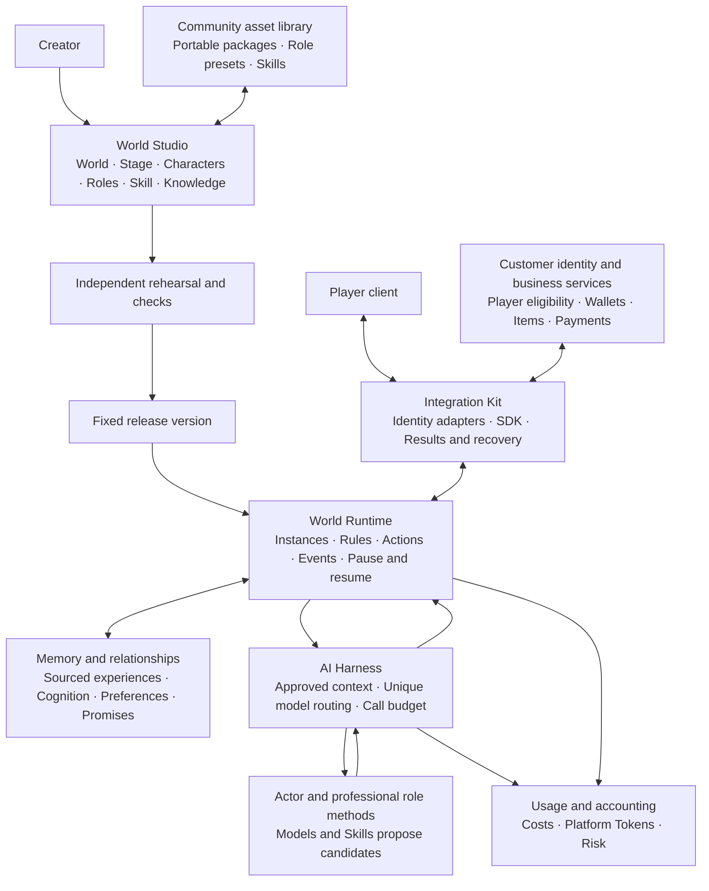
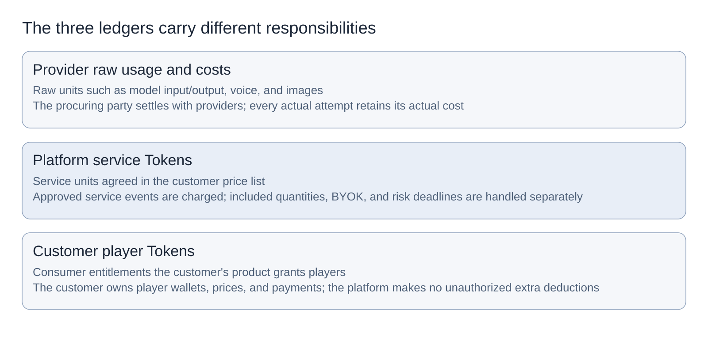

> Published design reading view v3.0.2; current product design is 3.1.0 and R0 execution baseline is 3.0.1. Source includes Task8 and Task9 static preflight under working contract 1.6.0. Whole Task8/R0 remain unaccepted. See [support scope](00-status.md).

# Loreviva Product Design Overview and Structure

Product design v3.0.2 | R0 execution contract v3.0.1. This document defines product design and acceptance requirements. See [current project state](00-status.md) for implementation and acceptance status.

Loreviva — The AI Platform for Living Worlds

Create worlds, and let them keep growing.

This overview explains Loreviva's positioning, experience, and components. The [Product Requirements](02-requirements.md) define behavior. The [Technical Whitepaper](03-architecture.md), [Setup and Integration Guide](04-setup-and-integration.md), and [Implementation Plan](05-roadmap.md) describe implementation, use, and delivery. Chinese product behavior and the sole engineering machine-contract fields remain authoritative.

## 01 The Product We Intend to Deliver

Loreviva is an AI platform for creators to build worlds and keep them running. A world contains background, scenes, rules, characters, professional roles, Skills, knowledge, and presentation assets. Creators combine these into a work; players enter it, communicate with its characters, and make choices. The program gives valid choices real world consequences. Within current permission, characters remember shared experiences and continue their goals, promises, and relationships.

The platform's main value is extending “making a character” into “operating a world that can continuously carry experiences forward.” Creators do not have to assemble character prompts, chat history, rules, assets, model connections, memory, and metering separately. Business customers can concentrate on their own client experience while standard integration gives them creation content, character operation, world consequences, and recovery from the same source. Industry customers retain final authority over identity, business eligibility, player charges, and their original business services.

“Having real individuality” has observable criteria: a character has relatively stable values, goals, speech patterns, knowledge boundaries, and reasonable grounds for refusal; different characters make different yet coherent choices in the same situation. “Understanding players increasingly well” means correctly continuing experiences, preferences, and agreements with clear provenance, accepting corrections, and acknowledging what is unknown. “Continuous growth” means the world has consequences, characters have goals, promises can be fulfilled, and relationships can become closer, be repaired, or end naturally. These are development and research objectives. Actual AI quality and human experience must still be verified separately.

The common kernel targets games, interactive film/game experiences, emotional companionship, online education, and virtual communities. World state, character experience, permissions, events, integration, and recovery share common needs; course grading, game economies, film/game editing, companionship contact channels, and public community activities are explicitly defined by industry product packages and customer adapters. Supporting an industry requires tests specific to that industry. Product claims cannot be expanded merely by replacing a prompt set.

## 02 From an Idea to an Experience Players Can Return To

The main creation flow starts from a template or a one-sentence description. A creator enters “rainy-night café”; the AI assistant may propose candidates for a world background, two characters, a wooden-sign interaction, reference material, and role bindings. The creator first confirms the characters' positions and world rules, then adjusts objects, positions, entrances and exits, appearance, and sound on the stage canvas. Each item has a normal form and in-place AI assistance. AI suggestions show field differences, provenance, the actual model, cost, and related effects. The creator can adopt, change, or discard items individually.

Rehearsal places content in an independent sandbox. It fixes the initial scene, input, memory, and model configuration to examine how a character responds, whether rules prevent invalid actions, and how a client degrades when sound is unavailable. Static properties, assets, and layout should preview accurately. Actual character generation varies; rehearsal shows verifiable conditions and the range of variation. Results already established can be replayed. Replay does not purchase another model call or execute world actions again.

Saving creates a draft, publishing creates a fixed version, and creating an instance establishes an independent world state. A separate start operation puts the instance into its running state. The interface and receipts distinguish saving, publishing and creation clearly. Before publication, checks cover characters, rules, reference-material rights, role responsibilities, Skill dependencies, model capabilities, budgets, and applicable tests. Existing instances keep their previous published version. After changing personality, knowledge, or rules, the creator must first publish a new version, then separately assess the effects of an instance upgrade on experiences, promises, and relationships.

A player entering a world first sees its characters and current scene, then participates through conversation, actions, or choices. Alex keeps the café's wooden sign, and Mia may suggest lending it. When a player requests the sign, the program checks custodial authority and current state; only success creates an event and displays a successful action. A character saying “I have already given it to you” does not itself move the item. When actions depend on one another, failure of a prerequisite prevents displaying the consequences that depend on it.

A player previously told Alex privately that they prefer quiet. When they return, Alex may use valid experience to invite them to a quiet conversation; Mia and the public view cannot thereby learn the private preference. The invitation is merged into that turn's main response and must satisfy resources, cooldown, permission, and budget. The player may refuse surprises, correct preferences, forget experiences, pause, or end naturally. Refusal, deletion, or leaving does not punish the relationship.

Disconnection and return are normal parts of the experience. The client queries the original task again, restores an authorized snapshot, and resumes updates for the same result. Text may appear first, with sound later added to the original presentation package. Duplicate delivery does not lend the sign again, replay an action, or charge again. Pausing prevents new narrative generation and commits; model requests already sent externally and existing storage costs are shown honestly. Unknown results have queryable states. The interface does not induce a player to purchase the same unknown execution again.

## 03 Product Structure and Shared Boundaries

Six common modules form the product loop. Modules divide responsibilities; by default they run in the same repository and application, rather than requiring six services.

[Product-structure image](../diagrams/product-structure.png).

| Module | What the creator or customer receives | Core boundary |
| --- | --- | --- |
| World Studio | Worlds, scenes, characters, knowledge, roles, Skill bindings, stage preview, and publication | Edits drafts; publication requires authorized operation |
| World Runtime | Action results, world state, events, clock, and controls | The program adjudicates and commits the world's own facts |
| Memory and relationships | Shared experiences, cognition, preferences, promises, relationships, and management entry points | Provenance and audience; correction and deletion supported |
| AI Harness | Model selection, approved context, role methods, tasks, and recovery | Agents propose candidates; they cannot broaden authority or write facts |
| Integration Kit | Public contracts, SDKs, reference clients, Mock, and industry examples | Clients consume approved results; the customer's business retains authority |
| Usage and accounting | Provider costs, platform Tokens, reservations, bills, and risk states | Three layers of units stay separate; the customer holds the player wallet |

Diagram source: [editable Mermaid definition](../diagrams/product-structure.md).

After the illustrated candidates return to Runtime, the program checks current identity, permission, state, provenance, and budget before establishing facts and approved output. External business actions are confirmed by receipts from customer services. An established world result, completed external business operation, and completed client playback are shown separately. The editable diagram preserves logical nodes and connections; the document image serves reading.

A world project is a work container; a world definition describes content; a published version fixes dependencies; a world instance holds actual state and experiences. A character definition saves core personality and starting presentation, while an actor instance is that character's existence in a particular world. Private experiences may provide independent worlds and actors for each player. Shared worlds use the same public facts, but each player's relationship with an actor is separate. Shared character templates do not carry private experiences. Carrying identity, promises, or memory across worlds requires explicit mapping and the player's choice.

## 04 Product Organization of the All-in-One Studio

The administration interface retains five navigation groups and puts creation first. “Workbench” offers continued creation, template starts, running status, and unresolved issues. “World Projects” brings together the stage, rules, characters, role and Skill bindings, knowledge, rehearsal, publication, and instance entry points. “Asset Library” saves reusable templates, role presets, Skills, reference material, and presentation assets. “Runtime Center” manages instances, tasks, memories, relationships, analytics, and finance. “System Settings” brings together model connections, workspace permissions, product integration, quotas, storage, and maintenance.

Every creation object supports search, tags, filtering, property inspection, creation, copying, editing, saving, cancellation, archiving, and conditional deletion. Copying first previews dependencies and remaps identifiers. It does not copy credentials, player identities, private chats, relationships, bills, or runtime state. Deletion shows reference effects; it cannot leave a published version missing dependencies while still declaring it valid. Save conflicts retain local changes and show differences. Cancellation discards only unsaved fields; it does not erase rehearsal costs or events that have already occurred.

Roles include director, writer/director, actor, makeup and styling, performance voice, stage operations, memory and relationships, and quality reviewer. Roles define responsibilities and methods; they may be combined, held concurrently, or performed by programs. They do not require a separate model call per role each turn. A director may bind multiple fixed-version Skills, and different roles may reuse a Skill. Dedicated Skills express professional methods; general Skills provide retrieval, provenance checks, structural proposals, field differences, and asset registration. Execution tools must be registered through authorized source code. Community prompts cannot install programs or obtain permissions by themselves.

Each actual generation module may select its model independently or inherit a world or workspace default. Ordinary interaction belongs to the main actor, proactive world events to the designated director, and editing assistance to the current module; an approved task override takes priority. Methods of other roles participating in the same generation are merged into context, and the interface clearly shows that their configured models were not called separately this turn. Online operation defaults to one main actor and one main text generation. Structural repair and recomputation after a state conflict share at most one additional text call. Memory, planning, and review cannot use subtasks to increase routine calls.

## 05 Long-Term Characters and Player Control

Character continuity comes from separating stable personality, changing state, and sourced experiences. Emotion, current location, and current goals may change. Long-term personality must acquire a valid version through growth events or creator revisions. An actor's relationship with a player is the character's judgment: it cannot turn inference into the player's real-world feelings or automatically increase closeness through payment. A new player without shared experience cannot be fabricated as an old friend.

Memory separates world facts, character cognition, shared experience, semantic preferences, promises and pending tasks, and relationship state. The program establishes facts. Cognition must additionally prove that the character actually learned them through initial knowledge, witnessing, being told, or grounded inference. Player statements retain their provenance as “previously expressed.” Correcting a world fact in administration does not make every absent character instantly know it. Revoked or deleted content cannot continue to be used even if it was learned previously.

Derived results from private material retain its private audience, including summaries, goals, plans, relationship conditions, rule branches, media, and presentation. Having permission for a public action does not authorize making a private source public. Without explicit authorization, private preferences are used only in the original relationship view. Deletion first makes original text and derivatives unavailable, then cleans related storage and indexes. Restoring a backup must first replay the latest deletions and revocations. Content saved offline by a client has an explicit reclamation boundary; the platform cannot promise to recall every copy remotely.

## 06 Partner Integration, Community, and Delivery Modes

Customer integration centers on the customer's own client. Its server confirms player identity and eligibility, exchanges a short-lived restricted session, selects an industry package, submits interaction, displays approved results and recovers tasks, and provides player memory controls. The platform provides single-source contracts, generated SDKs, a reference client, a thin backend example, Mock, error examples, and recovery guidance. Customer model and server keys do not enter player clients. The platform does not create another player wallet on the customer's behalf.

Content is shared in portable .wepkg packages containing worlds, characters, roles, Skills, knowledge, and presentation themes. Export excludes private runtime data and credentials. Import first performs static preflight, previews rights, maps local dependencies, saves an isolated draft, rehearses with Mock, and then publishes. Missing models, tools, or assets are located to specific objects. Different hashes for the same version are conflicts. The first phase shares through files, repository directories, and community content directories. A complete commercial marketplace and revenue sharing are deferred.

The complete open-source core can be self-hosted. It defaults to one Go/Kratos application and MySQL Community LTS. Vue administration static assets ship with the application, and files reside in a local private directory protected by authentication. api/worker separation or community storage adapters can be added as needed. The core does not mandate a platform account, top-up, or paid cloud. Hosted SaaS, dedicated deployment, and BYOK use the same kernel; procurement responsibility and service fees are disclosed. Open-source, model, asset, and third-party licenses are checked separately.

## 07 Charges and Release Commitments

[Three-ledger image](../diagrams/three-ledgers.png).

The three Token layers are provider raw usage and cost, platform standard service Tokens, and customer player business Tokens. The platform settles with customers under frozen SKUs and price lists; customers decide player entitlements and prices. BYOK does not charge the platform's model-resale fee again. Internal structural repair and recomputation caused by platform faults retain actual costs but do not pass on another normal-generation fee. Relationships do not grow automatically when players purchase, and the charging structure does not demonstrate that either platform or customer is profitable.

Unknown results separately record task, delivery, usage, and fee states. Paid contracts fix a finite deadline for customer reservations. If the result cannot be verified at expiry, the platform assumes the risk and releases the customer's reservation. Provider and global safety budgets continue conservative occupancy; late costs default to the platform and cannot be secretly deducted from customers afterward. Reaching the risk limit blocks new external requests. Pausing, cancellation, refunds, and provider results are distinct, and customers can see continuing storage or background costs.

R0 delivers an installable community Mock creation and runtime loop. R1 adds tested real models, personality and memory, and quality on player return. R2 adds explicit customer product packages, identity integration, tenant isolation, payment collection and Token settlement, risk, and support responsibilities. R3 adds independently accepted industry and shared-world scope. Shared, industry, and external-action tests required by the first paying customer must occur before R2 charging. Optional client adapters are tested within their explicitly declared support scope; they are not mandatory first-round dependencies.

Development first completes content and public contracts, worlds and memory, Harness, Studio, and the reference client, then completes the hosted metering loop. Acceptance is organized around 14 requirements, 40 core scenarios, 20 adaptation scenarios, and 12 groups of supplementary checks. Acceptance records evidence separately for engineering, character quality, novice creation, customer integration, community modification, and commercial results. Performance, capacity, actual rates, research thresholds, and environments are frozen before experiments. Unknown parameters require measurement; release claims remain limited to the scope actually passed.

## 08 How Characters Keep Growing

Creators need to design more than a character's opening setup: they must also define “how this person changes after particular experiences.” Loreviva organizes continuity into four layers: stable core, actor growth, relationship perspective, and current expression. Values and identity remain recognizable; capabilities, habits, and goals change through permitted experiences; each relationship holds its own understanding and shared experiences; immediate emotion and expression rhythm adjust to context. Growth does not directly rewrite the character template or spread one player's private experiences to every player.

Creation first chooses mutable dimensions, then defines the events required for change, permitted ranges, recovery methods, and counterexamples. At runtime, an established interaction may become an experience, update approved state, and create a next opportunity; the next response reads those changes. Growth has provenance, duplicate delivery does not duplicate growth, and characters may persist, refuse, repair, and change goals. Relationship progress and use permission are managed separately.

Long-term memory includes continuous organization and correct consumption. The system distinguishes current-turn instructions, contextual preferences, explicit long-term preferences, and inferences awaiting verification, preserving conflicts and corrections. Compiling bounded context protects current boundaries and unfinished agreements. A character-perspective retrospective can help a player understand shared experience, but cannot turn a character's guesses into user facts or increase a source's credibility by repeatedly summarizing it.

Surprises are built from experiences, character motives, the current world, and available resources. The platform may propose new activities or expressions; consequences requiring player participation occur only after the player chooses. Private reasons stay in an authorized view. Public world changes require valid public commands and the corresponding source eligibility. Creators observe this causal chain through consequence previews, experience timelines, comparative rehearsals, and version checks. Feedback becomes approved revisions and regression cases.

Detailed character-continuity requirements are in PRD section 26, with implementation constraints in whitepaper section 16.
