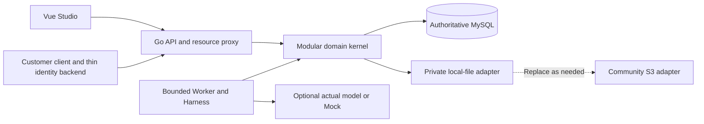
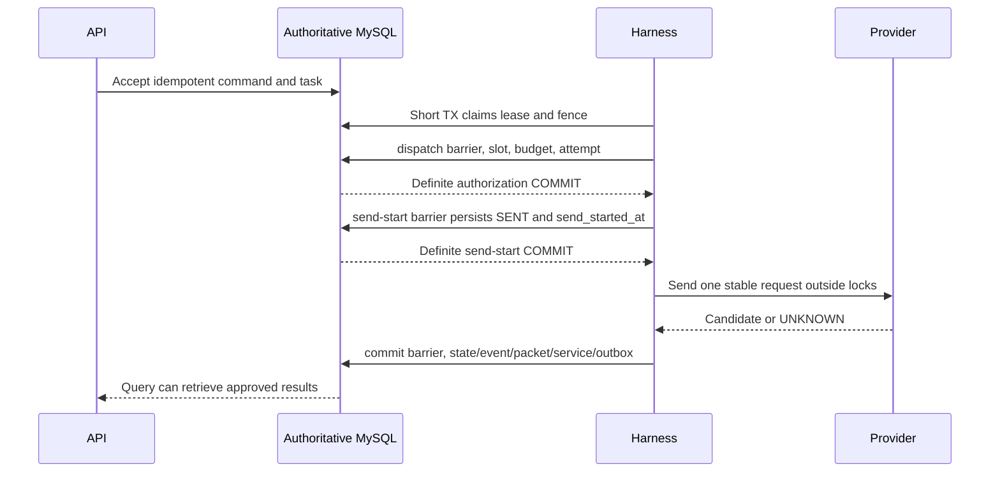
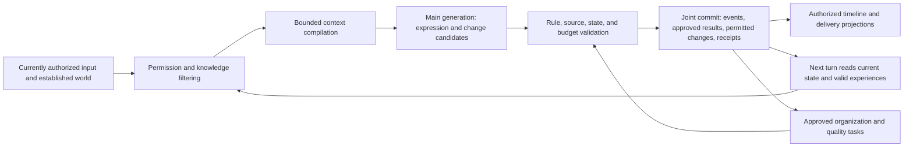

> Product design v3.0.2. This document defines goals and requirements. This branch still contains Tasks1–7 / contract1.4.0 source, without the in-development1.6.0 features. See [repository support scope](00-status.md) for implemented capabilities and setup.

# Loreviva Technical Architecture Whitepaper

Design v3.0.2; R0 execution baseline v3.0.1. Development is in progress and the complete product has not passed acceptance. See [Project State](00-status.md) for progress, supported scope and verification boundaries. Living-character (LC) capabilities are later design.

Loreviva — The AI Platform for Living Worlds  
Create worlds, and let them keep growing.

Development design v3.0.2 · Architecture and design contracts.

## 01 Document Authority and Technology Freeze

This whitepaper defines Loreviva's domain authority, module interfaces, persistence, concurrency barriers, identity, public protocols, model procurement, memory governance, extension and recovery. Design contracts describe required behavior; code, installation, model quality, payment and production capacity require their own evidence. Product objectives and interaction tasks are described in the [Product Overview](01-product-overview.md), [Product Requirements](02-requirements.md), [Setup and Integration Guide](04-setup-and-integration.md) and [Implementation Plan](05-roadmap.md). The sole field sources are `contracts/source/openapi.yaml` and `contracts/source/wepkg.schema.json`. Resolve inconsistencies there and in the responsible document; generated DTOs and SDKs must not become a separately maintained authority.

The engineering and documentation root is `<repository>`. Credentials, data and automation remain scoped to this project. The database is MySQL and the core requires no purchased cloud service. New code with the required rights defaults to Apache-2.0; third-party software, models, historical assets and content retain their original licenses and ownership.

| Item | Technology choice | Exact-artifact requirement |
| --- | --- | --- |
| Public HTTP contract | `/world/v1`, OpenAPI 3.1.2; the 1.3.0 compatibility baseline has 51 operations/131 schemas, the approved 1.4.0 baseline has 58/156, and working 1.6.0 has 65/177 | Original 18 public and 33 administrative/file operations retain compatibility; default memory responses remain compatible and provenance_v1 is explicitly selected. SDK and customer support claims follow actual release evidence |
| Data Schema | JSON Schema 2020-12 | Schema/versioned fixed valid and invalid examples together |
| Content package | `.wepkg` format 1.0, logical dependencies separate from local release | Traceable package digest, file manifest, import mapping |
| Frontend | Vue 3.5.43 stable, Node.js 24 LTS; TypeScript, Vite, Router, Pinia, reusable native Vue/HTML/CSS/SVG components | Exact artifacts, strict types, engineering lock each verified; ElementPlus is excluded; declaration incompatibility must not be hidden by weakened checking |
| Kernel | Go 1.27.2, Kratos modular monolith, database/sql | Go confirmed by official release records; exact Kratos/driver/transitive versions verified before locking |
| Database | MySQL Community LTS, InnoDB, 9.7 series | Verify exact packages/images and security patches for each release; no unverified latest-version claim |
| Files | Private local directory/application authenticated proxy | Fixed data root, permissions, backup manifest, no public directory mount |

The baseline names Vue 3.5.43, MySQL 9.7 LTS, Go 1.27.2 and Node.js 24 LTS. Project-level engineering uses Go1.27.2, MySQL Community9.7.2, Node24.19.0 and pnpm11.25.0; each release still pins and verifies its exact dependencies and artifacts. This does not prove a new-machine installation or a tested container release. [Vue releases](https://github.com/vuejs/core/releases), [Go releases](https://go.dev/doc/devel/release), [Node releases](https://nodejs.org/en/about/previous-releases) and [MySQL LTS](https://dev.mysql.com/doc/refman/9.7/en/mysql-releases.html) supply upstream version information. Protocol versions follow the product contract: [OpenAPI 3.1.2](https://spec.openapis.org/oas/v3.1.2.html), [JSON Schema 2020-12](https://json-schema.org/draft/2020-12).

Studio uses Vue3.5.43/TS5.9.3, Router/Pinia/Vite and native forms, object trees, property editors, differences, dialogs and SVG canvas. ElementPlus is excluded; skipLibCheck, invented ambient declarations or a TypeScript upgrade must not conceal declaration incompatibility. Features, permissions and side effects follow the PRD and the same-source SDK/Go release path. Keyboard access, focus, narrow screens and real task states require verification against the actual artifact.

## 02 Minimum Deployment and Module Boundaries

Community baseline has one Go application artifact and MySQL. The application supplies Vue static Studio, public API, authenticated resource proxy, and persistent-task executor. Default `all` runs API/Worker together. `api` and `worker` allow splitting processes as needed, sharing domain code, database, and migration versions; runtime modes are not feature levels. HTTP request completion does not terminate persistent tasks. all restart and split-process takeover must produce identical events, budgets, fences, and recovery results.



[Deployment diagram](../diagrams/deployment.png).

Diagram source: [Mermaid definition](../diagrams/deployment.md).

| Module | Owned responsibility | Authority it does not acquire |
| --- | --- | --- |
| identity/governance | Tenant, product, session, authorization, epoch, revocation/deletion commands | Does not trust client self-reported player eligibility |
| authoring/release | Drafts, differences, knowledge import, dependencies, immutable releases/mapping | Draft saving does not change running worlds |
| runtime | Scene items, controls, world revision, declarative rules, event commits | Generated text does not establish external payment/item results |
| memory/relationship | Provenance, actor knowledge, private experiences, preferences, promises, directional relationships | Readable retrieval does not imply public expression permission |
| harness/jobs | Routes, Skills, tasks, attempts, leases, checkpoints, call counts | Cannot expand rights, change rates, bypass parent budgets |
| presentation | approved packet, action identity, media updates, authorized delivery | Animation ACK cannot write facts back |
| usage/billing | Raw costs, service metering, customer Tokens, reservation/risk accounting | Cannot directly operate player wallets |
| integration/adapters | SDK inputs/outputs, providers, files, clients, business receipts | Adapters cannot decide world/accounting terminal states |

Domain modules call typed commands/queries and share one Unit of Work. Repositories accept only the current transaction connection; hidden multiple connections in one commit are prohibited. HTTP validates protocol/sessions; domain rechecks fact permissions. Workers request domain authorization only. Common libraries hold identifiers, exact numbers, errors, clocks, and transaction infrastructure, without accumulating all domain logic. Modules do not directly update others' tables.

Redis, separate queues, vector databases, analytics warehouses, Collector, Kubernetes, and microservices are optional. Before enabling, show bottlenecks, benefits, and comparable-condition regression; AI Native/community labels do not justify mandatory services. Basic structured logs, correlation IDs, costs, and diagnosis remain in the single-machine artifact.

## 03 Domain Identity, Scope, and Versions

All runtime objects have tenant/product boundaries. `world_project` is the creation container, `release` a local fixed publication, `world_instance` holds facts/controls, `character_definition` is the personality template, and `actor_instance` its existence in this instance. Player identities map after customer-backend verification; business-user strings are not unified cross-product profiling keys.

Relationships mean “the actor's understanding of the target subject.” Familiarity/trust/conflict are character judgments, not players' real-world feelings. Actor relationships are also directional. Unique scope contains tenant, product, world_instance, actor_instance, target_kind, target_id. Reverse relationships are separate records, not mutual closeness inferred from one affinity score.

| Identifier/version | Purpose | Must not be conflated |
| --- | --- | --- |
| turn_id/task_id | Interaction business identity/persistent execution identity | Multiple task takeovers are not new interactions |
| attempt_id | Actual provider request/procurement risk | Queries/network resends do not reset attempt |
| event_id | Established world-event identity | packet display count is not event count |
| packet_id/action_id | Approved presentation package/stable action identity within it | Audio readiness creates no second action |
| delivery_id/packet_revision | Audience delivery-stream identity/monotonic update version | ACK is not world commit/provider success |
| release_id | Fixed content/rule/route/budget-mode version | `.wepkg` version is not release_id |
| world_revision | Own-fact commit version | Different from control/privacy/delivery versions |
| control_version | Start/pause/resume/end version | Cost receipts cannot advance narrative clocks |
| privacy_epoch/view_epoch | Permission-governance generation/authorized-view generation | cursor generations do not grant rights |
| fence | Monotonic token at each task lease takeover | Worker cannot generate/reset it itself |

API large integers/amounts use exact strings. Internal sequences/cursor watermarks are not public; IDs/gaps cannot reveal others' events. External IDs follow explicit case-sensitive UTF-8 byte rules, nonempty/length-limited fields. Necessary global scope uses preregistered nonempty sentinel values, not NULL to escape uniqueness.

<a id="s67-actual-norm-adoption-and-unimplemented-boundary"></a>

### Registration time-hash compatibility

REGISTER_CUSTOMER/REGISTER_PLAYER_ACCESS use complete UTC commands under domain loreviva.registry.registration.utc.v2; other kinds are unchanged. Existing V1 keys match only original typed raw inputs, without a V1UTC fallback. Original hashes, deadlines and revisions remain immutable, without renewal or new authority. Complete historical proof supports known old-UTC V1 and V2UTC. Missing-command old-non-UTC history is UNVERIFIABLE and automatic R1/CREATE reconstruction is NOT_SUPPORTED; safe queries and exact-input replay remain separate.

## 04 Key Persistent Tables and Index Contracts

Frequently queried scope/state/version/amounts use structured columns; JSON stores only Schema-constrained extensions. Validate Schema before writing. Money/business unique keys cannot reside in free JSON. Cross-tenant references use composite foreign keys containing tenant/product; bare object_id joins to scoped objects are prohibited. Soft archiving does not revoke reference rights; deletion governance first makes content unreadable, then cleans it.

| Table group | Key structure/constraint | Query/concurrency purpose |
| --- | --- | --- |
| tenant_gates/product_gates/subject_governance | Nonempty composite PK, permission/privacy/view epoch, disabled/risk state | Shared permission/dispatch entry, without relying on caches |
| world_projects/releases/release_bindings | Project scope, immutable release, local connection/tool/asset mapping, content hash | Old instances retain release, credential bodies excluded |
| world_instances/world_controls | Unique `(tenant,product,instance)`, composite release FK, revision/control_version | Serialized per-world public-fact adjudication/linearized controls |
| actors/items/relationships | Full-scope FK, directional relationship composite uniqueness, revision | Unique-item competition/private relationship isolation |
| memories/memory_sources/acquisitions | actor/player/audience/use/validity/epoch, unique source edges | Filter provenance/knowledge before time/keyword retrieval |
| commands/tasks/checkpoints | Full idempotent scope/key uniqueness, claim state/next_run/lease indexes, fence/commit_key | Changed-parameter conflicts, restart recovery, commit queries |
| attempts/dispatch_authorizations | Unique task+slot/request_key, provider request ID/state | Reconcile each purchase/query unknown originals |
| events/approved_results/service_events | Unique internal world watermark/task commit/service_event item | Facts/results/service conditions in one transaction |
| budget_accounts/reservations/postings | Exact smallest units, unique task+account+purpose, stable posting key | Rebuildable projections; logs do not replace budgets |
| outbox/inbox/commit_receipts | Unique scope+consumer+message/commit_key, delivery-lease index | Local exactly-once effects/unknown COMMIT querying |
| assets/governance_tombstones | Ownership/audience/derivatives/hash/PENDING/READY, deletion version/cleanup progress | Nonatomic file states/recovery without body revival |

The DDL below indicates constraint direction only and is not an executable migration. Complete migrations validate index lengths, foreign keys, character sets, and execution plans against target patches. IDs use restricted ASCII bytes; business text uses utf8mb4 separately. FK cascading cannot erase accounting history along with fact events.

```sql
CREATE TABLE world_instances (
  tenant_id VARBINARY(64) NOT NULL,
  product_id VARBINARY(64) NOT NULL,
  instance_id VARBINARY(64) NOT NULL,
  release_id VARBINARY(64) NOT NULL,
  world_revision BIGINT UNSIGNED NOT NULL,
  PRIMARY KEY (tenant_id, product_id, instance_id),
  FOREIGN KEY (tenant_id, product_id, release_id)
    REFERENCES releases (tenant_id, product_id, release_id)
) ENGINE=InnoDB;
CREATE TABLE commands (
  tenant_id VARBINARY(64) NOT NULL,
  product_id VARBINARY(64) NOT NULL,
  subject_id VARBINARY(64) NOT NULL,
  operation VARBINARY(40) NOT NULL,
  instance_scope VARBINARY(64) NOT NULL,
  idem_key VARBINARY(128) NOT NULL,
  payload_hash BINARY(32) NOT NULL,
  command_id VARBINARY(64) NOT NULL,
  PRIMARY KEY (tenant_id, product_id, subject_id,
    operation, instance_scope, idem_key)
) ENGINE=InnoDB;
```

memory bodies separate from necessary audit metadata. event may retain sanitized identities/action results, while restricted statement text is cleaned under deletion requirements. Memory retrieval indexes start with scope, actor, validity, source time; full-text indexes separately test language/target version. Budget/analytics projections may rebuild and queries show lag. Permissions, fences, reservations, and commit receipts read authoritative primary databases.

## 05 Global Lock Order and Common Barriers

All authoritative short transactions explicitly use READ COMMITTED. Isolation level does not replace domain versions/governance locks. The following is the sole total lock order for acceptance, commit, dispatch authorization, pause/resume/cancel, revocation/deletion, cost settlement, and receipts; modules cannot define their own. Skip uninvolved levels. For multiple same-class objects, collect IDs first and acquire in binary ascending order; generating while discovering reverse locks is prohibited.

| Level | Row/resource | Total order within level |
| --- | --- | --- |
| 10 | tenant gate | tenant_id |
| 20 | product gate | tenant_id, product_id |
| 30 | subject governance | scope, subject_id |
| 40 | world control | scope, world_instance_id |
| 45 | Idempotent command | scope, subject, operation, instance_scope, key |
| 50 | task | scope, task_id |
| 60 | attempt/dispatch authorization | task_id, attempt_id, authorization_id |
| 70 | Budget accounts | Fixed kind order: supplier_global, supplier_tenant, platform_risk, customer, project, world; then scope, account_id |
| 80 | reservation | Account sort key, reservation_id |
| 90 | Domain rows | Fixed kind order: item, actor, relationship, memory, content_project, content_draft, content_release, asset, content_check; then scope, object_id |
| 100 | Inbox | scope, consumer_id, message_id |
| 110 | Append records/their unique keys | Fixed table order: events, approved_results, service_events, postings, outbox, commit_receipts; then stable business key |

A short transaction acquires only locks needed for its command. If the object set must grow, roll back entirely, recollect, and begin in total order; do not retain locks then acquire lower levels. Immutable releases, quotes, and capability snapshots use version reads. Changing validity uses upper gates, without directly locking immutable content. New tables join existing levels and pass contention review rather than leaving ordering to each module. Level 110 uniqueness conflicts are also database transaction errors.

The common barrier reads/locks applicable governance rows, world control, task, attempt, and budgets; it checks current eligibility, permission, release availability, privacy epoch, control version, world revision, fence, lease validity, cancellation, and balances. Commit barrier additionally validates action dependencies, provenance, and output audience. dispatch reserves call slots/exact bounds, fixes route/request hash, writes `dispatch_authorization`, stable attempt, irreversible send-boundary marker, then COMMIT. Only authorization successfully exiting the transaction permits sending.

Before actual networking, `send_started_at` must persist. Public attempt_state SENT means “entered the possible-send interval,” not proof of provider receipt. A crash after authorization queries original attempt even if nothing may have sent; without certainty, no automatic resend. Preparation AUTHORIZED without send marker permits no executor to send. Recovery passes the current complete dispatch barrier again under original attempt without added slots/reservations. Sending first and backfilling SENT is prohibited: crashes would misidentify purchases as unsent. Local send-authorization COMMIT receipts must also be definite; otherwise query its stable key first.

The linearization point is authorization/governance transaction commit. Pause/revocation committed first rejects later authorization. Authorization committed first means a later pause cannot promise recall; record in-flight requests, limit later sends, and recheck before local commit. Process-local cancellation checks before networking narrow windows but do not provide cross-system atomicity with DB pause/external receipt. Transactions holding locks cannot call models, payments, remote files, client pushes, or blocking external code.

Lease claim is a strict exception: one short transaction uses `FOR UPDATE SKIP LOCKED` to claim only task, increment fence/write lease, immediately COMMIT; no subsequent governance/budget locks or sending. Claim means scheduling eligibility, not execution authority; reenter the full barrier afterward. Outbox claims likewise update only delivery leases, then exit before applicable delivery authorization. Domain writes use another total-order transaction. [MySQL locking reads](https://dev.mysql.com/doc/refman/8.4/en/innodb-locking-reads.html) explains the mechanism; target 9.7 patches still require actual tests.

## 06 Transactions, Commits, and Message Recovery

A successful world commit writes own state, established events, approved_result, service_events meeting completion conditions, corresponding budget/accounting changes, and Outbox on one connection/in one transaction, then stable commit_receipt. Any failure rolls back entirely, without own partial commits where facts succeed but approved output is lost. Media creation may advance independently afterward without revoking facts. External accounts/payments/items/messages store references/receipts only; external confirmation is not an atomic member of this database.



[Interaction commit diagram](../diagrams/interaction-commit.png).

Diagram source: [Mermaid definition](../diagrams/interaction-commit.md).

Database errors during execution cause explicit Rollback of the whole transaction. Lock-wait timeout cannot continue to commit even if only the current statement rolled back. Only definitely failed retryable errors permit bounded retries of entire short transactions under the same stable business key. Database retries do not buy models again or reset slots/reservations. Updates condition on current fence/version; wrong affected-row counts mean contention failure. [InnoDB error handling](https://dev.mysql.com/doc/refman/8.4/en/innodb-error-handling.html).

Disconnected/timed-out/lost-receipt COMMIT enters local commit verification, querying `commit_key` receipt/task/approved_result on the authoritative primary. Until the authoritative connection is restored and commit or rollback is proven, do not write FAILED, release budgets, or send again. A stable receipt returns original results. Retry local transactions only after noncommit is established and the original transaction has ended. Commands generate/persist stable keys, not random retries.

Outbox provides at-least-once delivery. Internal consumers jointly commit Inbox deduplication and local changes. Unique Inbox conflict rolls back the duplicate effect entirely then returns original processing results. External customers should also jointly commit Inbox/local business changes; API/SDK grants no SQL rights. Cross-database/provider duplicates, disorder, and unknowns remain possible. Reconcile stable business keys, original-object queries, and authoritative receipts without promising cross-service exactly-once.

Synchronous save/publication/HTTP task acceptance uses typed WithCommandBarrier, sharing current subjects/gates, lock order, short transactions, and stable command receipts with leased WithBarrier. Synchronous receipt task_id is SQL NULL; do not fabricate worker/fence/world IDs. New tasks use preregistered rank50 locks and same-transaction CreateTask as ACCEPTED, fence0, no lease. Tasks/acceptance receipts succeed or roll back together. PRODUCT administrative tasks have no world_instance_id; WORLD tasks require actual complete instance scope. Final-state changes occur in the same owner/current-fence transaction.

Execution/control/governance/migration barrier purposes are closed program types bound to stored task_kind/current eligibility. Ordinary narrative/model sends require RUNNING. CONTROL allows valid transitions from current state without model procurement. Governance continues in PAUSED/ENDED; migration is PAUSED only. No purpose bypasses current scope/source/accounting permission. R0 initially serializes each tenant's short transactions with an exclusive tenant-gate lock; networking stays outside. This is an explicit throughput limit, not production-capacity commitment. supplier_global/platform_risk accounts are independent GLOBAL boundaries and cannot multiply limits through per-tenant copies.

## 07 task, attempt, delivery, and Checkpoints

task is business execution state, attempt one external-request state, delivery presentation-delivery state; accounting/media have further states. They cannot merge into one success field. COMMITTED tasks may retain media FAILED, delivery PENDING, supplier usage UNKNOWN. HTTP 200 queries mean only that original tasks were found, not successful interaction.

| State machine | Normal path | Unknown/terminal constraints |
| --- | --- | --- |
| task | ACCEPTED→RUNNING→WAITING_EXTERNAL→RUNNING→COMMITTED | UNKNOWN recovers with original-attempt evidence; FAILED/CANCELLED/REVOKED do not resume old execution |
| attempt | RESERVED→AUTHORIZED→SENT→SUCCEEDED/FAILED | No authoritative result after SENT→UNKNOWN; query original, no new purchase; cancellation requests separate |
| delivery | PENDING→AVAILABLE→ACKNOWLEDGED | WITHDRAWN prevents future access; ACK changes no facts; media updates same delivery |
| world | CREATED→RUNNING↔PAUSED→ENDED | ENDED does not resume narrative; cost verification/deletion remain |

ACCEPTED may cancel/revoke/explicitly fail. RUNNING/WAITING_EXTERNAL/UNKNOWN may enter local cancellation/revocation terminal states while attempts retain external unknowns. task UNKNOWN recovers only from authoritative original-result evidence, not a retry click returning RUNNING. COMMITTED cannot ordinarily cancel and returns 409 ALREADY_COMMITTED. Established-fact changes require new approved commands. FAILED is for known failure, never direct timeout labeling.

Checkpoints save phase, input/source versions, routes, parameter hashes, consumed slots, budgets, external references, and next allowed steps, without bypassing current permission. Only approved long tasks segment. Takeover rechecks all gates/fences/control/deletion versions and continues at most original allowed steps. Online structural repair/state conflict share one extra slot; checkpoints, recursive Skills, or child Agents cannot reset counts.

Task cancellation, world pause, playback stopping, provider cancellation, and refunds have separate receipts. Local cancellation immediately blocks future commits. Unsupported/unknown external cancellation is shown honestly; sent requests may cost. Process death is not failure; expired leases transfer by fence. Old Workers receiving late bodies/receipts may register verification only, without crossing new fences to commit/send again.

## 08 Actor Cognition, Source Memory, and Relationship Updates

World facts, character cognition, player statements, and sandbox assumptions use separate tables or strict types. Administrative fact corrections do not instantly inform absent actors. Presence/witnessing, private disclosure, initial knowledge, inference each generate acquisition records. Character input requires current permission and actual knowledge first, then selects bounded context by relevance/time/unfinished promises/goals.

Each memory includes scope, owner/actor/target, type, source event/knowledge version, acquisition, audience, purpose, validity, revision, privacy epoch, and derivative edges. “I like rain sounds” is a previously expressed preference, not a global fact. Inferences retain evidence/uncertainty. Corrections create effective versions/invalidate references without silent source edits. Relationship/goal/promise/emotion/media derivatives inherit source restrictions.

Private experiences generate personalization only inside their relationship. Public-action permission does not declassify private sources; public-state changes require independent declassification authorization/source rules. Revoked/deleted originals, summaries, vectors, indexes, rule conditions, relationships, and media derivatives cannot continue in use. Former character belief is no exception. Cross-world memory carryover needs explicit mapping, purpose, player choice.

R0 original-owner explicit consent is independent authorization provenance. fresh-bootstrap adds default-false --owner-private-generation-consent, retaining original BootstrapSynthetic wrapper/credential/governance/empty-database protections. It saves current generation.use only for the fixed synthetic creator themselves, PRIVATE_RESPONSE, for at most 30×24 hours DB UTC. 0006 attached consent records policy/original credential/explicit choice/time without granting reads/generation. Existing-installation replay does not reseed/renew/overwrite grants. Current MemoryService owning validator still reloads provenance/knowledge/audience/permission during actual AuthorizeDispatch, StartSend, final WORLD Tx. Renewal and withdrawal use closed self commands/current original credential/independent memory.generation.consent action/CAS/original key/same-transaction checks, without generic permission callbacks/bootstrap overwrite as recovery.

One main generation may jointly propose behavior/dialogue/promises/memory/relationships. The program checks source existence, actor knowledge, versions, output audience, writable fields, then controlled commit. Summaries shorten context without replacing original events. First-phase MySQL scoped/time/keyword retrieval is used. Vector adapters must demonstrate benefit on retained-set comparisons with fixed world/model/input/budget and cannot skip prior permission filtering.

Recovery approval is a closed program port, not a player/Operator-writable permission field. Persistent original-result evidence binds original task/attempt/authorization, send-marker commit identity, provider original request/Mock durable request, fixed route/request hash, complete result reference/hash/source governance. Complete authoritative results do not imply valid structure/known cost; bodies remain deletable. Approval binds parent interaction 1:1, original evidence/diagnosis hash, limited reason, currently approved new input/source, route, versions, cost bound, sole extra attempt. rank60 prelocks original/extra attempts and attached evidence/approval before existing account/reservation/domain order. Approval consumption, slot1/calls, reservations commit together; StartSend rechecks. Sent/unknown attempts query only originals. Incompatible unsent approvals cause bounded R0 rejection without route/hash/attempt replacement purchases. Online child Skills remain parent-interaction steps without another independent two-slot task; concurrent repair/conflict has one extra winner.

UNKNOWN/WAITING_EXTERNAL query scheduling needs closed original-request verification lease/purpose, queries only marker-bound originals, and grants no Generate. Once originals are authoritatively verified, programs may adjudicate locally/obtain eligible extra approval under current complete execution/source eligibility. Setting RUNNING is no authorization evidence. Costs recorded after narrative stop/revocation/cancellation use independent necessary-cost capability bound to original scope/authorization/marker/provider request/unique item, with minimum cost/audit metadata only. It cannot read/revive bodies, facts, memories, outputs/delivery, or new procurement, or misuse GovernancePurpose as a backdoor. Only proof transforming derived state-writer tasks into ACCOUNTING_ONLY removes migration blocking. Task10 still owns finite reservation deadlines/platform risk/no late extra customer charging.

Original-result retention and reading: owning Memory/Store adapter freezes attempt-level original identity/Versions/selected nodes/full governance-graph hash/core/route/request/input binding in original StartSend Tx, without bodies or overwriting attempt0. Only this private-check path gets current world revision server-side/checks original world lock and normalizes only WorldRevision. Ordinary Authorize/Send/WithBarrier remain strict. Runtime/permission/generation.use/expiry/source knowledge lineage/deletion/actor/route/release/control/privacy/view/lease/fence/install/seal otherwise unchanged. Files uses short Tx before/after storage lock/current independent J/body matches; IO outside DB. Pure-check sentinel rollback writes no receipt/FSM; missing bodies not rebuilt. Final current relevant-resource validation stays separate. Unrelated revision revalidation/rebase procures nothing; real conflict+explicit original rollback+new authorized input alone approves one shared recomputation. Full C covers new context/body dependencies.

World input: Memory private canonical includes actual typed current perception. Original creation/qualified scene proof allows only requesting actor's PUBLIC-scene actorID/slot and visible itemID/custodian/holder/state/closed capabilities, 32+32 and total 16000. ACTOR_SCOPED without evidence has only self; hidden referenced items excluded. No Name/Note/Description/character-private text/full definition. authoring audience does not infer runtime permission. Precollect actor/item/custodian90 before Tx, reread closure inside. Original StartSend freezes original allowlisted World values/hash/sources in same Tx. Ordinary Build/Authorize/Send uses current World; fixed original-evidence path reconstructs original canonical from actual frozen historical World and rechecks current perception/sources/scene/all other governance fields required by original-result reading rules. Old values cannot generate or new values impersonate old input. Current resource semantics/conflict approval stay separate; C includes original World snapshots, J does not reconstruct facts.

Source-lock bridge: Store private planPerception calls only fixed registered GenerationContext.PlanGenerationLocks, rebuilding unexported BarrierRequest.harnessPerceptionReleases each time. Only rank90 content_release is permitted, IDs exactly current t/p/actual originalcreation/qualified dependency id. Precollect/sort complete set, reread closure in Tx; changes yield ErrReplan. Other scope/kind guards/RuntimePurpose do not expand. Terminal Store.InspectApprovedTurn fixes internal command-only inspection without callback/purpose/list arguments, reuses private planner, calls Memory.InspectApprovedTurnTx for actual owner/COMMIT/narrative/currentversions/selectedsource/World eligibility, and sentinel-rolls back without receipt/FSM. Lock permission grants no authoring/privatebody/Generate/COMMIT permission.

COMMITTED-history reading: only registered InspectApprovedTurn terminal chains, requiring original approved_result+WORLD_COMMIT/HARNESS_TURN_COMMIT/actual current COMMITTED identity. Narrative retirement needs complete seal task item/receipt-generation chain; release drift needs actual Task4 original-owner/actor preservation/target currentrelease migration chain. First recheck current reader/privacy/view thresholds, actor visibility, generation.use expiry/selectedsource/acquisition/lineage/delete, original0/1 bodies, actual route settings, installation/maintenance currentness. Only internal historical comparison normalizes proven release/control/view/retired generations, not privacy. It requires no old RUNNING/execution lease/narrative deadline and changes no snapshots/bodies/receipts/FSM/delivery. Nonjoint-COMMITTED recovery remains strict original-result reading rules/World-input rules/additional-dependency rules. Missing chain/body rejects. Existing preview is pure read; execute writes complete seal+queue+SetMigration+original receipt in original Command Tx. ACK queries original receipt; worker fixed consumption. C contains actual complete chains.

Product-candidate terminal reading: actual typed candidate COMMIT/result asset/validated fields/original attempt/send/source/0+1 binding must first hold. Fixed ReadApprovedDraftCandidate→Content independent InspectCandidateSourcesTx→Files original bodies checks current scope/owner/content.read/asset.read/original selected-source use/licence/audience/privacy/expiry/delete/installation/GJ/governance/actual bodies. Original draft revision/hash/selection/effective route remain historical base, without compulsory equality to ordinary new revisions/future defaults. No old assist procurement permission/lease/execution deadline, but current independent read/use must remain valid. Pre-COMMIT stays strict original basis/current assist/lease/deadline; no candidate conflict recomputation. Pure-read sentinel rollback changes no FSM/receipt/body/budget. Local adoption then Save independently checks current CAS/edit/Schema/dependencies/sources without old-COMMIT authority. C retains actual complete Product result/source chains/original0+1 files; J is no substitute.

REHEARSAL-report terminal reading: original root joint COMMIT/asset/evidencehash/complete frozen child outcomes/actual0+1 evidence must hold first. Fixed Store→Content original-revision independent source closure→Memory actual child selected source→Files original bytes, with current owner/scope/enabled/content.read/asset.read/use/licence/audience/privacy/view/expiry/delete/install/GJ/admission unchanged. Pure reads need no old procurement can_execute/rehearse/parent-child execution leases/deadlines/latestdraft-default equality. Original historical basis immutable; proven own/laterSANDBOX growth follows fixed pure-read selection. Retired generations normalize only through actual full ownseal item/receipt chains, never privacy/install/current permission. Ordered physical locks source→each0→1→report, DB-external IO, short before/after proof Tx/sentinel rollback; no FSM/receipt/service/Generate/Save/newdelivery. Nonjoint-COMMIT remains strict original execution, no reconstruction of missing bytes. All new readers/original parents-children/versions/source/report/0+1 physical domains/seal chains enter complete C/drain.

Additional dependencies: Recovery adds only to extra the server's original0 identity/approval reason/valid UTF8 actual body. Original0 immutable, complete canonical≤16000. Both sends and extra-result fixed Files owning path read actual0/1 outside DB under ordered0→1 mutexes; before/after short Tx rechecks current eligibility/J/governance. Memory uses actual text to reconstruct final sent binding; BaseBinding/metadata/hash do not authorize bodies. snapshot stores extra base/final binding/fixed original0 identity/hash/storage/approval identity without private text. Original0 reads under its own snapshot but old candidates retire. Only explicit original-result reading rules/World-input rules historical-World reconstruction is permitted; other fullproof/current governance unchanged. Missing either body closes reads/world commits; costs remain bounded budget and recovery rules. Approval/commit retain file locks until actual Tx ends; terminal derivatives also check current-source dependencies. C contains both bodies/snapshots.

## 09 Harness Routing, Capabilities, and Budgets

Generation routing resolves unique ownership by approved task override, task-type owner, object override, world, workspace. Ordinary interactions belong to main actor; proactive world tasks to their director; editing assistance to editing module. Multiple role methods merge into one context rather than each calling their configured model. Acceptance fixes actual provider/model/parameters/capabilities/Skills/prompt/source hash; recovery does not follow new defaults.

Publication mappings are unique by restricted owner_reference+module_id, with owner_object_id only a display aid. LOCAL_DRAFT is scoped by its immutable release; PINNED_DEFINITION fixes release/object/version/hash and effective_settings/settings_hash/descriptor, without global module override. Bindings/roles/object/world/workspace inheritance within selected owner share one server resolver; NONE does not fall back. Draft resolvers provide supported-field projections consumed by Studio. R0 real-connection metadata remains disabled/unverified and cannot enter effective Mock routes. Save retains unsupported drafts/located findings; publication explicitly blocks.

Online defaults to one main text generation jointly producing candidates. Structural repair/state-conflict recomputation share at most one extra text call, at most two total. Extra slot serves only approved recovery of those two types, not routine planning/memory organization/online review. Retrieval/classification/voice/media have separate metering/caps. One main generation is not a claim of one total provider request. Multiple-actor modes/independent creation tasks have explicit new budget contracts/acceptance.

Each request reserves slots/cost bounds through short dispatch barrier before networking outside locks. Automatic SDK retries are off; transports cannot secretly procure twice. Only before first send, with approved connection definitely unavailable, may an approved fallback connection be selected. After SENT, timeout/5xx/disconnect/lost receipt queries original attempt without switching model to generate. Providers without query capability disclose inability to determine original results and enter UNKNOWN/risk handling.

Provider interfaces declare at least generate, query, cancel, usage, structured output, tools, multimodality, context, idempotency, and cost capabilities. Common protocol compatibility means similar shape, not actual capability proof. cancel is request/result; query distinguishes nonexistent, processing, known completed, unqueryable. Usage distinguishes authoritative, estimated, unknown. Actual model/adapter combinations pass capability tests before corresponding publication. Paid routes without trusted cost bounds cannot automatically send.

<a id="r0-harness-closed-budget-and-recovery-ports-s40"></a>

### R0 Harness Closed Budget and Recovery Ports

Retain original common Store/UoW/total order. quote/envelope/root-child bindings, step counters, narrative seals belong to rank50 task. Original-result evidence/recovery approval/query-cost leases belong to original rank60 attempt with target attempt prelocked. Units/account revisions are70; parent/attempt reservations/cutoff-risk cases80; supplier-entry appends/posting110, preceded by Inbox100 if present. New writes are typed closed methods without broader generic Exec/open SQL callback. Parent service/risk holds are references, not additional held amounts on second authorization. Supplier-attempt reservation/approval consumption/slot establish in one authorization Tx. StartSend rechecks without added hold. In known-metering paths, service metering still shares Tx with actions/memory/approved results/Outbox/receipt. Unknown paths follow unknown-metering joint-commit rules, jointly binding sole service identity/actual pending evidence in original business Tx. Later metering independently settles original identity without repeating business. All Scale8 amounts are checked integers under original Quote's two rounding enums. Old R0 Usage emits0 only under actual zero-price contracts; unknown metering does not fill0. Task10 explicitly versions nonzero risk projections.

Ordinary two slots/Skill parent budgets unchanged. Only server-frozen REHEARSAL fixed-input root-child bindings permit precollecting multiple task/attempt locks: actual isolated world40, parent/current child task50 sorted by complete binary address, original/target attempt60, then accounts/reservations. Check parent uncanceled/unsealed, child current lease/fence, both deadlines/counters, and installation-local isolation mapping together. Parent task.calls_used does not hold40; parent envelope accumulates2N, children retain calls_used<=2/slot<2. Do not generalize to arbitrary second tasks/new two-slot online Skills.

ORIGINAL_QUERY/NECESSARY_COST are server-closed execution families/independent verification leases, not player arbitrary purpose or ordinary Execution/Governance bypass switches. Registered verification services must be currently enabled, authorized for original tenant/product/attempt operation family, and have valid fences. R0 independent necessary-reconciliation policy lets registered original procurement continue minimum cost verification after ordinary owner/product disabling. “Necessary” alone grants no right. Ordinary DB writes remain isolated while maintenance generation is closed. query/necessary-query evidence uses only attempt.cost.query. Original item accounting/deadline/risk/safety occupancy/receipts separately check original envelope-bound attempt.cost.settle/DeadlineWriter. query reads only marker/request-bound state, controlled result reference/hash, cost metadata. Background necessary-cost querying may neither read nor reference bodies/storage/bodyhash. Neither may Generate/read bodies/write facts-memory-delivery/set RUNNING. Ordinary body recovery requires current complete execution/provenance-knowledge/audience eligibility. Result/cost unknown states persist separately.

Original Mock-request verification: fresh InitializeLocal registers installation-bound r0-mock-original-query/action attempt.cost.query/policy R0_ORIGINAL_MOCK_COST_V1. Ordinary Open does not reseed/enable. Local current QueryWriter shares admission to mint fixed opaque capabilities held outside DB. StartSend binds original attempt service/policy in the same Tx. typed Begin/Record checks original scope/task/attempt/marker/route/key/hash/current service/action/policy/query lease/fence. Necessary query continues metadata-only after owner/product pause/revocation/narrative terminal state, without Execution/GovernancePurpose reading bodies or forcing RUNNING. If needed, own0006 closed query-lease sidecar preserves original deadlines/rejects old fences. Failed/unknown-ACK fresh registration completes only through same-identity verification. Missing service/currentness or disabled immediately rejects. Full C contains all its business rows/query writer; service is no human-maintenance entry.

Necessary-cost follow-up: only original foreground 3-query exhaustion or execution deadline with cost UNKNOWN permits actual QueryWriter/currentadmission/original service policy/request identity/fenced query lease into typed Begin/RecordNecessaryCostQuery. Lifetime background limit 3 per attempt, 5 seconds each, at least 30 seconds between starts. rank60 sidecar persists cost_queries_used/next_cost_query_at/stable query command; restart/takeover/unknown do not reset. Unknown Begin COMMIT queries the same query receipt before IO; unknown Record also follows original receipt without decrementing counts. Short Tx before/after external querying rechecks current service/J identity/head/original marker/route/key/hash/lease/fence. Only minimum cost metadata, no body/storage/bodyhash references. Independent metadata budget adds no narrative steps, RUNNING/slots/holds/deadlines. Exhausted UNKNOWN conservatively occupies budget; later actual entries still deduplicate through original closed cost writer. Full C/drain includes sidecars/writers; bounded budget and recovery rules cutoff/seal/migration bridge remains required.

ACCOUNTING_ONLY is monotonic server proof. Lock world/complete related task-attempt/budgets/original commit identities, confirm world-write Tx ended/results known, retire all original execution/approval/unsent authorization/delivery writers, advance narrative generation of covered sets, then retain closed scope/root/sethash/sealcommit/revision proof. Single-parent deadline retirement invalidates only that root/proven related writers, not independent valid same-world TURNs. Whole-world migration checks all related sets/full seals. COMMITTED is not falsely canceled. SENT/UNKNOWN costs may remain unknown; proof says only no future world writes. Every execution/two sends/original-result recovery/local commit/delivery creation checks the same seal. Missing writers prevent signing. Task4 migration checks actual proof under world locks. Only closed unknown-cost tasks continue verification; terminal states/pause do not substitute.

Minimum cutoff and cost verification use the following constraints. DB-locked time makes service settlement/deadline one winner, transfers existing risk reservation without additional occupancy, retains original supplier cap on unknowns. Item deduplication does not swallow distinct duplicate purchases; full over-cap anomalies/new-send blocking coexist. Batch cutoff uses at most 100 per page, one short Tx per item, at most 30 seconds per run, persistent continuation without permanently skipping failures. FSM time/step limits follow current PRD bounded budget and recovery rules, deadlines fixed at acceptance DB UTC without takeover extension.

Durable Mock original-request journal sits in an installation-registered independent preservation domain outside paired DB/contentfiles restoration. It records installation/journal identity, monotonic chains/independent current-head evidence, original task/attempt/auth/request/route/marker references, authoritative complete results/costs separately, items, necessary retention/body-cleanup watermarks. Bodies are governable controlled references, not undeletable vaults; necessary minimum procurement/cost metadata remains after deletion. Missing journals, known old heads, identity/chain/retention gaps, or uncertain currentness fail closed, without inferring no purchase/zero cost/rebuilding attempts. Journals do not prove world COMMIT. Missing post-snapshot world receipts in old DB remain recovery gaps; Task11 requires genuine original-commit evidence before opening new execution that might cover gaps. Undetectable rollback of all local-host logs/trusted heads is an explicit unprovable boundary.

## 10 Public API, Sessions, and Recovery

Thin customer backends verify player login/product eligibility/business permission, then exchange short-lived client sessions using server credentials. The platform maps external identity to scoped players; client bodies cannot change tenant/product/player. Sessions bind subject/product/accessible instances/actions/expiry/current epoch; tokens retain only needed client scope. Model/server keys never enter clients. Server credentials are not player identity.

Public contracts cover client-sessions, instance creation/queries, controls, turns, task queries/cancellation, snapshot, paginated events/SSE, memory viewing/governance, usage, quote. operator servers create/start instances, then exchange sessions for joined players. Ordinary player tokens cannot create/START/END; PAUSE/RESUME apply only to authorized private instances. Creation returns201 without start. Initial world_revision/control_version=0 and privacy_epoch/view_epoch=1. Initial control_version=0 is allowed only in closed START/END paths for actual CREATED, without relaxing ordinary execution/send/governance-watermark checks. Control/interaction202 is persistent acceptance; queries200 return actual states. Idempotency scope tenant/product/subject/operation/instance/key is nonempty. Same normalized payload hash/key returns original command; changed parameters return409 IDEMPOTENCY_CONFLICT.

Studio administrative interfaces share the same OpenAPI source with typed ContentDraft/AdminTask/AssetFileRecord/OperatorBearer. OperatorBearer identifies creation subjects/product-scoped actions. Customer ServiceBearer does not automatically gain publication/migration rights. player session cannot administratively publish, increase budgets, change models. Static checks/synchronous publication201; long creation202 queries actual states. Administrative tasks explicitly use PRODUCT scope or INSTANCE targets, without expanding old world TaskReceipt enums with fake worlds. credential stores only secret references; current scope/audience authenticated file proxies avoid public static directories. Model-connection references/module GenerationSettings/character Skill bindings are typed; program Skills are NONE.

Administrative runtime facade provides createAdminInstance/listAdminInstances/getAdminInstance/controlAdminInstance/listAdminActorInstances through explicit OperatorBearer runtime actions delegated to same Runtime ports. Original 18 customer/player operation permissions unchanged; server credentials do not enter browsers. Actor lists give only currently authorized safe metadata. runtime.read does not automatically expose private goals/memory. Same-source Schema and Runtime ports remain consistent. Missing handlers reject without acceptance, not fabricated202.

Local settings: the same credential registry's currently unique bearer hash determines actual identity. tenant grants/commands use no fake product; product independently checks actual product/subject. Old actions/new grants/revocations/expiry cannot fall back to expanded rights. Fixed typed settings/member transactions have no free callback/SQL. issuer current subset/expiry, non-expired tenant maintenance caller-survivor protection, CAS/original receipt share one Tx. Replacement logs in before old revocation. Explicit CLI registers existing registered-subject credentials/original-owner narrow old-installation initialization, checking current OPEN/installation/governance/no previous initialization. Ordinary Open/restore does not reseed. Self consent independently checks original credential/action/current source/CAS/key/DB now+30 days without reviving sources. Complete C/draining covers every settings/config/member/consent writer/original receipt. Maintenance separately checks its own C/GJ guards.

Studio settings and identity: source allocates only7 operations/23settings+2artifact=58/156. Old51/131/complete 43/wepkg unchanged;0007 only appends8 sets/limited registry-job fields. Current private principal spans actual owning paths. DIRECT_OPERATOR/PROGRAM_OWNED/LEGACY_ORIGINAL_OWNER/UNKNOWN_LEGACY persist family-specific proofs, without owner fallback to new credentials. Fixed old10/20/30/40/45/50/60/70/80/90/100/110 lock order adds credential15/grants25/scope35/domain90 kinds registered once. Acceptance/disabling share scope/connection locks; original UNKNOWN cost queries remain. Actual consent/current use/CAS/fact/receipt share short Tx; new writers enter full C/drain.

Configuration preflight and task directory (source1.3): resolveDraftGeneration uses named pure-read resolver/original EffectiveRoute/actual field descriptor/sentinel rollback, with zero task/quote/hold/service writes. Current source/owner/install/admission/before-after proof remain; original Generate stays strict assist/execute. 8 new types reuse only ProductScope/WorldScope/GenerationSettings/original ADMIN/TaskReceipt states. CONTROL/MIGRATION map INSTANCE_CONTROL/INSTANCE_MIGRATION. AdminTaskListItem uses two separately closed oneOf branches. Listing SQL current tenant/product/owner/family/isolation exclusion precedes VARBINARY keyset; limit+1/at most limit proofs/individual omission with cursor advancement. Global failure is not hidden; empty pages with cursor continue. Runtime AES-GCM cursor binds credential/gate/privacy/view/install/filter/limit/lastkey, current authorization each page, restart invalidation, no new persistent secret/300-second TTL. WORLD links return same list with product_id/task_id; safe accounting-state projections/unknown-metering joint-commit rules axes contain no fee bodies. Every new reader/eligibility/drain enters full C/Task11. Original 43 complete generated declarations require byte verification. Full maintenance and overall R0 require their own verification.

ADMIN detail metadata: auth.Operator.AuthorizeRegisteredAdminTaskRead uses only current owner/exact ProductScope/task.read independent of procurement can_execute. Installation/G-J/maintenance/Coordinator admission/final reauthorization persist throughout. Store.ReadAdminTaskMetadata fixes same sql.Tx/world40/task50/original intake/registered kind-operation/isolation exclusion. Private same-Tx Candidate/Rehearsal projection verifies only actual typed business receipt/result-asset metadata, with zero body IO/business writes. Final current enabled/privacy-view/gates/credential/action stamp recheck precedes sentinel rollback. Fixed proof-invalid/sql.ErrNoRows yields detail 404; SQL/IO/global failure cannot hide. Listings retain configuration preflight and task-directory rules individual omission/global page rejection. Every reader enters C/drain/Task11 without generic purpose/flag/callback. Original 49/123/complete 43/wepkg and configuration preflight and task-directory rules only 2 new operations/8 new schemas unchanged.

Initial JSON entry rejects illegal UTF-8, unpaired Unicode surrogate, duplicate keys, extra top-level values, size/depth excess; validate raw wire Schema before DTO. Idempotency normalization sorts object keys, retains array order, performs no Unicode/case folding on strings/identities/amounts, and normalizes numbers exactly without float. Servers generate scope/revision/hash/author/check status; client values cannot expand rights. Equivalent field-order retries, changed parameters, duplicate keys, oversized integers have shared assertions.

Instance-migration preview201 returns a safe expiring plan; execution202 returns INSTANCE_MIGRATION administrative task. Plans bind same-project/definition lineage, PAUSED, all current versions/governance, complete preserved-state hash/source-target release. Compatibility allows safe asset/presentation changes and rejects undefined personality/state semantic conversion/potential old state writers. active_migration_task blocks RESUME/END interleaving; deletion/necessary ACCOUNTING_ONLY verification remain. Commit switches release, increments world_revision/control_version/view_epoch, records event/task/receipt/Outbox in same Tx, keeps PAUSED/privacy_epoch/identities/knowledge/history, with no model networking. Unknown COMMIT queries original stable receipts. Final commit may atomically clear active marker while saving COMMITTED task/event/result/receipt. New explicit controls verify persistent completion/current versions, not marker absence alone. No client ACK is needed to unlock; no automatic RESUME. An initiator's receipt UNKNOWN cannot backfill FAILED/rollback markers or overturn authority found by another currently authorized query.

401 unauthenticated; uniformly404 invisible;403 visible but inoperable;400 format;422 domain fields;409 state/version conflicts;429 frequency/budget separately RATE_LIMITED/BUDGET_EXCEEDED;503 definitely unaccepted unavailable dependency. Post-acceptance execution problems appear through task queries, not safe-resubmission503. Independent governance preservation is an explicit exception: if G1 blocked but G2/G3 unverified,503 does not mean unaccepted. retryable=false, recovery_action=QUERY_ORIGINAL_TASK, with currently authorized Operation-Location(original task)/Governance-Location(governance status by original task) headers; retain key without instructing new business submissions. Normal202/default TaskReceipt/Error bodies retain old shapes; new governance details use independent status paths. Error carries safe code/explanation/correlation_id/concrete recovery_action. `retryable` only describes repeating the same request/query; EXTERNAL_UNKNOWN forbids new-key repurchases.

approved packet contains only program-approved text/actions; actions reference committed event IDs. Success lines without event evidence reject. Narrative statements use independent statement type/permission; incorrect success feedback cannot retroactively become fictional lies. Actions deduplicate packet+action ID, events event ID, updates delivery ID+packet revision. Audio pending→ready retains packet/delivery/action/event IDs, strictly increases packet_revision, and does not reapply events. Identical revisions deduplicate only identical contents; old out-of-order revisions cannot overwrite new.

snapshot/cursor generate in one authoritative short Tx: take governance/world-control locks in total order, read watermark H/state at H, form authorized view. Because every view-affecting commit also uses world lock, READ COMMITTED yields same-boundary snapshots. cursor encloses subject/scope/instance/H/view epoch/expiry, signed and uninterpretable; encoding after Tx does not change H. Pagination advances internal scanning watermark to actual scanned end, returning next cursor even with zero visible events, without count gaps.

Epoch changes/expiry/context mismatch yield409 VIEW_RESET. Clients clear old-view caches, refetch snapshot, continue its cursor, query original task first, and never repeat original interaction. SSE uses approved session authentication/stable update IDs/cursor notices; events recover loss. Reconnect cannot infer worldrevision from Last-Event-ID alone. Revocation ends streams promptly; recovery rechecks current permission.

Customer integration includes protocol discovery, customer-safe notification GET, ServiceBearer message-receipt POST; the sole machine source defines generated fields. Default public_v1 retains original 18 projections; explicit Loreviva-Client-Contract selects integration_r0_v1. Session reading binds profiles without privilege escalation. Notifications internally bind established task/turn/event/packet/delivery/initial revision; externally expose only currently authorized opaque references/fixed synthetic summaries. Consumer permission is independent; ServiceBearer cannot read private packets. Customer Inbox+Message share its local Tx. Platform receipts use independent short Tx/stable key, without two-database atomicity/exactly-once. challenge belongs to original notification/consumer/identity/hash/revision; current authorized GET updates expired challenges without business-identity changes. Revocation first withdraws challenges; R0 adds no governance bypass. Original world COMMITTED, authenticated customer persistent assertion, playback establish separately. Receipts do not alter world versions/packet revisions/costs or generate models. Delivery and receipt operations register closed delivery/receipt purposes/fixed lock ownership, reuses Store/UoW, keeps files/customer networking outside platform locks.

<a id="task8-proposed-owning-and-delivery-delta--not-yet-adopted"></a>

### Customer integration ownership and delivery

Customer integration uses Loreviva-Client-Contract as the sole selector for public_v1/integration_r0_v1. The 1.6.0 allocation adds 7 operations/21 schemas (65/177), 17 platform tables and two separate customer-example tables, typed participant/issuer bridges and actual CONFIG/NOTIFICATIONS registration with Close/drain. Service world ownership and the single-player data owner require a real same-Tx bridge; global bearer hashes cover Operator/SERVICE/CLIENT. Existing schema objects, lock ordinals, migrations0001–0007 and wepkg remain protected. Every new table, file, key reference and writer enters the complete recovery inventory; full C restoration is a separate capability.

<a id="task8-fix1-bounded-specification-candidate-not-adopted"></a>

### Expiry, consent generations and cancellation

Customer/mapping expiry is persisted as expires_at DATETIME(6) NOT NULL, bounded in the same transaction by DB UTC future/30-day and entitlement expiry. Registration receipts retain the original expiry; replay does not renew it.

TURN intake freezes accepted_use_generation/accepted_use_expires_at/accepted_consent_revision; current facts persist use_authority_generation. New REVOKE atomically increments generation with use=false, subject versions, fact and receipt; replay and RENEW do not increment it. Every issuer/Prepare/send/repair/approval/commit gate compares original generation and expiry in its owning transaction. New GateVersions cannot revive old tasks. ACTIVE RENEW does not invalidate all old tasks merely through revision changes, and the original expiry does not extend. Necessary UNKNOWN accounting and PROGRAM cleanup retain narrow original rights.

CancelIntegrationTask uses existing CancelRequest and completes CancelReceipt from actual local/external/billing state, never fabricated zero cost. The 17+2 tables, 7/21 additions, old58/156 baseline, migrations0001–7 and wepkg retain compatibility. Installation ownership, installer and production bootstrap require their separate installation acceptance.

<a id="sealed-r0-create-ownership-and-source-lineage-bounded-s66-supplement"></a>

### R0 CREATE ownership and source lineage

Only Store-private authentication issues real SERVICE authority; scopes, getters, CreationIDs, receipts and callbacks do not confer it. Exact locks retain the existing10/15/20/25/30/35/40/45/90/110 order. Mapping hashes serialize but SQL compares complete bytes; product20 linearizes registration and the full candidate set. At most3 whole-transaction replans retain the request and selected entitlement, with no new lower lock under held locks. Every owning/replay transaction obtains its own STORE admission; CLOSING denies new entries and Drain waits for real short-Tx release.

Two exact Store-private sql.Tx INSERT writers own participant and delivery_streams. Their sealed createInstance/unit/Tx/tuple/phase/locks and actual materialization match; each RowsAffected is1. Generic unit.ExecContext is not broadened and old Admin/fake Operator authority is not reused. First CAS changes R/world NULL to R+1/fixedworld without changing expiry/actions/eligibility. After BeforeCommit and applicable old current/lease gates, immediately before commit, finish executes PRE_COMMIT with no mutable later hook. First readback and original-key replay use owning ORIGINAL_RESULT read transactions; legitimately advanced streams need not remain at sequence0. Any failure rolls back the group; UNKNOWN queries only the original key.

Current authorized publication and full origin chains are rebuilt from real content_releases/releases, original Release results and publishContentDraft COMMITs. releaseID uses the original "publish" Identity and result/commitKey the "publishContentDraft" Identity; they are different IDs. Release90, result content_check90 and original receipt110 locks are preplanned. PRE_BODY/PRE_COMMIT recheck available/hash/rights/audience and the exact player. A retired publisher does not automatically withdraw every earlier publication; snapshots, hashes and entitlements do not authorize sources alone.

The integration-only initial adapter stores optional typed IntegrationInitialLineage in existing runtime_instances.initialization JSON; old Admin omits it and retains its algorithm. It binds policy, t/p/world/customer/player/create receipt, actor/source/acquisition, all qualified objects/versions/hashes, field pointers, goal indexes, origin edges, rights/audience/body hashes and empty-ref/absent-asset evidence, atomically with player sources/nodes/grants. Later body Begin/Finish, source/use, Prepare/AuthorizeDispatch/StartSend/Approve/Commit use the same current revalidator or stay unavailable. Deletion/blocked/use revocation cannot be repaired using latest releases or reimport. Safe metadata, necessary governance and PROGRAM cleanup retain narrow proof without returning bodies.

The complete recovery set C includes lineage, aggregate/acquisition, participant/create COMMIT/result, every publish dependency/COMMIT/result, current governance/tombstones and installation watermarks. Full C restoration still requires independent implementation and verification. The CREATE bridge adds no public fields/enums/tables and retains65/177,17 platform+2 customer tables,0001–8,wepkg and the single source.

## 11 Three-Layer Accounting, BYOK, and UNKNOWN

Provider raw usage/costs, platform service Tokens, customer player entitlements stay independent. Platform Tokens are internally WE Credits, exact strings in APIs. Customers hold player wallets/orders/refunds/disputes; SDKs do not debit player balances directly. Complete self-hosted kernel needs no platform top-up/online license. BYOK customers procure models themselves; platform meters only disclosed runtime/memory/storage/media SKUs without reselling their direct model costs.

quote fixes procurement responsibility, route, service SKU, raw units, rate version, included quantity, charging trigger, maximum quota, rounding, validity, reservation_settle_by, contract. Original QuoteRequest includes no body/accepted_at. quote-deadline rules defines reservation_settle_by as prior latest bound expires_at+frozen execution duration+60 seconds. Actual task envelope/Settlement strictly freezes DB accepted_at+duration+60 seconds; replay/takeover cannot extend via the upper bound. quote-request hash/route/bounds are separate from original accepted Turn canonical payload/key. Generation hash further binds governed input/current context; quotes do not authorize future bodies. Acceptance jointly checks customer quotas/project-world limits/supplier safety/platform-risk limits. Amounts use integer smallest units/DECIMAL, accumulating contract precision before common rounding. Internal repairs/platform-fault recomputation add no normal-generation fee; every actual attempt cost remains.

Ledgers append posting only. Balance projections equal grants/signed adjustments minus consumption/expiry/active reservations. Settle idempotently by service_event+line_key; provider costs record attempt+cost item. Deduplicate notices but retain actual duplicate charges as anomalies, without silently deleting accounting. Approved result committed and retrievable by authorized customers meets default result-based service completion. Actual player viewing uses delivery evidence separately; ACK does not decide provider costs.

UNKNOWN retains separate customer-service reservations/provider-safety reservations/platform risk. At finite contract deadline still unknown, one total-order short Tx appends risk posting, releases unsettled customer reservation, creates reconciliation ticket. Provider/global safety reservations remain occupied; call counts/original attempt do not reset. Late costs default to platform without customer deductions/recreated reservations. Risk limits block new costs. Cancellation/top-up/restart/support manual changes cannot clear safety occupancy. Safety-budget adjustment/writeoff needs permission/reason/authoritative evidence.

Background settlement: fresh-only r0-mock-settlement/attempt.cost.settle/R0_BOUNDED_SETTLEMENT_V1, own0006 service tables/original intake same-Tx envelope binding. Current Local DeadlineWriter/sole admission/generation mints fixed typed authority. ordinaryOpen does not reseed; missing/disabled services fail closed. Cutoff/original BillItem writes only original cost/risk/holds/receipt, without body/Generate/narrative/governance rights. Normal joint world settlement remains the original execution Tx. world COMMITTED retains joint service result without repeating parent settlement, not replacing supplier UsageKnown/NoFurtherCost or releasing UNKNOWN safety responsibility; original cost verification/responsibility continue independently. Recover complete original primary world40/task50/all attempt60/account70/hold80/original-commit locks, then DBUTC+exact world/prepare receipts adjudicate. In-flight lock/primary uncertainty persists failed continuation. PENDING without worldreceipt after original settle/execute deadline may release customer with independent no-world-commit/future-narrative-block proof in the same Tx only if all actual commit-entry times/seal/future writers are blocked and proven. Do not falsely mark old roundROLLED_BACK or use it for old B. Single parents cannot retire other valid TURNs. Full ACCOUNTING_ONLY still checks all actual writers/original local results/generations/Task4world-lock consumption. C/draining covers new services/bindings/proofs/continuations/entries; J does not prove COMMIT.

Safe accounting-state projections: Task/Attempt/Billing DTOs retain the 49-operation compatibility baseline. Only full background-settlement rules cutoff proof yields FAILED (not old Tx rollback). worldCOMMITTED+serviceSETTLED remains. Original risk-transfer handling retains RISK_TRANSFERRED; supplier final is not falsely service ADJUSTED. Only original customer adjustments with no supplier obligation/risk released become ADJUSTED. New 1.3 WORLD safe task accounting_status separates service_settlement_state, supplier_reconciliation_state(NOT_APPLICABLE/PENDING_VERIFICATION/RECONCILED/DISPUTED), platform_risk_state(NOT_APPLICABLE/RESERVED/TRANSFERRED/RESOLVED/DEBT_BLOCKED) under current task-metadata authorization, without procurement identity/amounts/body/third operation. Fixed dedicated background Conn may set SESSION lock-wait limits/restore old values outside Tx; failure reliably discards it. Timeout does not prove wholeTxrollback; cleanup/failure registration includes items/pass budget without global/arbitrary callbacks. Full C/drain follows actual new provenance/writers.

Unknown-metering joint commit: complete original narrative evidence/sole service identity/actual PENDING-metering evidence share business Tx. Unknown attempts do not write numerical service_lines/fake totals. Known path unchanged; report/original J results not rewritten. Only fixed original service/quote/envelope/actual independent original-attempt unit evidence continue verification. heldJ/currentinstall/admission/complete original task/attempt/account/reservation/commit locks and DB-external IO remain. No new service/model/narrative step or caller units/amounts/parent/purpose/SQL. Settle once within original deadline. Original COMMITTED+metering PENDING separately uses finite scanners to release unsettled customer/original risk proof, without no-world-commit proof/fake FAILED. Late arrival retains original facts/platform responsibility without added deductions. Actual unknown-metering proof supplements second/third/sixth choices. COMMITTED-history reading rules/Product-candidate reading rules/REHEARSAL-report reading rules terminal joint-COMMIT reads retain bytes/all current governance. own0006 new metering/continuation/receipt/readers-writers all enter C/Close-drain/seal; sole public source/two 1.3 operations remain unchanged.

Collection opens only at R2. Machine contracts design payment-intents paths with `x-release-gate: R2`/`x-implementation-status: pending`. Missing market/channel/contract/real-receipt/refund-chargeback/risk parameters returns503 PAYMENT_GATE_PENDING rather than payable fake orders. Payment signatures/Inbox/local posting share Tx. Out-of-order callbacks query original authoritative objects first. Refunds append original-entry adjustments. Price examples without contracts are synthetic, not actual quotes.

## 12 Files, Deletion, and Backup Replay

Resource IDs separate from local paths. Paths outside private root reject; absolute paths never enter packages, escaping symlinks are not followed. Upload validates type/size/hash before PENDING→READY. DB/files have no shared atomic transaction. Failures leave cleanable intermediates/idempotent compensation rather than marking READY then blindly assuming files exist. Reads use Runtime proxy/scope/audience/governance-epoch authorization. Revocation ends delivery; delivered bytes cannot be guaranteed remotely recallable.

Deletion first writes effective tombstone/increments privacy/view epoch/blocks original and derived reading under common barrier, then persistent governance tasks clean bodies/summaries/vectors/indexes/relationships/media, recording scope/progress/necessary proof. Archiving hides daily entry only, not deletion. Audit/billing/cost evidence keeps minimum sanitized metadata where possible; private chats are not retained permanently for debugging. Cleanup failure retries the same governance task without a new deletion identity.

Backup manifests pair database watermarks/resource manifest/schema/release/governance-log watermark. Recovery obtains independently preserved latest deletion/revocation lists including post-backup records. First isolate, replay governance/clean derivatives/check file hashes/references/epochs, then open. Missing latest lists remain blocked. Old-backup restore/vector rebuild/analytics recomputation cannot revive deleted material. Self-hosters supply preservation location/recovery process, without calling a backup's own list latest.

G0–G4 governance preservation is a staged program under one stable governance identity. G0 ReserveOnce stores normalized request digest in independent preservation domain. G1 short GovernancePurpose Tx rechecks eligibility, fixes source epoch/intake cutoff/revisions, commits effective tombstone/privacy-view increments/actual governance task/original command receipt. G2 outside locks AppendOnce fixes governance record/obtains independent-anchor confirmation. G3 original task current lease/fence verifies preservation receipt/schedules cleanup. G4 small-batch cleanup/safe status queries. File IO cannot occur under DB-locked callbacks. UNKNOWN at any stage queries original governance/record/commit identities without reopening/changing keys. Unresolved reservations found in recovery close access; missing intent in old DB does not prove absence. SealRejectedOnce requires complete evidence of unrecovered current DB generation, actually ended original Tx, absent acceptance receipt, etc.

DeletionLedger internal ports: ReserveOnce, AppendOnce, SealRejectedOnce, Lookup, LatestHead(fresh challenge), ReadAfter(pinned head,bounded page), VerifyHead. Records include installation/ledger identity, continuous seq/prev_hash/hash, normalized request/binding digests, complete scope, selector/cutoff/old revision/new-revision identity/necessary authorization evidence, without body/reason/keys. Same identity/digest returns original; changed parameters conflict. Source-intake sequences/governance-log sequences/DB-backup boundaries store separately. Derivative commits preserve provably complete ancestor closure; any blocked old evidence prohibits original mixed derivative. Removing references/new node IDs/new intake sequences cannot launder provenance.

R0 is same-host local filesystem. Short cross-process OS exclusive file locks serialize journal/anchor writes/flushes; API/worker share installation/preservation directory. Unverified network filesystems reject. journal/trusted-anchor are excluded from paired DB/resource backup/restore overwrites. Anchors fix identity/confirmed seq-hash/pending reservations/maintenance generation. Logs fully write/flush on target OS and anchors confirm before preservation receipts return. Anchor ahead of log, identity mismatch, missing anchor, broken chain, corruption, or known staleness fail closed. Lagging anchors may advance only after verifying continuous unsealed tails/reservations. fresh challenge binds current trusted anchor; signature/expiry alone does not prove no rollback. Undetectable joint log/anchor/trusted-state rollback, administrator replacement, or entire-disk loss exceeds purely local proof. Self-hosters independently retain trusted checkpoints; current maximum seq cannot automatically be latest, and this boundary cannot masquerade as passed testing.

Recovery closes all API/worker/resource reads/new dispatch with persistent maintenance generation and proves registered processes isolated before paired DB/file replacement. Replay uses closed internal maintenance capability bound to installation/maintenance generation/independent Ledger proof. It only adds blocking/invalidation/cleanup/watermarks, grants no rights, changes no facts/procurement/accounting, accepts no client SQL. Ordinary governance retains full current gates. After catching up complete continuous latest log/cleanup, the file coordinator blocks new ordinary acceptance and SealReplay issues one-time OpenCandidate. Outside file locks, a short DB Tx binds same generation, then ConfirmReady. Both conditions must hold before opening; uncertainty stays closed. Recovery issues new source_epoch for independent new intake while originals retain epochs/sequences. Cross-installation copies cannot reuse Ledger identity. Missing correction bytes are not fabricated with models or an undeletable body vault.

Memory Schema1.2.0 preserves its compatibility baseline. Old requests/default responses remain; provenance projection explicitly chosen. All new /admin memory metadata/body/governance/status/use-policy endpoints use OperatorBearer; actions/target-subject permissions separate. R0 domain locks reuse rank90 memory aggregate. Source/knowledge/permission/derivative/tombstone belong to preregistered stable MEMORY aggregate resource keys without module-private lock order. Multiple subjects/nodes precollect all scope/IDs then binary sort, preceded by subject-governance30/world40. Recovery-replay ports are separately reviewed without expanding ordinary GovernancePurpose.

<a id="r0-current-rescue-reconstruction-and-continuity-s41"></a>

### R0 Current Rescue Reconstruction and Continuity

R0 recovery continuity (current rescue and continuity rules, REQ03-05/13-03 implementation contract): positive reopening uses closed-capture complete current rescue set C, retaining all actual business tables/current approved file closure, catching up latest governance G/independent Mock original-request J, then rebuilding current state. Old paired B is only for isolated governance drills or same-hash file repair explicitly specified by current C scope/identity/hash/size/governance. B+G/J/scattered receipt-posting cannot prove post-backup world COMMIT/accounting completeness or justify opening. C is private governable recovery material, not public packages; no arbitrary table merges/repeated models-business operations to restore facts.

Independent maintenance continuity outside paired restore binds installation, monotonic running/maintenance generation, current DB/file targets, participant set, original plan/key, C-seal hash. First CLOSING, prove all current writers/original local transactions ended, export complete C/independently confirm seal, then replace targets. Or reuse independently CLOSED(C), sealed and never OPEN afterward. Before any business/config/cost/governance/file writes reopen, advance independent OPEN; old C no longer proves latest. Do not backfill currentness for unknown-origin/replaced DBs or infer no later effects from post-restore absence/maxseq/time/nonce/TTL/counts. If original current primary is lost during OPEN without trusted complete terminal material, remain BLOCKED_POST_SNAPSHOT_EFFECTS_UNPROVEN. Undetectable joint rollback of all local trusted material remains a purely local detection limit.

All registered API/workers, file upload/cleanup/resource streams, governance, Harness/Mock writers, original query/cost, cutoff, notification Inbox/Outbox, maintenance writers drain and invalidate old incarnation/generation. Unreachable processes/TTL are not stop proof. Unregistered external writers are unsupported; discovery blocks. Network/file IO stays outside locked DB business callbacks; total lock order/current eligibility remain. DB/file target switches are staged/nonatomic, each original plan/key with persistent receipt/checkpoint. One-sided success/unknown ACK is not READY and does not replay worlds/procurement/settlement.

C fixes G/J heads at seal, not currentness at recovery. Leading G causes deny-only catch-up/cleanup/full final C2 seal. Pending reservations/missing correction bytes retain corresponding object/installation blocks. Final export/switch/seal interval closes new governance acceptance; accepted tasks first preserve/drain. Unfixed heads prevent opening. J necessary metadata/governable bodies are separate domains. Paired-file bodies enter C as current approved bytes; independent governed-result-domain bodies bind dependencies/current cleanup proof without overwriting J/head. Legally deleted bodies may be absent and cost querying still allowed. Required missing bytes/wrong hashes/J procurement identities absent from C block as gaps, without invented tasks/attempts. J does not prove world COMMIT. Local unknowns first query original receipts on unrecovered primary and enter C completely; lost primary does not invite guessing. Proven ACCOUNTING_ONLY unknown costs with full evidence/holds/risk may verify original identity after recovery, rather than rejecting all proven safe positive operations.

Memory and content modules provide the sole same-host maintenance coordination, participant registration, closure and governance-sealing ports. Harness registers and drains every Mock/query/cost/body-cleanup writer and supplies bounded body-free original-attempt evidence, fixed-head verification and original-world-COMMIT bridges under the current generation. Maintenance tools must provide full C adapters, independent continuity seals/target bindings, isolated B drills, recovery CLI and all-writer verification. Notification and accounting writers join the same inventory. Exact signatures and migration versions follow the sole machine source.

Actual evidence determines R0 tested scope. Required positive cases establish real world commits/call slots-UNKNOWN/receipt-Outbox/accounting-risk/governance after B, then seal C/actually rebuild DB-files/verify G-J/successfully resume approved ordinary operations, with zero duplicate procurement/settlement. Also test B isolated governance, post-C G/C2, separate body domains, currentness gaps, seal/two-target-binding/final-seal ACK faults, and old-writer rejection in all and api/worker. Permanent503/deletion replay alone are not positives. This path serves controlled maintenance/upgrade errors and trusted-C rebuilding; it does not promise never-preserved lost post-backup history, automatic logical-corruption correction, or full disaster recovery. PITR/continuous archives are separately verified future capabilities, not default dependencies.

## 13 .wepkg, release, and Community Replacement

`.wepkg` is a safe archive container; manifest uses independent JSON Schema2020-12 for format1.0. It contains logical IDs, fixed version hashes, entry points, dependencies, capabilities, Schema, rules, provenance/licenses, synthetic examples/tests, file manifest. It excludes credentials, connection addresses, actual players, private chats, relationships, runtime states, tasks, bills, local absolute paths. Reading rights do not automatically grant redistribution.

Import: upload, pure static preflight, content/rights preview, ID/dependency mapping, isolated draft, Mock rehearsal, local publication. Preflight prohibits model/tool execution and rejects path traversal, links, excessive decompression, unknown types, wrong hashes, cycles, missing references. Schema validity is not passed hash/dependency/rights; semantic checks have separate evidence. Package ID+version+hash duplicates return original records, same version/different hash409; explicit independent copy remaps IDs.

Local release maps logical model capabilities to actual connection/model, tools to reviewed tools, resource IDs to local resources, fixing routes/Skills/parameters/budgets/verification. Missing capability locates objects/blocks publication without silently changing provider/expanding sends. Connection-default changes do not rewrite published releases. Instance upgrades are authorized migration commands checking personality/promises/goals/knowledge/relationships/rules. Credential rotation references current secret versions/records executed reference identity without freezing key bodies in releases.

Content, declarative Skills, models, storage, presentation replace through interfaces. New program tools need source contributions/review/registration/capability acceptance; first phase does not automatically install remote-execution plugins. “Compatible API” providers still need structured output/query-cancel/usage/cost-bound/permission tests. Replacing local files with S3 needs equal identity/authentication/deletion/replay/fault semantics. Integrators get public commands/approved views, not fact-database SQL write rights.

## 14 Minimum Compatibility, Implementation Gates, and Evidence

Public API/content package/database/application versions are separate. Optional fields may be added within API major versions. Clients follow explicit unknown-enum policies to safely stop/degrade without guessing success. Breaking fields/permissions/state semantics increase API major versions with migration. Unknown package major versions reject. Compatibility needs primitive/capability verification, not version strings alone. DB uses expand→migrate→contract and first verifies old/new program compatibility windows. DDL/business commits separate; content migration does not erase established events/costs/tombstones.

R0 M1–M4 follows implementation plan through dependencies/contracts, domain recovery, Harness Mock, Studio/reference-client loop. Mock is not actual AI capability. Real model capability/personality-memory human evaluation are R1. Hosted accounting independently opens under actual R2 gates. All parallel modules regress the same barriers. Industry/shared/external-side-effect acceptance used by paying R2 customers precedes charging, without future-R3 excuses. Unspecified names/budgets/SLOs/dates await actual environment freezes.

| Required check | Testable assertion | Evidence requirement |
| --- | --- | --- |
| Lock order/barriers | Concurrent pause/revoke/commit/dispatch/cancel/reservation-release respects rights; old fences reject | TX traces, lock-order records, fault seeds, states/accounting |
| lease/external send | No calls before claim COMMIT; every send explicitly authorized outside DB locks | Transaction lifecycle/external-request correlation |
| Unknown COMMIT | No repurchase/FAILED/release before receipt verification | Disconnect injection, authoritative queries, stable-key comparison |
| Same transaction/Inbox | state/event/packet/service/outbox all or none, duplicates not reconsumed | Crash-point matrix, persistence, ledger rebuild |
| snapshot/cursor | Same watermark under competing commits; invisible pages advance safely; epoch VIEW_RESET | Two-player/revocation-recovery client records |
| memory/deletion | Unknowing actors cannot read; private derivatives not public; old backups do not revive | Source graph, cleanup manifest, before/after recovery assertions |
| Token/UNKNOWN | Finite customer release, supplier occupied, no late added customer charge, no duplicated BYOK model fees | Synthetic exact ledgers, boundaries, out-of-order receipts |
| Modes/extensions | all/api-worker equivalent, transferred packages secret-free, replacement retains governance | Exact environment, differences, scope/failure records |

Machine parsing, Schema checks and synthetic examples establish only their measured scope. R0 non-maintainer installation/Mock flows, R1 real-model personality and memory, R2 hosted charging, and R3 industry/sharing extensions each need their own evidence. Implementable, testable contracts establish architecture readiness; runtime maturity depends on actual code and corresponding results.

## 15 Sources and Applicability Boundaries

Product behavior follows the PRD, technical invariants follow this whitepaper, and machine fields follow the sole contract source. External standards explain specific mechanisms; they do not prove Loreviva performance, availability or commercial results. Software and content provenance, licenses and redistribution conditions remain part of each release.

External primary sources: [OpenAPI 3.1.2](https://spec.openapis.org/oas/v3.1.2.html), [JSON Schema2020-12](https://json-schema.org/draft/2020-12), [MySQL locking reads](https://dev.mysql.com/doc/refman/8.4/en/innodb-locking-reads.html), [MySQL error handling](https://dev.mysql.com/doc/refman/8.4/en/innodb-error-handling.html), [Go transactions](https://go.dev/doc/database/execute-transactions). MySQL 8.4 mechanism documentation does not verify9.7 artifacts; exact target-series compatibility requires release verification.

## 16 Lightweight Implementation Constraints for Living Characters

This corresponds to PRD section26 as R1/later technical design. It does not modify frozen R0 source,0001–0006 migrations, current lock order, public fields. Before implementation, allocate versions in the sole machine source, generate types, add compatibility assertions/update recovery closure. Free JSON/bypass services cannot establish another state set first. Character quality remains an effect needing verification.

### 16.1 Choices and Module Responsibilities

Simply lengthening prompts lacks reliable change provenance/governance. Training models per player adds rights/deletion/version/maintenance costs. Default is “sourced memory + controlled change policies + context compilation” inside existing modular application. Independent training/vector databases/multiple online Agents are not prerequisites and enter only after corresponding comparisons/governance evidence.

Reuse existing content/world/memory/Harness/tasks/delivery/quality modules. Content fixes policies/character versions; world owns established events; memory saves authorized roots/controlled derivatives; controlled transitions map valid events to state; compilation assembles current bounded input; quality turns approved issues into revisions/regressions. New role methods merge into one main generation without procurement per step.

Core comes from immutable release. Growth belongs to specific actor/world-branch; relationship overlays also bind player/direction/purpose/audience; short expression binds valid situation/clock. Private-derived state cannot become audience-free public actor properties. Necessary query columns use explicit scopes/revisions; extension JSON has closed Schema, without arbitrary dynamic execution in “psychological-state JSON.”

### 16.2 Atomic Chain from Interaction to the Next Turn



F follows existing joint-transaction/receipt-Outbox contracts. Successful text cannot precede asynchronous world changes. Formal relationship/growth changes from online tasks jointly commit with original established results. Async consumers build rebuildable projections only. Independent tasks adding authoritative state require registered identity/source-currentness validation/their own receipts; consumed Outbox is insufficient authority for changing state.

Each policy transition binds complete scope, original established event, fixed policy version, target-state revision. Business deduplication identity represents the same logical effect of original event across policy evolution. Policy version validates; target revision is CAS only, neither justifying repeated old effects. Changed tasks/proposal IDs/policy versions/rebuilt projections retain original effect identity. Reassessment requires explicit semantic migration/adjustment receipts. Commit checks existing fence/control/source/permission/knowledge/budget/relevant-state CAS. Transactions read no files/call no models-business services. More locks first revise total order/precollected closure, without reverse acquisition during computation. Unknown commit queries original identity; new character changes cannot become a second side effect while recovering original requests.

### 16.3 Evidence and Memory Consumption

Candidates/projections retain root-source sets/revisions, actual knowledge, purposes, audiences, dependencies. Independence counts root events/material, not summaries/diaries/retellings. Actor expression is not equivalent evidence of explicit user statements. Generated viewpoints cannot feed back as higher-authority user facts. Strength/confidence is versioned policy output, not objective psychological measurement.

Preference resolution checks eligibility/boundaries first, then PRD hierarchy/context/validity. Conflict sets are representable states; clarification does not first write one new fact. Each consumption rechecks source graphs, without bypasses for caches/long-term personality/prior knowledge. Public-event eligibility, private relationship explanation, public display projections each check separately. Independent public commands carry no permission to publish historical private motives.

Organization batches fix intake watermark/root-evidence revisions/current governance/policy/budget/deadline. Existing task/checkpoint continuation applies. Final commit checks current revisions; changes reject stale writes or reassemble authorized input without treating “completed later” as “more correct.” SENT/commit UNKNOWN requests cannot have original request/input hash/procurement identity rewritten by reassembly. New budgets do not authorize replacement procurement. Verify originals first. Invalid sources may close bodies/effects while necessary costs verify original identity. New calls are evaluated only once original results are definite and meet original recomputation/independent-new-task contracts. Organization does not relax recovery. Deletion affecting in-progress organization/undelivered output retains original closure/writer blocking; derivative graphs are no revocation-bypass archive.

Context compilation is pure assembly/validation, emitting fixed input hash/safe explanation: category occupancy, selected/excluded authorized references, reasons, policies, source watermark. Correction/old object, statement/condition/counterevidence, matter/state evidence are grouped for faithful selection/compression. Groups that do not fit are entirely excluded or related execution rejects. Explanation storage does not duplicate complete private passages; bodies remain under governed file/data domains. Insufficient hard-constraint capacity closes or uses approved fallback without silently omitting boundaries. R0 canonical cap unchanged; R1 model context/byte-token conversion/partition budgets freeze separately after actual compatibility verification.

### 16.4 Time, Projections, and World Effects

Fact occurrence time, system acceptance time, order watermark, use validity stay separate. Declared established events advance narrative clocks; browser refresh/duplicate delivery do not. Real UTC adjudicates actual execution/permission/cost deadlines; narrative matters use declared world clocks. Local time zones are display/author-declared business-day interpretation only. Caches do not independently decay emotion. Dynamic values use the same clock/policy; persistent authoritative changes register corresponding events/receipts.

Diaries, impressions, recaps, relationship explanations, opportunities are distinct projections, each with dependency watermarks/availability. Invalid derivatives block before rebuilding. Deleting private evidence may make personalization unavailable without creating broken player promises, erasing independent public facts, or restoring old material. Deleted repair evidence cannot revive closed negative effects/canceled matters on recomputation. Still-effective controls remain separately. Mixed-source old derivatives block wholly; independent valid sources produce new versions only through newly approved derivation, not removing one root ID and retaining old body. Public consequences require explicit commands/rules. Candidate/media delivery/time alone cannot prove player participation in activities requiring it.

Replay original artifact, change presentation only, open story branch have registered distinct semantics. R0 keeps existing replay/compatible asset-presentation scope. Regeneration/branches/merges reject until specialized contracts freeze. Future presentation-only changes bind original events/validate allowed fields/semantic invariants. Branches cannot duplicate external payments/messages/game effects or automatically merge mutually exclusive experiences.

### 16.5 Presentation and Feedback

Clients consume the same approved semantics and generate authorized presentation from fixed perspectives. Voice configurations/preview assets/dialogue segments/private voice instructions/generated audio have independent identities/capability evidence. TTS accepts closed performance types, binding tasks to original dialogue/hash; provider adaptation does not regenerate text. Reference media/licenses/current sources/character versions span production/validation/storage transfer/selection. File IO/procurement stay outside DB Tx; state/original references commit under authorized short Tx.

Unified capability mapping explains existing world/instance/theme vocabulary relationships, required/optional types, deterministic fallback. Current MediaRef/administrative assets/content-package scopes differ. New types simultaneously update sole source/resource handling/SDK/compatibility tests; similar names/available enum values do not imply support. Playback ACK records only declared endpoint facts, not relationship growth/shared viewing/business completion.

Minimum feedback references exact approved delivery/frozen dependencies. Submission/every read checks current scope/original delivery eligibility; opaque references do not authorize bodies. Unauthorized/nonexistent references reveal no existence. Author evidence collection/research use have separate authorization. Personal controls enter original scoped commands; quality feedback enters stateful evidence/attribution/revision tasks without directly training/publishing. Actual/synthetic samples separately retain provenance/availability; actual derivatives inherit deletion. Evaluation manifests fix input/scenarios/character-rule-Skill-model-asset hashes/budgets/assertions/human ratings/failure denominators. Issued support scope equals actual tested release; draft changes cannot reuse old evidence as new-version pass.

### 16.6 Evolution and Evidence Gates

Implementation converges in three steps: define controlled policies/synthetic deterministic assertions; complete actual provenance/state/memory/return human evaluation for private-text R1; expand voice/shared/film-game according to chosen customer capabilities. Reuse current Store/UoW/tasks/file governance without rewriting an independent psychology engine. R0 retains its existing acceptance thresholds and scope.

New persistent states/readers-writers/organization checkpoints/feedback material/media dependencies enter complete current recovery set C/source governance/draining/continuity verification. Their Schema/migration/lock-level allocation/exact interfaces are subsequent engineering freezes. This section gives no fake executable DDL/private API. Deterministic rules, actual character naturalness, long-term human value have separate acceptance; logs/model self-scores/retention length do not substitute.
