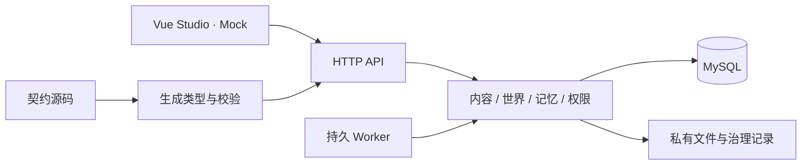

# Technical Architecture and Implementation Boundaries

Loreviva — The AI Platform for Living Worlds.

This page describes the locally approved Tasks 1–7 implementation and subsequent architectural direction. Public documents are curated distribution views of the specifications and create no new field source; protocol generation starts from [contracts/source](../../contracts/source/openapi.yaml).

## Technology and runtime modes

| Item | Status in this batch |
| --- | --- |
| Backend | Go 1.27.2, Kratos 3.0.0, modular single application; see [go.mod](../../go.mod) |
| Database | MySQL Community LTS / InnoDB, `database/sql`; embedded migrations 0001–0007 |
| Toolchain | Node.js 24, pnpm 11.25.0, TypeScript; exact dependencies in [package.json](../../package.json) and lockfile |
| Files | Private local directory and application authentication proxy; the file root is not publicly mounted |
| Frontend | Native Vue Studio; the Go application embeds and serves the actual build at `/studio/` |
| Model/billing | Configuration accepts only Mock; real suppliers and paid hosting are not connected |

One application supports `all`, `api`, and `worker`. Default `all` runs HTTP and the persistent Worker together; separate processes still share domain code, database, and migrations. Redis, a separate message queue, a vector database, and Kubernetes are not currently required.

## Modules and authority

| Module entry | Responsibilities held |
| --- | --- |
| [app](../../internal/app/runtime.go) | Compose services, HTTP, Worker, and runtime readiness checks |
| [auth](../../internal/auth/operator.go) / [store](../../internal/store/mysql) | Current Operator eligibility, scope, and command/task/commit infrastructure |
| [content](../../internal/content) | Draft revisions, association impacts, rights/dependency checks, and pinned releases/routes |
| [runtime](../../internal/runtime) | Instances, control, action rules, and compatible migration |
| [memory](../../internal/memory) | Sources and acquisition, private relationships, use policies, and governance |
| [harness](../../internal/harness) | Bounded Mock text calls, draft candidates, isolated rehearsals, and recovery by querying original requests |
| [files](../../internal/files) | Private uploads, authenticated reads, and persistent cleanup |
| [maintenance](../../internal/maintenance) | New synthetic installations, migration plans, and coordination |

The program holds authority over facts, permissions, transactions, metering, and final commits. The Harness and future Agents return candidates; they cannot directly obtain database write access, expand data purposes, or decide final external business states.

## Persistence and concurrency

Commands are registered by scope and stable idempotency key; the same key/input returns the original record, while the same key with different input conflicts. Replay still checks current authorization. Persistent tasks support takeover and checkpoints; an old executor cannot continue committing after losing eligibility.

World state, events, task results, commit receipts, and corresponding Outbox records are established through an authoritative transaction. If an HTTP response is lost, query the original commit identity rather than re-executing an uncertain result as a new business action. This local mechanism does not establish cross-service atomic commits between the database and customer payments, external messages, or third-party item services.

Files use separate persistent stages: register upload, verify content, move the private file, and confirm READY. The filesystem and database are not one atomic transaction; cleanup tasks record scope and progress, and recovering the original task is not creating a new task.

## Content, identity, and memory

A draft is mutable input, a release is an immutable snapshot, and an instance pins its release reference. Dependency locks resolve by release, object, version, and hash; a display ID cannot replace full dependency identity.

Generation routes are pinned by constrained `owner_reference` and `module_id`; `owner_object_id` is only a display aid. PROGRAM roles/Skills have no generation routes, and `NONE` stops generation. Saving, preflight, and publication have distinct responsibilities, with publication rechecking current rights.

Runtime data is isolated by tenant, product, and world instance; private relationships additionally bind the actor and target subject. Current read eligibility, actual acquisition, purpose, and source validity jointly constrain use. Copying a template does not automatically turn private content into shared knowledge.

## HTTP routes actually connected

[HTTP registration](../../internal/app/http.go), [instance routes](../../internal/app/instances.go), [memory routes](../../internal/app/memory.go), [asset routes](../../internal/app/assets.go), [task routes](../../internal/app/tasks.go), and [settings routes](../../internal/app/settings.go) are implementation entry points:

| Route family | Actual owner and status |
| --- | --- |
| `/health`, `/version`, `/ready`, `/` | app startup checks; the root page is minimal HTML only |
| `/studio/`, `/studio/editor`, `/studio/resources`, `/studio/runtime`, `/studio/settings` | Actual Vue pages embedded by Go; administrative requests still check authorization on every access |
| `/world/v1/admin/content-drafts` and revision/impact/command/publication paths, `/admin/releases` | content service connected |
| `/world/v1/admin/capabilities` | app provides content capability check information |
| `/world/v1/admin/assets` upload/details, `/world/v1/assets/{asset_id}/content` download | files and asset services connected; content authorization checked on every access |
| `/world/v1/admin/tasks`, `/world/v1/admin/tasks/{task_id}`, and cancellation | Safe task list, original registered task queries, and cancellation under current eligibility; list metadata grants no private body eligibility |
| `/world/v1/admin/instances`, actors, control, and migration paths | runtime service connected |
| memories, bodies, memory-governance, and memory-use-policy under instances | memory service connected; metadata/body/governance permissions are separate |
| POST `rehearsals`, `candidates` under drafts | Persistent tasks accepted with 202 when Mock owners/dependencies are ready and current eligibility/routes/inputs are valid; missing dependencies or unsupported inputs are still rejected, not a general real AI entry point |
| POST `generation-resolution` under drafts | Current draft generation configuration resolution read added in source1.3; no model procurement or draft modification |
| Other reserved OpenAPI operations | Schema alone does not establish connection in this batch, especially complete player session/interaction/event delivery workflows |

Abbreviated `/admin/...` entries in the table are all under `/world/v1`. Exact methods, parameters, and responses must be checked against both the sole OpenAPI source and corresponding HTTP registration; contract coverage exceeds currently available handlers.

## Registered Worker tasks

The [Worker](../../internal/app/worker.go) supports `ADMIN/FILE_CLEANUP`, `CONTROL/INSTANCE_CONTROL`, `MIGRATION/INSTANCE_MIGRATION`, and `GOVERNANCE/MEMORY_GOVERNANCE` when the Memory service is installed. Normal startup composes the Memory service and registers `TURN/TURN`, `ADMIN/CANDIDATE`, and `ADMIN/REHEARSAL` when the corresponding Harness owners are ready, processing by original task, attempt, and current eligibility.

This batch's Worker can execute only the corresponding registered jobs. The Mock interaction kernel, world control, and migration are implemented; original UNKNOWN and necessary costs continue querying the original request identity without recreating procurement. Successful internal TURN and rehearsals do not establish connected player session/interaction HTTP, SSE delivery, real models, or a complete customer SDK.

## Contracts and extensions

The machine contract is 1.4.0, 58 operations / 156 schemas. Source1.3 51/131, source1.2 49/123, and the original 18 operations/43 DTO retain their respective historical comparison meanings. Source1.3 added `resolveDraftGeneration` and `listAdminTasks`; source1.4 adds the seven Settings operations below. [OpenAPI](../../contracts/source/openapi.yaml) and [wepkg Schema](../../contracts/source/wepkg.schema.json) are the maintained sources; Go/TypeScript types and validation artifacts are derived by the generator. The [TypeScript SDK entry](../../packages/sdk-ts/src/index.ts) retains configuration and type support, while the [administrative client](../../packages/sdk-ts/src/admin.ts) adds limited administrative HTTP calls, authenticated asset reads, and uploads; this is not the complete customer SDK or player SSE.

| Operation ID | Method | Path |
| --- | --- | --- |
| `getAdminSettings` | GET | `/world/v1/admin/settings` |
| `commandAdminSettings` | POST | `/world/v1/admin/settings/commands` |
| `getAdminSettingsCommand` | GET | `/world/v1/admin/settings/commands/{command_key}` |
| `listAdminMembers` | GET | `/world/v1/admin/settings/members` |
| `commandAdminMembers` | POST | `/world/v1/admin/settings/members/commands` |
| `getAdminSelfConsent` | GET | `/world/v1/admin/settings/self-consent` |
| `commandAdminSelfConsent` | POST | `/world/v1/admin/settings/self-consent/commands` |

Local settings persist by exact tenant/product scope and independent revision. Ordinary settings depend on local persistence and governance, not model-provider readiness. Member actions do not replace subject, source, or private-memory rights; self-consent grants no other-subject or administrator action. Notification preferences send no external messages.

Task7 provides native Vue Studio; Task8–12 implementation and subsequent scope including the complete SDK, import/export, metering management, and complete recovery remain pending. New industry adapters can submit candidates or receipts but cannot bypass facts, privacy, or customer business authority. LC, real models, human experience, the complete release, billing, and deployment are unaccepted.

Return to [home](README.md) · View [setup and integration](04-setup-and-integration.md)
